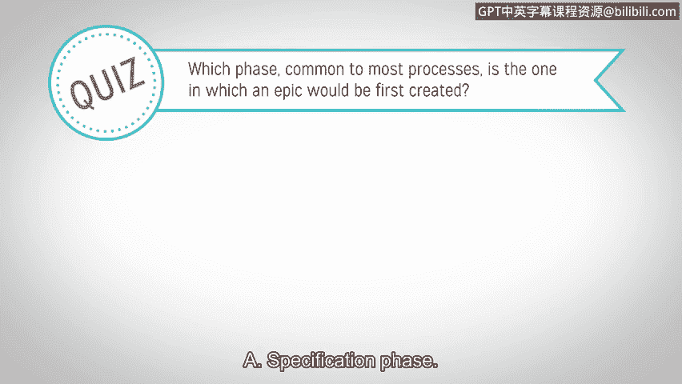

# 055：用户故事

在本节课中，我们将要学习如何编写高质量的用户故事。用户故事是表达软件需求的一种有效方式，但并非所有用户故事都是好的。我们将了解构成一个好用户故事的关键要素，并学习如何避免创建过于庞大和模糊的“史诗级”故事。

## 用户故事的撰写者

用户故事本应由您的客户来撰写，因为客户通常最清楚他们希望产品具备什么功能。

然而，软件产品经理最终常常承担起撰写用户故事的责任。

这并非因为客户对指定产品功能不感兴趣。

通常是由于客户缺乏创建用户故事的经验或培训。

但这并不意味着您不应该请客户创建用户故事。

这意味着您和您的开发团队可能需要帮助他们以用户故事的形式表达需求。

## 好用户故事的标准

上一节我们介绍了用户故事的撰写者，本节中我们来看看什么才是一个好的用户故事。仅仅将需求套入用户故事格式是不够的，关键在于故事本身的质量。

一个好的用户故事应能清晰地勾勒出产品中一个具体的软件需求。

那么如何做到这一点呢？业界广泛使用一个由比尔·韦克提出的助记符“INVEST”，它可以帮助您记住好需求的标准。

以下是INVEST中每个字母所代表的含义：

*   **I 代表 独立的**：一个用户故事应该是独立的，意味着它可以独立于任何其他用户故事进行开发，无论何时实施。这很重要，因为它允许您重新安排用户故事的开发顺序。如果两个用户故事紧密相关且相互依赖，您可以将它们合并成一个独立的用户故事。但需要注意平衡，避免故事变得过于庞大。
*   **N 代表 可协商的**：用户故事应足够通用，以便您的团队和客户围绕其实现方式进行协商。由于可能不存在唯一正确的实现方式，因此不应专注于满足需求的具体技术细节，而应关注需求的主要重要方面。情况可能会发生变化，这是可以接受的。
*   **V 代表 有价值的**：每个故事都应该为客户带来某种价值。避免创建华而不实的“忙碌工作”。
*   **E 代表 可估算的**：您应该能够估算设计和实现该需求所需的时间。如果您无法估算开发时长，那么您可能指定了一个所谓的“史诗”。
*   **S 代表 小的**：这与需求应该可估算的理念相关。然而，即使您可以估算某件事所需的时间，这本身并不能使其成为一个好需求。如果一个用户故事需要三个月来开发，您会希望将其分解为更小的故事。用户故事之所以要小，是因为每个故事都应在短时间内开发完成。此外，较小的故事其估算也应更为确定。如果您遇到一个庞大的故事，请尝试尽可能将其分解，否则您将面临处理一个“史诗”的风险。
*   **T 代表 可测试的**：基本上，您需要验证每个用户故事在被视为“完成”之前都满足一套特定的标准。这通常通过定义和使用验收测试来实现。

**测试：INVEST中的S代表什么？**
A. 简单的
B. 聪明的
C. 稳定的
D. 小的
**答案：D**。需求当然应该简单，但这不是我们在这里寻找的词。

## 避免“史诗”

我已经多次提到我们要避免创建“史诗”。那么，究竟什么是“史诗”呢？

正如您可能从上下文中猜到的，“史诗”是一个几乎无法克服的庞大用户故事。

“史诗”肯定无法在短时间内完成。它是对需求的模糊、宽泛的描述。

即使在最成熟的软件开发团队中，“史诗”也会进入需求待办列表。

“史诗”通常是在项目初期描述未来要开发的功能时被引入的。当客户希望在未来完成某项功能时，很难确切知道它应该是什么样子或应该如何完成。通常的做法是建立一个用户故事，勾勒出客户所需功能的大致想法。

**测试：回想软件开发过程和敏捷实践课程中的开发阶段。在大多数流程中，哪个阶段会首先创建“史诗”？**
A. 规格说明阶段
B. 架构设计阶段
C. 构建阶段
D. 过渡阶段
**正确答案是A，规格说明阶段**。这是与客户创建和讨论需求的阶段。其他阶段构成了后续要完成的工作。

---

本节课中我们一起学习了用户故事的撰写责任、使用INVEST准则（独立、可协商、有价值、可估算、小、可测试）来评估和创建高质量用户故事，以及如何识别和避免创建过于庞大模糊的“史诗”。掌握这些要点，将帮助您更有效地与客户和开发团队沟通需求。