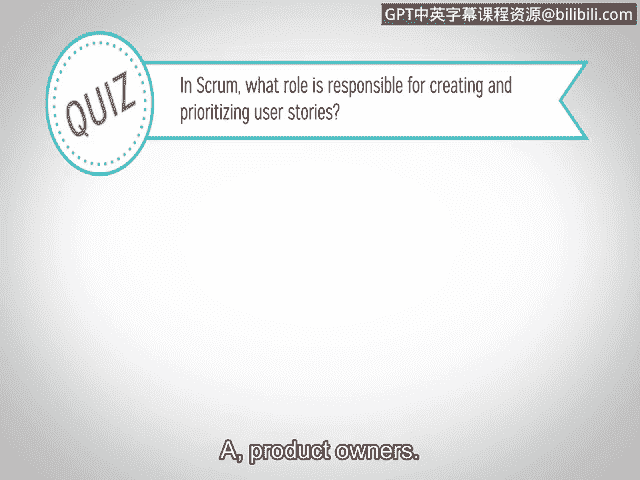

# 058：产品待办事项列表（Product Backlog）📋

在本节课中，我们将要学习敏捷开发中的一个核心工具——产品待办事项列表（Product Backlog）。我们将了解它的构成、作用以及如何与客户协作来创建和管理它。

上一节我们介绍了用户故事的验收测试，本节中我们来看看如何组织和管理这些用户故事。

## 什么是产品待办事项列表？

产品待办事项列表是您和您的团队计划开发的软件功能列表。它最初是一个未经排序的大型待办事项清单，并会随着时间的推移而不断细化。

## 待办事项列表包含哪些内容？

产品待办事项列表主要由用户故事构成。然而，它并不局限于用户故事，还可以包含其他类型的条目。

以下是产品待办事项列表中可以包含的内容：

*   **用户故事**：这是最常见的条目，以“作为[角色]，我想要[功能]，以便[价值]”的格式描述功能需求。
*   **工作任务**：这些是与产品功能开发不直接相关的具体待办事项。例如：`设置产品测试服务器`。
*   **知识任务**：这是需要学习或研究的事项。例如：`评估数据库连接的编程选项`。
*   **缺陷**：这是产品代码中需要关注的错误。

**小测验**：以下哪些项目可以包含在产品待办事项列表中？
A. 用户需求
B. 非工作相关职责
C. 缺陷
D. 产品愿景

**正确答案是 A 和 C**。用户需求以用户故事的形式进入待办事项列表，缺陷也会被列在其中。产品愿景可能指导用户需求的创建，但不会明确列在待办事项列表中。非工作相关职责同理。

## 如何创建待办事项列表？

产品待办事项列表是Scrum（一种敏捷方法）中的一项技术。因此，它应该是动态的，并专注于与客户的互动。

当您与客户一起编写用户故事时，首先要做的就是将它们放入这个列表中。最初，列表没有特定的顺序。事实上，待办事项列表在最初阶段就是一个包含所有理想中应构建到最终产品中的事项的无序集合。

在创建每个要放入待办事项列表的用户故事时，请确保为其分配一个**唯一的用户故事标识符**。这很重要，因为它为项目中的每个人提供了一个参考框架。引用某个故事时，您无需复述其内容，只需引用其标识符即可。

标识符的分配方式并不重要，但一个简单的方法是使用顺序数字。将想到的第一个故事标记为1，第二个为2，依此类推。

## 如何确定优先级？

一旦您有了列表，下一步就是请客户为每个故事指定优先级。然后，客户将之前无序的用户故事列表按照从最高到最低的优先级进行排序。

目标是让最有价值的功能排在待办事项列表的顶部，最不重要的功能排在底部。这会打乱按标识符排序的顺序，但这没关系。用户故事标识符更多是一种跟踪机制，而非排序工具。

优先级排序为您的开发团队提供了开发重点。他们只需关注从列表顶部提取任务即可。同时，这也迫使您的客户思考他们真正需要和想要什么，从而经常引发客户与开发团队之间的对话。

然而，这种对话并非总能自动发生。可能会出现客户只专注于确定优先级，而开发人员只专注于估算实现每个用户故事所需工作量的情况，这会在他们之间形成一种隔阂。在敏捷开发中，应该鼓励讨论和协作，让双方都能理解某个用户故事具有特定优先级的原因，以及某个工作量估算具有特定数值的原因。

您能做的最好的事情就是尽可能与客户协作，并允许您的开发团队在整个优先级排序和规划过程中与客户沟通。

## 优先级确定后做什么？

现在，您已经与客户一起创建了待办事项列表，并且所有条目都已确定了优先级。您的所有用户故事都已编号，并根据对客户的优先级从高到低排序。

下一步就是以这些优先级为参考点，开始规划您的项目。虽然这将在《敏捷规划与软件产品》课程中详细讲解，但简单来说，用户故事会从待办事项列表中取出，并放入称为“冲刺”的特定时间间隔内要完成的工作块中。

**小测验**：在Scrum中，哪个角色负责创建用户故事并确定其优先级？
A. 产品负责人
B. 开发团队
C. 客户
D. 团队领导

**正确答案是 A，产品负责人**。在Scrum中，产品负责人负责确保产品待办事项列表是最新的。客户、团队领导或开发团队成员可能担任产品负责人角色，但如果他们要负责更改产品待办事项列表，他们就必须是产品负责人。

## 总结

本节课中，我们一起学习了产品待办事项列表（Product Backlog）的概念。我们了解到它是一个动态的、包含用户故事、工作任务、知识任务和缺陷的列表。创建列表后，关键在于与客户协作，为所有条目确定优先级，从而为开发团队提供清晰的工作重点。产品负责人是维护和管理这个列表的关键角色。掌握待办事项列表是进行有效敏捷项目规划的基础。