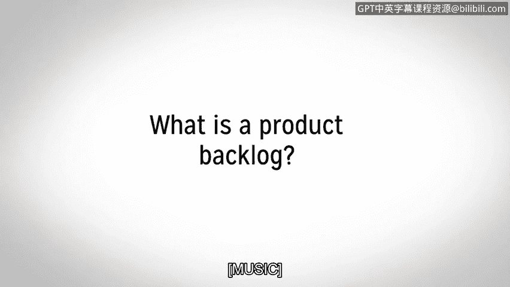
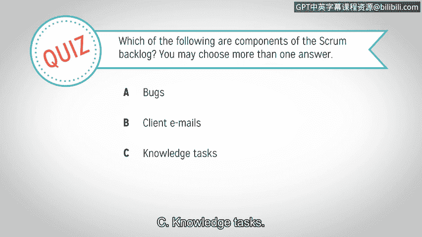

# 059：客户需求与软件需求

## 概述
在本节课中，我们将要学习产品待办事项列表（Product Backlog）的核心概念、动态特性及其在Scrum敏捷开发中的重要作用。我们将了解如何通过它来管理用户故事、应对需求变化，并确保项目始终围绕最高优先级的需求展开。

---

## 产品待办事项列表的动态特性 🗓️

上一节我们介绍了用户故事和优先级排序。本节中我们来看看产品待办事项列表如何在实际项目中动态演变。

客户设定为高优先级的用户故事计划被更早完成。重要性较低的故事则计划在后期发布。然而，由于Scrum专注于一次一个冲刺的开发节奏，这为当前冲刺之后的计划留下了很大的调整空间。

你只需要专注于规划下一个冲刺。当该冲刺完成后，客户可以添加新的用户故事、重新评估优先级，并相应地调整你的冲刺计划。这意味着需求可能改变其最初计划的优先级。

事实上，这种情况非常普遍。你经常会发现，当你的开发团队在一个冲刺中愉快地开发一组用户故事时，客户决定需要做出一些改变。也许一个先前低优先级的需求现在变得极其紧急。也许一个先前高优先级的需求现在完全不再需要。或者，你的客户想到了一个新功能，于是更多的用户故事被添加到待办事项列表中。

这最终可能导致其他事项的优先级发生变动。当然，你也肯定会发现需要解决的缺陷。你的待办事项列表必然会随着时间的推移而演变。它会移动、增长、缩减并改变顺序。这都没问题。

在Scrum中，唯一不允许这种变动的地方，是当前正在进行开发工作的冲刺期间。除此之外，如果你为了适应需求变化而调整计划，那是完全可以的。事实上，这是被鼓励的。只是不要觉得事情从一开始就一成不变。那不仅不现实，还会给你的项目带来大量问题。

---

## 行业访谈：产品待办事项列表的实际应用 🏢

接下来，让我们通过一段访谈，看看产品待办事项列表在行业中是如何被使用的。

产品待办事项列表通常是一个按优先级排序的工作项列表，它交付客户在特定版本或产品中期望的价值。放入产品待办事项列表的内容类型包括新功能、增强功能，甚至是现有产品版本中导致缺陷的问题。其他如架构工作、技术债务等，也可能是产品待办事项列表包含的项。

产品待办事项列表上的需求形式通常被指定为用户故事。用户故事通常由**角色**、**需求**和**价值**三部分组成，其格式可以概括为：
**作为一个 `<角色>`， 我想要 `<需求>`， 以便于 `<价值>`。**

待办事项列表的优先级排序可以通过一个称为“待办事项列表梳理”的过程来完成。这个过程包括检查产品待办事项列表的内容，并尝试使其与业务优先级、技术可行性以及代码本身的实际情况保持一致。

产品待办事项列表本身是相当动态的。因此，在版本发布之初，它可能与版本发布之末的样子大不相同。其中的事项可能会通过待办事项列表梳理本身发生转变，也会因为不断变化的业务需求和优先级，以及团队自身发现了之前未知的新技术依赖而改变。这些也都是需要放入待办事项列表并确保得到处理的事项，以满足待办事项列表所涵盖的整体工作目标。

---

## 测验：Scrum待办事项列表的组成部分 ❓

以下是关于Scrum待办事项列表组成部分的一个小测验。

以下哪些是Scrum待办事项列表的组成部分？你可以选择多个答案。
A. 缺陷
B. 客户邮件
C. 知识性任务
D. 工作任务
E. 业务需求

正确答案是A、C和D。缺陷、知识性任务和工作任务都可以包含在Scrum待办事项列表中。

---

## 总结

本节课中我们一起学习了产品待办事项列表。它是一个非常有价值的工具，对Scrum至关重要。它允许你组织工作，轻松查看项目的优先级所在，并基于这些优先级进行规划。产品待办事项列表在敏捷开发中运作良好，因为它为你的客户和团队提供了很大的灵活性。

在下一课中，我将讨论另一种用于组织用户故事的方法——故事地图。我们下一课见。