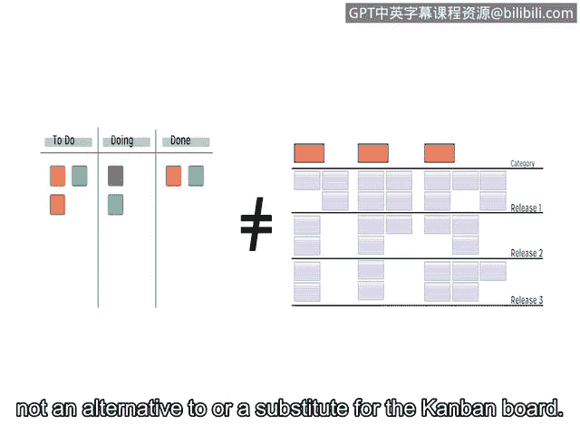

**软件产品管理课程3：《客户需求与软件需求》：3-3-5：用户故事地图**

在本节课中，我们将要学习一个用于组织和规划需求的重要工具——用户故事地图。上一节我们介绍了Scrum产品待办事项列表，本节中我们来看看如何通过故事地图更直观地展现和管理需求。

用户故事地图是一种以更丰富的视觉细节来呈现产品待办事项列表的绝佳方式。本质上，它是一种将待办事项列表中的用户故事，按照更具体的功能类别进行分组的方法。

以下是一个故事地图的示例。假设你正在开发一个简单的电子邮件程序。你的客户提供了一份需求列表，其中包含如下用户故事：

*   作为一个作者，我希望能够撰写纯文本消息，包含收件人、主题行和正文，以便我能以基本方式指导和传达我的消息内容。
*   作为一个读者，我希望能够在收到邮件时打开它们，以便我能阅读最新的消息。
*   作为一个读者，我希望能够将消息存储到存档中，以便我能为将来参考而保留消息。
*   作为一个读者，我希望能够在我的存档中搜索消息，以便我能快速找到相关消息，而无需手动浏览。
*   作为一个作者，我希望能够将文件附加到我的消息中，以便我能为我的消息添加额外信息。
*   作为一个读者，我希望能够打开我消息上的任何附件，以便我能查看所收到消息的额外信息。

你可能已经可以看出这些故事如何被分组。你可以使用产品的基本功能作为类别标题。这里的基本功能是：**撰写和发送**、**阅读、接收和存储**以及**搜索**。如果将每个故事放入其相应的类别，你就能立即看出什么属于哪里，以及可能缺少什么。然后，客户可以根据自己的判断，对这些类别内的故事进行优先级排序。这样一来，一个可能令人望而生畏的需求列表，就变成了一套组织有序、易于管理的待实现功能集。

现在你已经了解了故事地图的创建方式。请思考一下，创建故事地图可能为你的项目带来哪些好处。

以下是故事地图可能带来的好处，请选择你认为正确的选项：
A. 在初始规划阶段节省时间。
B. 简化优先级排序。
C. 让你对项目将如何发展有一个整体视图。
D. 提供详细的开发计划。

正确答案是B和C。故事地图简化了优先级排序，并让你对项目的发展有一个整体视图。它不会在初始规划阶段节省太多时间，但可能会在后续过程中节省时间。请记住，故事地图不是一份开发计划。

以上是故事地图的一些好处。那么，与经典的产品待办事项列表相比，故事地图还提供了哪些改进？

故事地图在经典产品待办事项列表的基础上提供了许多改进。首先，它让你的待办事项列表更具可追踪性和视觉感。你不再需要费力管理一个大列表的优先级，而是被迫将事情分解到各个类别中。

另一个改进是，它让你能够看清各个用户故事之间的关系。故事地图让你看到这些需求是如何组合在一起的，而不是处理一堆按优先级排序的需求。通过可视化需求之间的联系，你可以非常容易地发现是否有遗漏之处，轻松识别需求中的任何缺口并相应地填补它们。

故事地图的另一个巨大好处是，它让你的开发人员对产品应如何作为一个整体来构建有了概念。许多产品都有多个可被视为主要功能的类别或功能。在经典的一维产品待办事项列表中，来自一个功能组的用户故事很容易压倒来自另一个功能组的用户故事。然而，在故事地图中，地图顶行的所有用户故事都具有相同的重要性级别。这不仅简化了优先级排序，还让你了解产品在每次迭代中能做什么。

如果你将每个水平行视为产品的一个发布版本，那么你就可以看到产品如何随着你逐行向下移动地图而演进和增长。在我之前给出的例子中，你的产品可能会从仅支持基于文本的交互，发展到支持多媒体文件的传输。你不是通过只关注一个类别来构建产品，故事地图确保你将精力均匀地分配到各个功能上。故事地图为开发人员的工作提供了上下文，而不是构建一个可能无法完全满足客户的单一类别功能。它表明，在转向更复杂的工作之前，最好先实现简单的功能。你不会构建一个能发送多媒体和文本电子邮件，却无法阅读它们的电子邮件系统。故事地图提供了有时识别这些依赖关系所需的上下文。这是敏捷原则中“构建可工作的软件”的一个绝佳例证。你不是在构建一个任意的需求列表，而是在实际展示整个产品在各个阶段如何组合在一起。

如果你之前学习过我们的软件过程和敏捷实践课程，你会看到看板是什么样子。这里需要特别指出，故事地图不是看板的替代品。看板是一种展示项目当前状态和跟踪任务进展的方式。而故事地图是一种在二维结构中规划和组织用户故事的方式。实际上，你可以同时使用故事地图和看板来规划和跟踪项目，这并不少见。

因此，故事地图的核心只是一种让你的需求变得更好的方法。它为项目中的每个独立需求提供了上下文，并为项目带来了更强的组织结构。当然，故事地图仍然支持软件产品中不可避免的变更。甚至可以说，它们比经典的产品待办事项列表更好地支持变更。它们让开发人员和客户对产品的整体性有所感知，快速了解事物是如何组合在一起的。

在本节课中，我们一起学习了用户故事地图的概念、创建方法及其优势。故事地图通过视觉化、分类和提供上下文，显著改善了需求的组织和管理方式，帮助团队更好地理解产品全貌和功能演进路径。在下一个模块中，Morgan将与你探讨更多改进需求的方法。