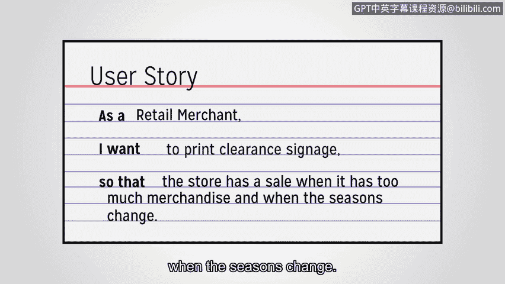

# 063：识别与避免模糊需求

## 概述
在本节课中，我们将学习模糊需求的定义、识别方法以及如何避免它们。模糊需求是指那些可以以多种方式解释的需求，它们可能导致沟通误解和资源浪费。我们将探讨11类容易导致模糊的词语，并通过实例学习如何澄清需求。

---

## 模糊需求的危害
上一节我们介绍了需求管理的重要性，本节中我们来看看模糊需求可能带来的具体问题。

模糊需求会引发多种问题，因为它们可以被不同方式解读。这可能导致沟通误解，并最终导致软件被错误构建。这会浪费时间和金钱等资源。

## 什么是模糊需求？
一个模糊需求是指可以以多种方式解释的需求。它可能不总是提供清晰或足够的细节来进行正确解读。

## 识别模糊需求的词语类别
我们将探讨11类可能导致需求模糊的词语。请注意，使用这些词语并不总是导致模糊，但需要仔细考虑，并可能需要添加额外信息来消除模糊性。

以下是11类词语：
1.  间接词语
2.  模糊词语
3.  劝说词语
4.  完成词语
5.  限定词
6.  比较词
7.  数量词
8.  代词
9.  方位词
10. 时间词
11. 连接词

### 1. 间接词语
这类词语暗示某事可能发生，但没有具体说明如何或何时。例如：**should**（应该）、**could**（可以）、**may**（可能）、**will**（将）。

如果陈述没有解释事件**应该**或**可以**发生的具体条件，那么“should”和“could”可能表示模糊。如果需求中包含了这些条件，则能消除模糊。“may”一词的作用类似。

考虑以下用户故事示例：
> 作为一个在线扑克玩家，**我可能赢钱**，以便我能因赢得游戏而获得奖励。

在这个例子中，不清楚在线扑克玩家在什么条件下赢钱。你可以通过指定这些信息来澄清这个用户故事。

更好的写法是重写这个用户故事：
> 作为一个在线扑克玩家，**当我在扑克游戏中战胜对手时，我收到钱**，以便我能因赢得游戏而获得奖励。

最后，间接词语类别中要涵盖的最后一个词是“will”。如果陈述没有指定事件**何时**发生，那么“will”是模糊的标志。它是**一直**发生还是**有时**发生？如果一个事件**每次**都发生，最好使用“must”（必须）。如果事件只**有时**发生，则需指定它发生的条件。

### 2. 模糊词语
模糊词语通常是描述中缺乏细节的动作、对象名称或说法。问题不在于存在多种解释可供选择，而是没有足够的细节来进行任何解释。

以下是模糊词语的类别示例：
*   **模糊动作**：例如 **processed**（处理）、**handled**（处理）、**operated**（操作）。
*   **模糊对象名称**：例如 **item**（项目）、**entity**（实体）、**unit**（单位）。
*   **模糊说法**：例如 **as appropriate**（酌情）、**where applicable**（适用时）、**within reason**（在合理范围内）。

对于模糊对象名称，要么用更具描述性的名称替换这些术语，要么确保该术语在产品术语表中定义并一致使用。对于模糊说法，需要明确具体是什么决定了“appropriateness”（适当性）、“applicability”（适用性）或“reason”（合理性）。

### 3. 完成词语
这类词语的例子包括：**and so on**（等等）、**and so forth**（等等）、**et cetera**（等等）。这些词语通常暗示列表中还有更多可以命名的成员，但为了简洁而没有列出。

当你列出事物时，请确保提供列表中包含内容的必要细节。通用的归属规则可能并不明显，因此不要将规则留待解释。

另一个属于此类别的词是“also”（也）。这个词通常出现在对现有陈述的补充中。如果脱离上下文理解添加的从句，或者它与前面的陈述不一致，可能会导致模糊。因此，如果你在需求中使用“also”一词，请确保提供上下文，说明“also”从句的含义。

### 4. 劝说词语
这些词语包括：**clearly**（显然）、**certainly**（当然）、**obviously**（显然）。如果一个陈述是“obvious”（明显的），它对所有读者来说都真的明显吗？为什么读者应该相信它？这个陈述是在断言观点而不是事实吗？用户故事不需要说服，因此应避免使用这些词语。

### 5. 限定词
到目前为止，我们看到的类别和示例因为缺乏信息而导致模糊。现在我们将看看那些因为限定或修改某些条件而可能表示模糊的词语。

限定词的例子包括：**all**（所有）、**every**（每个）、**only**（仅）、**no**（无）、**never**（从不）、**always**（总是）、**sometimes**（有时）、**often**（经常）、**usually**（通常）。

“all”和“every”导致模糊的原因相似。考虑以下用户故事：
> 作为管理员，我希望**所有**社交媒体用户使用一个账户，以便我能跟踪他们的使用情况。
> 作为管理员，我希望**每个**社交媒体用户使用一个账户，以便我能跟踪他们的使用情况。

这两个用户故事都可能意味着所有社交媒体用户使用**同一个**账户，也可能意味着**每个**用户拥有自己的账户。

接下来，我们看看“only”这个词。请谨慎使用这个词，尤其是在英语中，因为根据你将“only”放在句子中的位置，它可能导致含义完全不同。

考虑这个句子：
> Premium account holders are allowed to read the full online article.
> （高级账户持有者被允许阅读完整的在线文章。）

我们可以插入“only”一词使句子表达不同的意思。
*   **Only** premium account holders are allowed to read the full online article.
    （**只有**高级账户持有者被允许阅读完整的在线文章。）
    *   这意味着其他账户持有者不允许阅读完整的在线文章。
*   Premium account holders are **only** allowed to read the full online article.
    （高级账户持有者**只**被允许阅读完整的在线文章。）
    *   这意味着高级账户持有者不允许阅读完整文章以外的任何内容。
*   Premium account holders are allowed to read the full online article **only**.
    （高级账户持有者被允许阅读**仅**完整的在线文章。）
    *   同样表示高级账户持有者只被允许阅读完整的在线文章。
*   Premium account holders are allowed to read the **only** full online article.
    （高级账户持有者被允许阅读**唯一的**完整在线文章。）
    *   这意味着只有一篇完整的在线文章可用，并且高级账户持有者被允许阅读它。

使用“only”时，请注意你用它来修饰句子以表达正确的含义。

### 6. 比较词
比较词是用于比较两个或更多事物的短语。如果我们使用比较两辆车大小的例子，我们可以使用以下短语：
*   Car A is the same as car B. （车A与车B相同。）
*   Car A is bigger than car B. （车A比车B大。）
*   Car A is the biggest. （车A是最大的。）
*   Car A is more spacious than car B. （车A比车B更宽敞。）
*   Car A is as big as a truck. （车A和卡车一样大。）

这些短语中的每一个都是模糊的，或缺乏细节。当我们比较车A和车B时，我们指的是物理整体尺寸、高度、宽度、内部空间、载货容量、头部空间还是发动机尺寸？比较两个对象时，请务必具体说明正在比较对象的哪个特定属性。

同时，注意使用以“-er”结尾的单词，如 **bigger**（更大）、**smaller**（更小）或 **wider**（更宽）；或以“-est”结尾的单词，如 **biggest**（最大）、**smallest**（最小）或 **widest**（最宽）。

### 7. 数量词
涉及数量的词语也可能导致模糊。这些词的例子有：**a**/**an**（一个）、**some**（一些）、**most**（大多数）、**few**（少数）。

“a”或“an”是你经常遇到的词。考虑以下例子：
> 作为一个填字游戏解谜者，我希望应用程序有**一个**填字游戏，以便我能在喜欢的消遣中挑战自己。

“一个填字游戏”是指应用程序上**只有**一个填字游戏，还是指应用程序上**至少**有一个填字游戏？为了避免“a”或“an”带来的模糊，请使用量词，如具体数字或至少某个最小数量。

例如，你可以说：
> 作为一个填字游戏解谜者，我希望应用程序**至少有一个**填字游戏，以便我能在喜欢的消遣中挑战自己。

如果陈述没有给出具体数量或涉及哪些项目，那么“some”、“most”和“few”这些词就表示模糊。

### 8. 代词
代词是诸如 **he**（他）、**she**（她）、**it**（它）、**we**（我们）、**you**（你/你们）、**they**（他们）、**us**（我们）、**our**（我们的）、**this**（这个）、**that**（那个）等词语。

代词可能导致模糊短语，因为可能不清楚代词代表的是哪个名词。例如，在用户故事中：
> 作为一个虚拟农场主，我希望**它**生长，以便我能卖掉**它**换取虚拟资金。

不清楚“it”指的是什么。“it”可能指的是虚拟农场本身、虚拟作物或虚拟农场动物。你应该定义并使用更具体的术语来避免混淆，而不是使用代词。

### 9. 方位词
方位词的例子有：**after**（在...之后）、**before**（在...之前）、**following**（跟随）、**last**（最后的）。对于这些词，让我们使用数据库条目的例子。

如果我们说条目A出现在数据库中的条目B**之前**，这可能意味着条目A直接出现在条目B之前，或者出现在数据库中条目B之前的任何位置。类似地，我们可以说条目B出现在数据库中的条目A**之后**，或者说条目B出现在数据库中**跟随**条目A。所有这些短语出于同样的原因都是模糊的：你需要更明确地指定条目出现的位置。

现在看看这个短语：“I am making changes to the **last** entry.”（我正在修改**最后**一个条目。）这个短语中的“last”一词导致了很多模糊。这可能意味着我正在修改**上一个**条目，也可能意味着我正在修改出现在**最末尾**的条目，还可能意味着没有更多条目将被添加，而这个条目将是**最终**条目。

### 10. 时间词
接下来，我们将看一个与方位词类似的类别，即时间词。它们与时间或事件相关。时间词的例子有：**when**（当...时）、**for**（持续）、**until**（直到）、**from**（从...起）、**current**（当前的）、**latest**（最新的）。如果你指的是时间而不是位置，也可以将方位词包含在此类别中。

让我们先看看“when”这个词。考虑以下例子：
> 作为一个跑步者，我希望当我开始绕跑道跑一圈时，圈速计时器**设置为0**，以便我能监控我的配速。

这可以解释为：计时器在跑步者开始跑一圈的**时刻**设置为0。它也可能意味着：计时器在跑步者**第一次**开始跑一圈时设置为0。但它还可能意味着：计时器在跑步者**每次**开始绕跑道跑一圈时都设置为0。

接下来，让我们看看例子中的“for”这个词：
> 作为一个露营者，我希望产品能显示**未来三天**的天气，以便我能看到露营期间的天气情况。

这个用户故事可以有两种不同的解释。一种方式是产品显示一个**三天的天气预报**。但另一种方式是产品**在接下来的三天内**显示每日天气，之后停止显示。

### 11. 连接词
我们要看的最后一个类别是连接词。这些是连接两个或更多短语或对象的词语。连接词的例子有：**and**（和）、**or**（或）、**both**（两者都）。

首先，让我们看看由“and”一词可能引起的模糊。考虑用户故事：
> 作为一个零售商人，我希望打印清仓标识，以便商店在**有太多商品时**和**季节变化时**进行促销。

那么，这是否意味着商店在有太多商品时进行促销，并且在季节变化时也进行促销？还是暗示了一个双重条件，即商店只有在**同时**有太多商品**并且**季节正在变化时才进行促销？在第一种情况下，将需求分解为两个独立的需求来分别满足是清晰的。

最后，“or”一词也会导致模糊。“or”的问题在于它没有区分在**两个条件都成立**的情况下会发生什么。

## 其他发现模糊的方法
在你的用户故事中扫描特定词语作为模糊迹象，并不是确定你是否有不明确需求的唯一方法。

另一个确保你的需求和术语表都没有模糊的好方法是，用术语表中的定义替换用户故事中的术语。你的用户故事仍然有意义吗？你的术语表定义是否恰当地代表了该术语？通过这样做，你可能会发现需要向术语表中添加更多术语、重新定义术语表中的术语，或者重写一些用户故事。

## 总结
在本节课中，我们一起学习了模糊需求的定义及其危害，并深入探讨了11类容易导致需求模糊的词语，包括间接词、模糊词、劝说词等。我们通过具体实例分析了每类词语如何引发歧义，并学习了通过提供具体条件、使用明确术语、重写用户故事等方法来消除模糊性。记住，目标是使需求或用户故事的含义能够被开发人员准确理解，而非追求语言的绝对完美。在敏捷实践中，与利益相关者进行对话是澄清需求的关键。