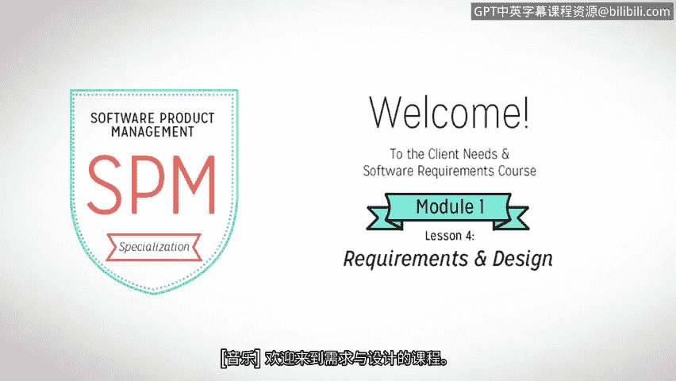
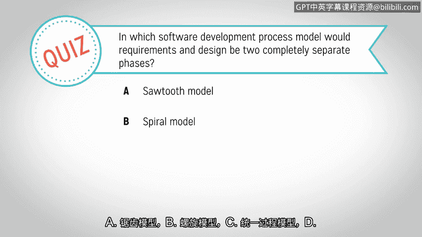

# 艾伯塔大学软件产品管理课程3：《客户需求与软件需求》｜client-needs-and-software-requirements｜ - P11：10_第3.1.4节 需求和设计.zh - GPT中英字幕课程资源 - BV1K94y1h7Tp

Welcome to this lesson on requirementsments and design。

In the last lesson， I talked about how scope can grow when requirements change。

I also talked about some of the consequences of this and how to manage them。In this lesson。

 I will discuss how requirements differ from design and what that means for a software project。

There's a fuzzy boundary between what it means to form a set of requirements and what it means to design a product。

Typically， requirements emphasize the what of a product。

What do my clients need me to develop for the product to succeed？

Design then emphasizes the how of a product。How will the development team implement the product to satisfy my client' needs？

Feel free to skip this quiz if you have not taken the softwareft processescesses and Agile Practices course。

In which softwareer development process model would requirements and design be two completely separate phases？

A saw tooooth model。B， spiral model。C， Unified process model。

D， V model， or E， waterfall model。In the waterfall model。

 requirements in design are two completely separate activities。

The waterfall model is covered in the software processes and Agile Practic course。

 So don't worry about the details right now。According to this model。

 requirements are developed on their own prior to any product design so that the requirements do not become constrained by design limitations。

That is， requirements here focus solely on the problem and nothing about the solution。

With modern iterative and parallel development processes。

 the development team works on both requirements and design simultaneously。

It's very common for development teams to form requirements with elements of design in mind。Also。

 clients may envision their product with desired design characteristics rather than what their true problem or needs are。

This is why requirements in design are often combined or confused。For example。

 an easy way to understand your product is to place your requirements in the context of a product drawing。

This can help you map out the correctness， consistency， and clarity of requirements。

Once your requirements are placed together in this visual way。

 it is very easy to see whether your requirements fit together as a logical whole。

Bluurrrring the boundary is fine。 However， be careful not to let this concept go too far。

If you focus too early on a design solution， you may end up unintentionally overlooking the underlying need and imposing unnecessary constraints onto your product。

For example， let's imagine that you have been tasked with producing an application which runs on a user's device。

And interfaces with a remote server。If your requirements specify that the product shall be written in the Java programming language。

You are imposing an unnecessary design constraint on your development team。

What if it made more sense to write a web application and use a different programming language instead？

Essentially， you don't want to prematurely make design decisions for a product just because at the time it seemed best。

This principle can be extended beyond overarching design principles， like programming languages。

Check out this example and see if you can find out what's wrong with the requirement。

Your client says that they want to have the user click OK to submit a request。I'll give you a hint。

 What if the product interface only uses physical buttons for input。

These small design influences can be tricky。In this example。

 the client was imposing a click requirement on the product。

They're essentially saying that the user must be using a very specific input device to control how to make a selection。

If you were to apply this requirement to a mobile device。

 the terminology doesn't translate perfectly。In that case。

 they may tap the button instead of clicking it。It would be much better to say something like the user submits the request。

As you develop requirements。Keep these questions in mind。Is a solution just a possible option？

Is the solution the only one possible？Is a solution addressing the wrong problem？

Is a solution just to attract developer interest？Is the client more solution focused？

When you think about these questions， as you begin to conceptualize your product。

 your product quality really improves。As you can see。

 design often sneaks into requirements in bad ways。Now that you know how this can happen。

 you're more prepared to avoid it。Always be mindful of how you're constructing your requirements to avoid imposing certain design solutions upon your product too early。

That's it for this lesson， and this module。Hopefully。

 I gave you a good idea of what requirements are， why we need them。

 and some things to think about while you create them。In the next module。

 Morgan is going to be talking to you about how to elicit and express user requirements。 Have fun。😊。

