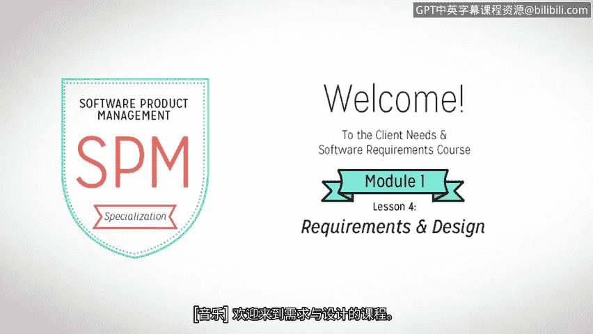
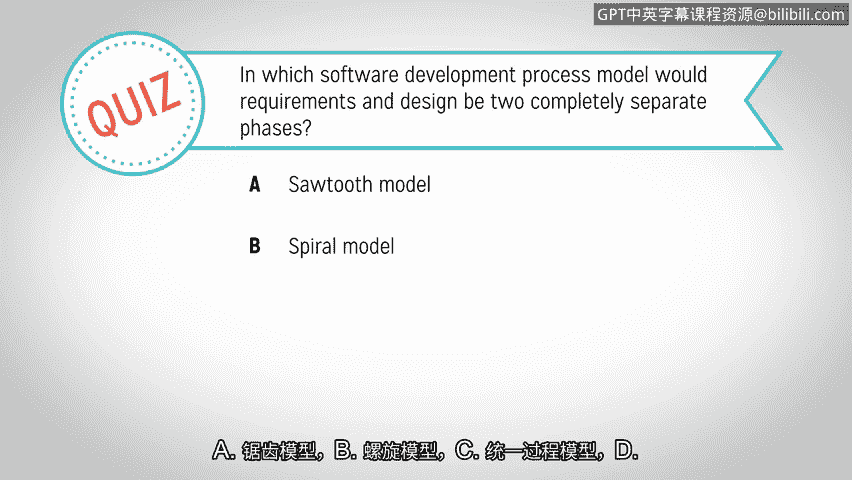

# 软件产品管理：3.1.4：需求与设计 🧩

在本节课中，我们将探讨软件项目中“需求”与“设计”的区别。理解这两者的边界对于构建成功的产品至关重要。

上一节我们讨论了需求变更如何导致范围蔓延及其管理方法。本节中，我们来看看需求与设计有何不同，以及这对软件项目意味着什么。

## 需求与设计的区别

在制定需求与设计产品之间，存在一个模糊的边界。

通常，**需求**强调产品的 **“是什么”**。即：客户需要开发什么才能使产品成功？

而**设计**则强调产品的 **“如何实现”**。即：开发团队将如何实现产品以满足客户需求？

## 历史视角：瀑布模型

如果你没有学习过《软件过程与敏捷实践》课程，可以跳过这个小测验。

**问题**：在哪个软件开发过程模型中，需求与设计是完全独立的两个阶段？
A. 锯齿模型
B. 螺旋模型
C. 统一过程模型
D. V模型
E. 瀑布模型

**答案**：E. 瀑布模型。

在瀑布模型中，需求与设计是完全独立的活动。根据该模型，需求在产品设计之前独立制定，以确保需求不受设计限制的约束。也就是说，此时的需求只关注问题本身，而不涉及解决方案。

## 现代开发中的融合

在现代迭代和并行开发过程中，开发团队通常同时处理需求和设计。

开发团队在构思需求时考虑设计元素是非常普遍的。同样，客户也可能带着期望的设计特性来构想产品，而非描述他们真正的问题或需求。这就是为什么需求与设计经常被结合或混淆。

例如，在产品的视觉图纸背景下放置你的需求，是理解产品的一种简单方法。这可以帮助你规划需求的正确性、一致性和清晰度。一旦你的需求以这种视觉方式组合在一起，就很容易看出它们是否作为一个逻辑整体相互契合。

## 模糊边界的风险与应对

模糊边界是可以的。然而，需要注意不要让这个概念走得太远。

如果你过早地关注设计解决方案，最终可能会无意中忽略根本需求，并对产品施加不必要的约束。

以下是几个需要警惕的情况：

*   **过早施加技术约束**：例如，假设你的任务是开发一个在用户设备上运行并与远程服务器交互的应用程序。如果你的需求规定“产品应使用Java编程语言编写”，你就是在对开发团队施加不必要的设计约束。如果开发一个Web应用程序并使用其他编程语言更有意义呢？
*   **隐含特定交互方式**：看看这个例子，找出需求的问题所在。你的客户说，他们希望“用户点击OK按钮来提交请求”。**提示**：如果产品界面只使用物理按钮进行输入呢？在这个例子中，客户对产品施加了“点击”要求。他们实质上是在说，用户必须使用非常特定的输入设备来控制如何进行选择。如果你将此需求应用于移动设备，这个术语就不能完美转化。在这种情况下，用户可能是“点击”按钮，而不是“单击”它。更好的说法是“用户提交请求”。

## 制定需求时的关键问题

在制定需求时，请将以下问题牢记于心：

*   某个解决方案只是一种可能的选择吗？
*   这个解决方案是唯一可能的吗？
*   这个解决方案是否针对了错误的问题？
*   这个解决方案只是为了吸引开发者的兴趣吗？
*   客户是否更关注解决方案本身？

当你在构思产品时思考这些问题，你的产品质量将得到真正提升。

## 总结

正如你所见，设计常常以不好的方式潜入需求。现在你知道了这种情况是如何发生的，就能更好地避免它。在构建需求时，始终要留意你是否过早地对产品施加了某些设计解决方案。

本节课以及本模块的内容到此结束。希望我对需求是什么、为什么需要需求以及创建需求时的一些注意事项给出了清晰的阐述。在下一个模块中，Morgan将与你探讨如何获取和表达用户需求。祝你学习愉快。😊