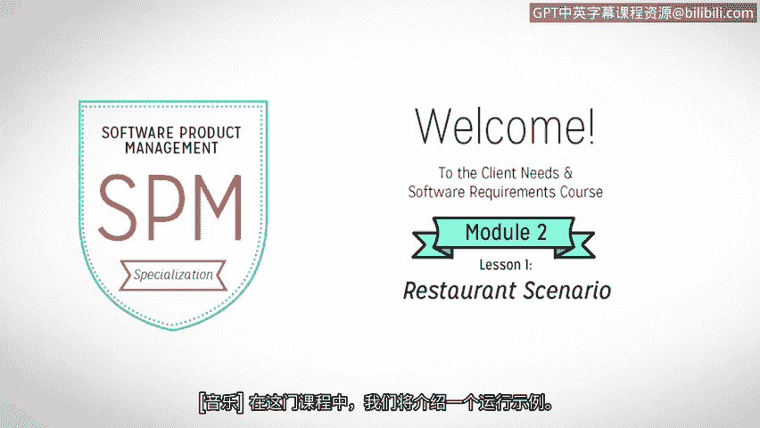

# 艾伯塔大学软件产品管理课程3：《客户需求与软件需求》｜client-needs-and-software-requirements｜ - P12：11_第3.2.1节 餐馆场景.zh - GPT中英字幕课程资源 - BV1K94y1h7Tp

🎼。😊。

In this course， we are going to introduce a running example。

 we are going to follow this example throughout the remainder of the course so that you can see how requirement activities progress from beginning to end。

I'm pleased to introduce you to your client。Hi， I'm Jamie。

 I'm an executive at a chain of family restaurants called Brampton's Pizza and Pasta。

 We're looking to develop some software for in house use at our restaurants。😊。

My goal is to take the restaurant ordering process and make it more efficient。

I'm thinking that customers should be able to view the menu of the restaurant they're in and once they're ready。

 place an order I'd really like there to be a kids' page where you can see the kids menu。

 maybe there's a few games for the kids to play but most importantly it should be easy enough to use that kids can make an order themselves Oh customers should also be able to specify any changes they'd like to make for their meal。

 and they should be able to list any dietary restrictions they may have before they submit their order to the kitchen。

The kitchen should then be able to view these orders as they come in。

 customers should be able to view and pay their bill within the system。I think that's it。

 I'm looking forward to working with you on this project。😊，All right。

 so now that you've met your client and heard their pitch， let's start building some requirements。

