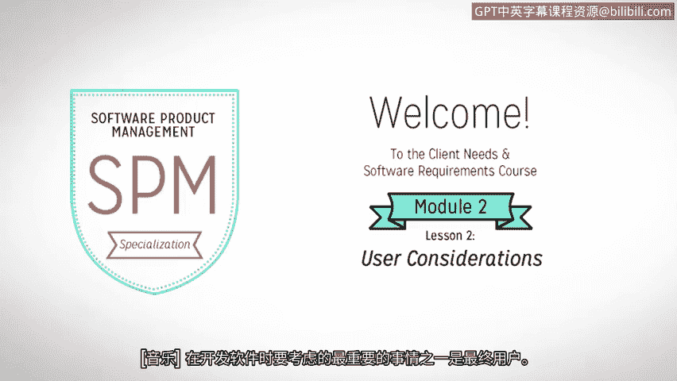
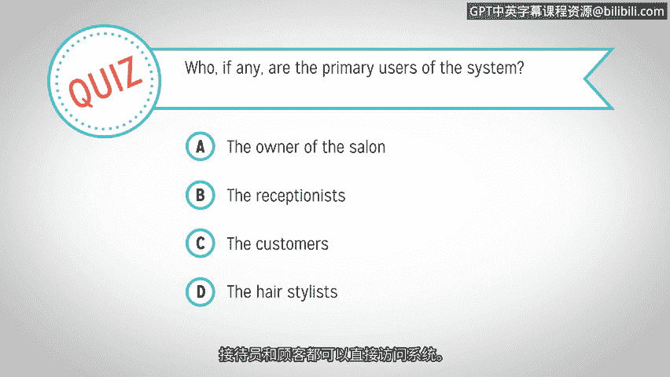

# 艾伯塔大学软件产品管理课程3：《客户需求与软件需求》｜P13：3.2.2 用户考虑因素

在本节课中，我们将要学习软件开发过程中一个至关重要的方面：理解并考虑最终用户。我们将探讨用户、利益相关者等核心概念，并学习如何将他们纳入产品设计考量。

开发软件时，最重要的事情之一是考虑最终用户。你为谁制作这个产品。谁会使用这个产品。你可能开发出你认为有史以来最伟大的产品。但如果用户不喜欢这个产品，或者他们无法操作这个产品，它就会失败。尤其是在技术行业，用户有非常多的选择。如果市场上存在一个对最终用户来说更容易使用的类似产品。他们会选择那个产品。想想市场上所有的任务管理应用程序。花点时间在你手机的应用商店里搜索“任务管理器”。有成千上万种不同的应用程序，有些很棒，有些很糟糕。但正如你所见。如果用户不喜欢一个应用程序，他们有很多选择，他们会转向下一个。对于网络应用程序来说，这一点可能更为关键。竞争对手只需点击一下即可访问。无需下载和安装新的应用程序。由此可见。时刻牢记你的最终用户非常重要。这就是我们本节课要讨论的内容。

当你开发产品时，必须考虑哪些用户方面？首先。让我们回顾一下我将要使用的一些术语。

## 👥 核心术语定义

最终用户或用户是指将直接使用产品的任何人。利益相关者是指任何受项目成功影响或对项目成功有影响的人。这包括最终用户，但也包括其他人，例如客户、最终用户的管理员和系统管理员。

用户界面或UI是最终用户将与之交互的任何东西。以一个应用程序为例。后台有许多东西在运作以使其正常工作。但其中没有一个是用户界面。用户界面是你在使用应用程序时能看到的一切。例如，像窗口、按钮、滚动条、复选框和文本框这样的元素共同构成了用户界面。

## 🎯 利益相关者类型

上一节我们介绍了利益相关者的基本概念，本节中我们来看看利益相关者的具体分类。利益相关者通常分为三种类型的用户：主要用户、次要用户或三级用户。

主要用户是实际将使用产品的人。我们将主要用户称为最终用户。次要用户是偶尔使用产品或通过中介使用产品的人。

以下是三种用户类型的简要说明：

*   **主要用户**：产品的直接、频繁使用者。
*   **次要用户**：产品的间接或偶尔使用者。
*   **三级用户**：受产品使用影响或为产品做决策的人。

让我们看一个次要用户的例子。在我们的餐厅点餐系统示例中。服务员可以被视为次要用户。他们不是产品的目标用户。但他们必须具备产品的工作知识才能协助顾客。他们也可能使用应用程序来帮助顾客下单。

三级用户是那些会受到产品使用影响或为产品做出决策的人。你的客户就是三级用户。让我们再看一下我们的例子。具体来说是面向4至12岁儿童的儿童友好页面。客户指定此页面应显示儿童菜单，包含可玩的游戏，并且足够简单，让儿童可以自己选择食物。对于这个页面。孩子是主要用户，因为他们是页面的预期使用者。孩子的监护人将是次要用户。监护人需要知道页面如何工作，以便他们可以帮助孩子。但他们可能不会成为大部分时间使用该页面的人。你的客户杰米。是三级用户，但餐厅老板也是三级用户，因为他们受到应用程序成功与否的影响。

成功的产品会考虑到所有利益相关者的需求。

## 🔍 深入分析利益相关者影响

让我们更详细地看看我们的儿童菜单例子。如果主要用户，即孩子。无法弄清楚如何使用菜单，他们会失去兴趣。孩子的注意力持续时间不是很长，所以你必须快速吸引他们。如果食物选择不适合儿童，或者如果孩子能够选择不止一份餐食。那么监护人，即次要用户，可能不会允许孩子使用该应用程序。如果应用程序太难使用并影响了餐厅老板的生意。那么他们不会满意并会拒绝该产品。

让我们看另一个利益相关者的例子。你为一家美发沙龙制作了一个在线预订系统。该系统由沙龙老板请求并资助。该系统允许沙龙的顾客致电或到访，让接待员在系统上为他们预订预约。顾客也可以选择创建一个在线账户，并通过沙龙的网站自己预订预约。发型师也可以要求接待员查看他们在特定日期是否有预约。

那么，如果有的话，谁是系统的主要用户？A，沙龙老板。B，接待员，C。顾客和/或D，发型师。由于沙龙老板请求并资助了该系统。他们是客户和三级用户。发型师通过中介（接待员）使用系统，所以他们是次要用户。当顾客致电沙龙并让接待员为他们预订预约时，顾客也可以被视为次要用户。接待员和顾客都直接访问系统。

如果他们定期使用它，那么他们都是主要用户，因此。答案B和C是正确答案。

## 📝 总结

本节课中我们一起学习了在软件开发中考虑用户的重要性。我们定义了**最终用户**、**利益相关者**和**用户界面**等核心概念，并将利益相关者细分为**主要用户**、**次要用户**和**三级用户**。通过餐厅点餐系统和美发沙龙预订系统的例子，我们分析了不同用户类型如何与产品互动，以及他们的需求如何影响产品的成败。记住，一个成功的产品必须平衡并满足所有利益相关者的需求。