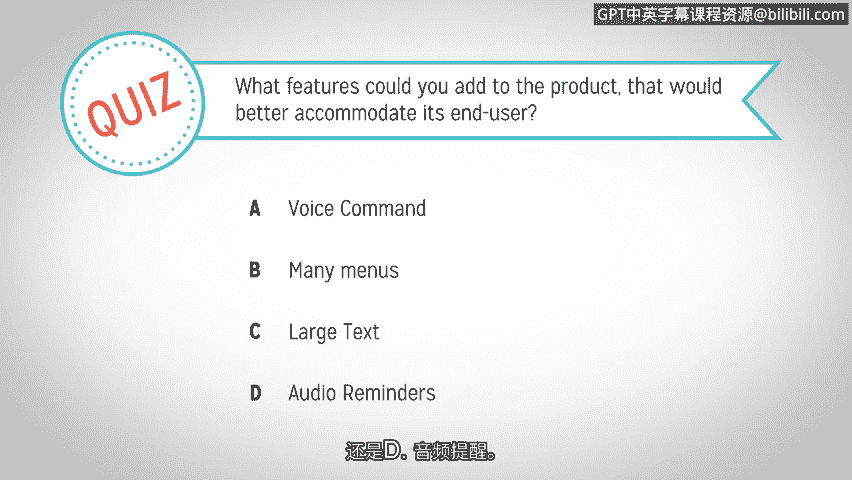

# 艾伯塔大学软件产品管理课程3：《客户需求与软件需求》｜client-needs-and-software-requirements｜ - P14：13_第3.2.2a节 用户考虑因素.zh - GPT中英字幕课程资源 - BV1K94y1h7Tp

Now that we know who we are building the product for。

 let's see how we can cater the product to their needs。

Like I said before， it's important to identify the primary audience for your product。

This helps us to tailor the design of the product to fit the navigation and functional needs of the user。

With our kidss menu example， our primary users are children。

There are many ways that you can cater products towards children， such as bright colors。

 images and sounds。The discipline that studies how end users interact with a technology product is called human Computer interactionction or HCI。

HCI could be a course on its own。 We will go into some basics。

 but if this is something that interests you， I recommend you research it further。

It is a very compelling area of computing that I am quite passionate about。

There are plenty of resources available on the subject you can find a few in our class resources。

Developing for end users can be frustrating， for many reasons。

Users tend to have a hard time expressing what they need。

 but they will usually tell you what they don't like。

This generally comes from them not knowing what is possible in software。

Developers must think creatively to make new， engaging products。

Users can be biased by what they know。Users are often more comfortable using a poor product that they know how to navigate rather than a superior product that is new to them。

Which leaves me thinking， what are we trying to do here？

Why would we develop new products for customers that are just going to use old ones？

That's why developing user friendly， intuitive user interfaces is so important。

It encourages users to get out of their shell。But that only works if the product is intuitive to learn and easy to use。

Creating intuitive user friendly products is something that developers often struggle with。

One thing you may have already noticed is that engineers， scientists。

 and programmers are not representative of the mainstream population。

So welcome to the world of the abnormalormal。What I'm getting at here is that developers don't think like the average end user。

What makes perfect sense to a developer may make no sense to a layperson。

Developers might prioritize the advancement of back end technology。

 so it's sometimes hard for them to design an intuitive product for the wider population。

As a software product manager， it's important that you understand how your users think。

It's been suggested that designing for the two extremes of the beginner and the expert is ideal。

If you do that， the middle tends to take care of itself。

When you're designing the product with your developers or testing the product。

 keep the end user in mind， will they be able to understand how this product works？

An association that represents senior citizens with diabetes has approached your team to develop a mobile application that will allow seniors to track their blood glucose levels。

The representative from the association specified that users will be above the age of 65。Also。

 the application must be easy enough to use without assistance。

What features could you add to the product that would better accommodate its end user。A。

 voice command， B， many menus， C， La text， and or D， audio reminders。

Developing for seniors can be difficult。 Their senses might not work well。

 which may pose limitations on what they can do。Since they didn't grow up in the age of technology。

 their technical skills tend to not be very advanced； therefore。

 a product with many menus may be hard for them to navigate。

Adding features like voice command and large text are good ways to accommodate the aging end user。

Voice commands help those who cannot type on a small keyboard， and large text is easier to read。

Having reminders for them would be a great feature。 however。

 you may want to make the notification through multiple modes， not just audio。

Maybe have the phone make a sound， show a pop up on screen， and vibrate。

This would catch the attention of most users。 Therefore， the best answers are A and C。

Let's now talk about some more human limitations。