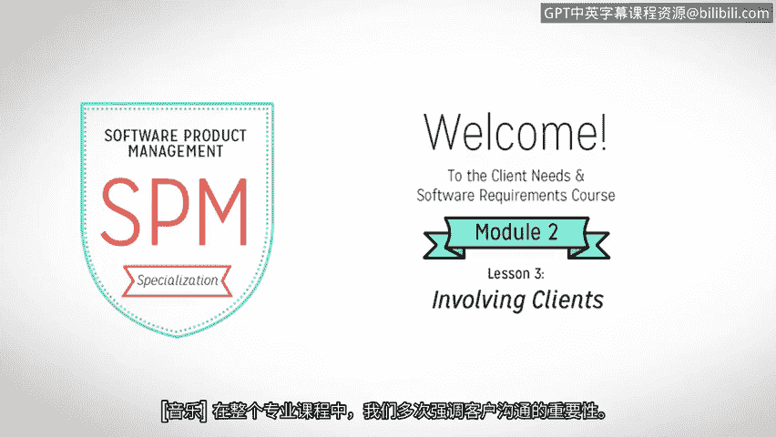
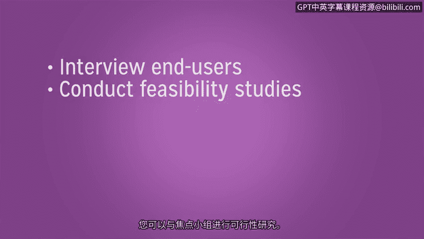
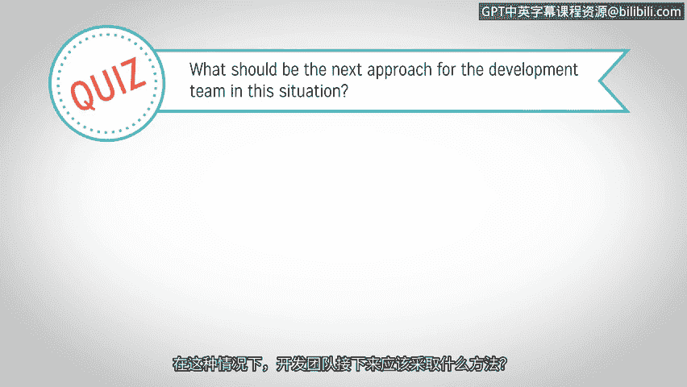

# 艾伯塔大学软件产品管理课程3：《客户需求与软件需求》｜client-needs-and-software-requirements｜ - P16：15_第3.2.3节 让客户参与.zh - GPT中英字幕课程资源 - BV1K94y1h7Tp

🎼。😊。

Throughout this specialization， we've talked a lot about the importance of client communication。Well。

 now it's time to talk to the client。What do you say， Where do you start。

It can definitely be intimidating to initiate client interactions at first。

 but this lesson will provide good questions to ask， questions to avoid。

 and what to keep in mind when interacting with your client。By the end of this lesson。

 you will be able to confidently converse with your client and elicit requirements effectively。

Imagine that you and your development team are meeting your client for the first time。

You need to take an idea from their head and turn it into a software product。

An important thing to keep in mind is that you are there to explore options with them。

 you are not there to simply gather their ideas。Client interaction should be well， interactive。

This isn't like a restaurant where you are the waiter or waitress。

 you are not just taking their order and delivering them what they asked。

It's more like inviting them back into the kitchen， introducing them to the chef。

 and letting them look at the ingredients。Then you。

 the chef and the client talk about all the delicious dishes you could make。As a team。

 with the ingredients you have， you invent a new innovative meal that is perfect for the client。Now。

 requirement solicitation is not something that only happens before development。

As we've said many times in this specialization， you need to revisit requirements often。

You are not going to get all the requirements correct the first time。

It's hard to create an idea out of thin air。Once you have mock ups and prototypes to show your client。

 it's much easier for them to say what they like， what they want， and what they hate。

To get requirements right and thus the right product。

 you're going to have to visit requirements solicitlicitation frequently。

Since you'll be revisiting the requirements often， I'd make sure that you are numbering your requirements with some unique identifier。

This will make them easy to reference throughout development for everyone involved。Also。

 requirements do not have to specifically come from the client。

There are many ways to elicit additional requirements。For example。

 you can interview end users to see how they work， what they want， and what they like。

You can conduct a feasibility study with a focus group。

You can observe end users to see how they use the product。😊。

If the end users had used a previous product， you can consult the product's user manual to see what they're used to。

These elicitation techniques help to deliver a better product for your end user。

Another tool that can ease client interactions is to establish a glossary for the product。

This glossary presents information specific to the product。Once a term is inducted into the glossary。

 it should be used by everyone。This increases clarity because there will not be different terms for the same thing。

It's common for the development team to make up a name for an element and then have the client call it something else。

It is then confusing to determine if everyone is talking about the same thing。

Kyle is a new software product manager， he has his first ever client meeting of his career。Inside。

 he is very nervous， but he confidently enters the room， shakes his client's hand。

 and introduces himself and his development team。He askeds his client about the goal of the product and get some insightful answers。

He then asked the client what they would like to see in the product。

The client starts listing features that she wants to see。Kyle records the answers。After the meeting。

 Kyle meets with his development team to turn the list of requested features into a backlog of requirements。

He emails the backlog to the client and askeds her to prioritize the requirements。

Once the development team receives the prioritized backlog， they get started with development。

Two weeks later， Kyle and the development team meet the client to show a prototype。

The prototype was exactly what the client asked for， but was pretty difficult to use。

The development team wasn't very satisfied with their work。

What did Kyle do that resulted in this situation？A， ask the client about the goal of the product。B。

 based the requirements solely on what the client suggested。C。

 had the client prioritize the requirements， or D， provide the client with a prototype after two weeks。

When you meet with the client to elicit requirements。

 it should be a conversation with everyone involved。 You want to get the vision。

 goal or purpose of the product， which Kyle did。Then you want the development team and the client to discuss possible approaches。

Have them come to a solution that satisfies the client， but also makes the product high quality。

Having the client prioritize the requirements and providing them with prototypes are a great way to satisfy the clients。

That said， requirements should not be solely based on the client's initial request； therefore。

 B is the correct answer。Client interactions will be an important part of your job as a software product manager。

😊，There are several considerations to keep in mind when you're interacting with your client。

Let's go over some of these now。The first is to make sure that you find a correct balance with your client。

You do not want to come across as too passive。 Like I said before。

 you are not a waiter or waitress taking an order。You want to suggest new ideas and perspectives。

You do not want to come across too aggressive either。

You want to avoid telling the customer what they want or interrogating them for details and decisions。

You need to find a balance where you are assertive and helpful。

A good way to find this balance is to ask good questions。With your questions。

 you want to elicit more than a yes or no response。Ask good open ended questions。

Stay focused on the goal and purpose of the product and try to stay as independent of technology as possible。

Why is going to be a very important question for you？Constantly ask your client why？

Why do they want it that way， Why do they need the product， Why would anyone use it。

There's a great TD talk by Simon Sk about the power of the question why we've shared this with you in our class resources。

 you should definitely check it out。There are also questions that you should avoid。

 other than yes or no questions。For example， try to stay away from asking what do you want or what are your requirements？

These questions are a little too open ended。 They will result in random， poorly structured。

 but important thoughts。Think of the way a trial lawyer interacts with a witness。

You may have seen this on TV or in movies。The lawyer only asked clothes ended yes or no questions。

They do not want the witness to elaborate as it might ruin their argument。

As a software product manager， you want to act in the opposite way of a trial lawyer。

Try to structure the conversation to allow more organized thoughts。

 This will make it easier to transform ideas into requirements。

Make sure that you are not steering clients to a prematurely conceived solution。

You want to explore alternatives if the client prematurely agrees to a solution without exploring other ideas。

 they may end up less satisfied with the end result。

The client may try steering towards a certain solution。If you've ever worked a retail job。

 you're probably familiar with the phrase the customer is always right。 Well。

 that's not always the case in software development。Sometimes the client is wrong。

 sometimes the client doesn't know what is possible。

 or they might suggest ideas that would make the product harder to learn by their end users。

It's important that you respect the point and understand the rationale behind their thinking。 again。

 ask why。Try to suggest possible alternatives and politely highlight why their approach may not work。

At the end of the day， the client makes key requirements level decisions。

If you leave requirements totally up to the development team。

 it allows them to build whatever they want and not what the client needs。

You and your development team are creating an online shopping website for a company that sells pet supplies online。

The client is very specific about what they want。She wants a green background with red text。

She wants pictures of animals that are animated to look like they are dancing。

And she wants all products displayed on the front page sorted by price from high to low。

Your development team is a little uneasy about this design。

 They try to convince her to let go of these features。

One developer explains that it's hard to read red text on a green background and that people who are colorblind won't be able to read it at all。

Her favorite colors are red and green， so she was hesitant to change her mind。

 but eventually she agreed to a green background with blue text。😊，Not ideal， but better。

The development team then tried to convince her out of sorting prices from high to low。

They decided the dancing animals were harmless and the least of their worries。

They explained to the client that the user should be able to sort by animal type or product types like food。

 toys， etc。They explained it would make the website much easier for users and less crowded on the main page。

 She refuses to change the sorting system。What should be the next approach for the development team in this situation？

A)， create the website with all her requests and deliver it the product she wants。B。

 provide experimental data to ensure that sales can be increased with a better sorting system。C。

 make the animal dance moves inappropriate， just despite her， or D。

 create a website that is visually appealing and has a great sorting feature。

The team needs to have courage in this situation。Their next approach should be to do an experiment or find some data that backs the position of the development team。

You can use this to create a data driven decision。Again。

 you need to think of the why of the product is needed。

If the why is to increase sales or to satisfy customers， then the product should reflect that。

A reasonable client will be swayed with the right data and economic argument therefore B is the correct answer。

However， if your client is completely unreasonable and no approach is working to change their mind。

 then it may be best just to deliver the product they want。

