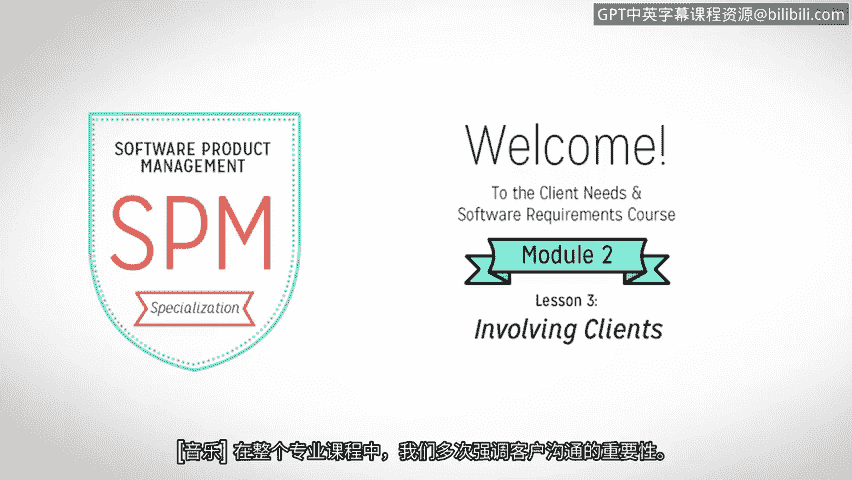
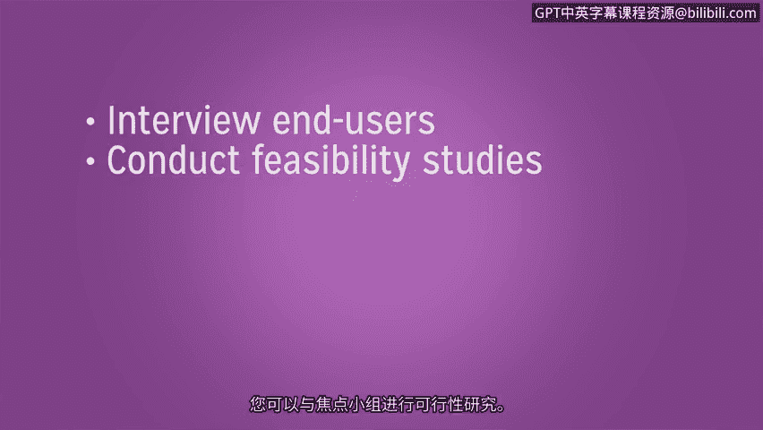
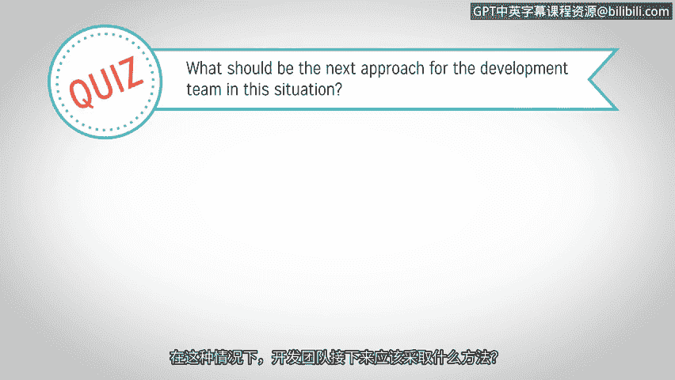

# 艾伯塔大学软件产品管理课程3：《客户需求与软件需求》：3.2.3：让客户参与

在本节课程中，我们将学习如何有效地与客户互动以获取需求。我们将探讨如何开启对话、应该提出哪些问题、应该避免哪些问题，以及在互动中需要牢记的关键事项。通过本节学习，你将能够自信地与客户沟通，并有效地引导出软件需求。

在本专项课程中，我们已经多次强调了客户沟通的重要性。现在，是时候具体谈谈如何与客户对话了。你应该说什么？从哪里开始？

初次发起客户互动确实可能令人望而生畏，但本课程将提供一些好的提问范例、需要避免的问题，以及与客户互动时的注意事项。学完本节后，你将能够自信地与客户交谈，并有效地引导出需求。

## 与客户协作，而非单纯收集

想象一下，你和你的开发团队第一次与客户会面。你需要将他们脑海中的想法转化为一个软件产品。需要牢记的一个重要点是，你是在那里与他们一起探索各种可能性，而不是简单地收集他们的想法。客户互动应该是互动的。

这不像在餐厅，你是服务员，只是记下订单并交付他们点的东西。这更像是邀请客户进入厨房，介绍他们认识厨师，并让他们看看食材。然后，你、厨师和客户一起讨论可以用现有食材制作的所有美味菜肴。作为一个团队，你们为客户创造出一道完美的新颖餐点。

## 需求引导是一个持续的过程

现在，需求引导并非仅在开发前进行一次的活动。正如我们在本专项课程中多次提到的，你需要经常重新审视需求。你不可能第一次就获取所有正确的需求。

凭空创造一个想法是很困难的。一旦你有了可以向客户展示的模型和原型，客户就更容易说出他们喜欢什么、想要什么以及讨厌什么。为了获得正确的需求，从而开发出正确的产品，你必须频繁地进行需求引导。

## 有效管理需求

既然你会经常重新审视需求，我建议你为需求编号，使用一些唯一的标识符。这将使所有参与者在整个开发过程中更容易引用它们。此外，需求不一定必须直接来自客户。

有多种方法可以引导出额外的需求。例如，你可以采访最终用户，了解他们的工作方式、需求和喜好。你可以与焦点小组进行可行性研究。

你可以观察最终用户，看他们如何使用产品。如果最终用户使用过之前的产品，你可以查阅该产品的用户手册，了解他们习惯的操作方式。这些引导技术有助于为最终用户交付更好的产品。

## 建立术语表以提升清晰度

另一个可以简化客户互动的工具是为产品建立一个术语表。这个术语表呈现了产品特有的信息。一旦一个术语被纳入术语表，每个人都应该使用它。这提高了清晰度，因为不会对同一事物使用不同的术语。

开发团队为一个元素起一个名字，而客户却叫它别的名字，这种情况很常见。这会导致混淆，难以确定大家谈论的是否是同一件事。

## 案例分析：凯尔的第一场客户会议

凯尔是一名新的软件产品经理，他迎来了职业生涯中的第一次客户会议。他内心非常紧张，但还是自信地走进房间，与客户握手，并介绍了自己和开发团队。他询问客户产品的目标，并获得了一些有见地的回答。

然后他问客户希望在产品中看到什么。客户开始列出她希望看到的功能。凯尔记录下了答案。会议结束后，凯尔与开发团队会面，将请求的功能列表转化为需求待办列表。他将待办列表通过电子邮件发送给客户，并请她对需求进行优先级排序。

开发团队收到优先级排序后的待办列表后，便开始了开发工作。两周后，凯尔和开发团队与客户会面，展示了一个原型。这个原型正是客户所要求的，但使用起来相当困难。开发团队对他们的工作成果也不太满意。

**是什么导致了这种情况？**
A. 询问客户产品的目标。
B. 仅基于客户建议来确定需求。
C. 让客户对需求进行优先级排序。
D. 两周后向客户提供原型。

当你与客户会面以引导需求时，这应该是所有参与者之间的对话。你需要了解产品的愿景、目标或目的，凯尔做到了这一点。然后，你需要开发团队和客户讨论可能的方法。让他们共同达成一个既能满足客户，又能保证产品质量的解决方案。

让客户对需求进行优先级排序并向他们提供原型，是满足客户需求的绝佳方式。尽管如此，需求不应仅仅基于客户的初始请求；因此，**B是正确答案**。

## 客户互动中的关键考量

客户互动将是你作为软件产品经理工作的重要组成部分。在互动时，有几个注意事项需要牢记。现在让我们来回顾其中一些。

首先，确保与客户找到正确的平衡。你不想表现得过于被动。就像我之前说的，你不是记下订单的服务员。你需要提出新的想法和观点。

你也不想表现得过于激进。你需要避免告诉客户他们想要什么，或者为了细节和决定而盘问他们。你需要找到一个平衡点，在这个点上你既自信又乐于助人。

找到这种平衡的一个好方法是提出好的问题。通过你的问题，你希望引导出不仅仅是“是”或“否”的回答。提出好的开放式问题。专注于产品的目标和目的，并尽可能保持与技术无关。

“为什么”对你来说将是一个非常重要的问题。不断问你的客户“为什么？”他们为什么想要那样？他们为什么需要这个产品？为什么会有人使用它？西蒙·斯涅克有一个关于“为什么”这个问题的力量的精彩TED演讲，我们已在课程资源中分享给你，你一定要去看看。

## 需要避免的问题

除了“是/否”问题，还有一些问题你应该避免。例如，尽量避免问“你想要什么？”或“你的需求是什么？”。这些问题有点过于开放。它们会导致随机、结构松散但重要的想法。

想想庭审律师与证人互动的方式。你可能在电视或电影中见过。律师只问封闭式的“是/否”问题。他们不希望证人详细阐述，因为这可能会破坏他们的论点。作为软件产品经理，你需要以与庭审律师相反的方式行事。尝试构建对话，以允许更有条理的想法，这将使将想法转化为需求变得更容易。

## 避免过早导向解决方案

确保你没有将客户导向一个过早构想的解决方案。如果客户在没有探索其他想法的情况下过早同意某个解决方案，他们可能最终对结果不太满意。你需要探索替代方案。

客户可能会试图导向某个特定的解决方案。如果你曾经从事过零售工作，你可能熟悉“顾客永远是对的”这句话。但在软件开发中，情况并非总是如此。有时客户是错的，有时客户不知道什么是可能的，或者他们可能会提出一些让最终用户更难学习产品的想法。

重要的是，你要尊重他们的观点，并理解他们想法背后的理由。再次强调，问“为什么”。尝试提出可能的替代方案，并礼貌地指出他们的方法可能行不通的原因。归根结底，客户做出关键的需求层面决策。如果你把需求完全交给开发团队决定，那将允许他们构建任何他们想要的东西，而不是客户需要的东西。

## 实践场景：宠物用品网站

你和你的开发团队正在为一家在线销售宠物用品的公司创建一个在线购物网站。客户对他们的要求非常具体。她想要绿色背景配红色文字。她想要动物图片做成动画，看起来像在跳舞。她希望所有产品都显示在首页，并按价格从高到低排序。

你的开发团队对这个设计有些不安，他们试图说服她放弃这些功能。一位开发人员解释说，绿色背景上的红色文字很难阅读，色盲用户可能完全无法阅读。她最喜欢的颜色是红色和绿色，所以她犹豫是否改变主意，但最终她同意使用绿色背景配蓝色文字。不理想，但更好。

然后，开发团队试图说服她放弃按价格从高到低排序。他们认为跳舞的动物无害，是最不需要担心的问题。他们向客户解释说，用户应该能够按动物类型或产品类型（如食物、玩具等）进行排序。他们解释说，这将使网站对用户来说更容易使用，并且主页不会那么拥挤。她拒绝更改排序系统。

**在这种情况下，开发团队下一步应该采取什么方法？**

A. 按照她的所有要求创建网站，交付她想要的产品。
B. 提供实验数据，以确保更好的排序系统可以增加销售额。
C. 让动物的舞蹈动作不恰当，以此反对她。
D. 创建一个视觉吸引人且具有出色排序功能的网站。

在这种情况下，团队需要有勇气。他们的下一步方法应该是进行实验或找到一些数据来支持开发团队的立场。你可以利用这些数据来做出数据驱动的决策。再次强调，你需要思考产品被需要的“原因”。如果“原因”是为了增加销售额或满足客户，那么产品就应该反映这一点。一个理性的客户会被正确的数据和经济论证所说服，因此**B是正确答案**。

然而，如果你的客户完全不讲道理，并且没有任何方法能改变他们的想法，那么最好只是交付他们想要的产品。

## 本节总结

在本节课程中，我们一起学习了如何有效地让客户参与需求引导过程。我们了解到，与客户的互动应该是协作式的对话，而非单向的信息收集。我们探讨了提出开放式问题（尤其是“为什么”）的重要性，以及需要避免的提问方式。我们还学习了通过建立术语表来确保沟通清晰，并认识到需求引导是一个需要在整个开发周期中反复进行的持续活动。最后，我们讨论了如何在尊重客户意见的同时，以数据和理性论证为基础，引导客户做出更优的产品决策。掌握这些技巧，将帮助你更自信、更专业地与客户合作，共同打造成功的软件产品。