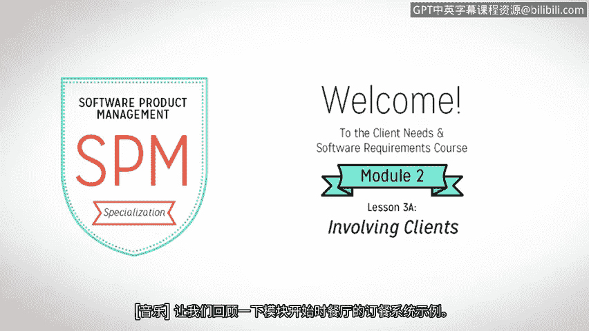

# 艾伯塔大学软件产品管理课程3：《客户需求与软件需求》｜client-needs-and-software-requirements｜ - P17：16_第3.2.3a节 让客户参与.zh - GPT中英字幕课程资源 - BV1K94y1h7Tp

🎼。😊。

Let's look at our ordering system example for the restaurant from the beginning of the module。

One of the features your client requested was that customers can use the system to place an order。

This is very vague， as there are many ways that you could resolve this requirement。

This is a good situation to ask more direct questions to figure out exactly how Jamie envisions this feature to work。

Some questions that you could ask could be， what does a customer do to make a selection？

What should happen with multiple customers at one table。

Is there a limit or minimum to what a table can order？

And what does a customer do to send their order to the kitchen？

I apologize for being so vague when I picture a customer interacting with the app。

 I envision that there should be one or more tablets at each table for customers to use for ordering。

 I see them browsing through images of the food if they want to read more about a dish they can tap on it and if they want to order it they'll push order。

That should take them to another page where they can specify changes to the meal and any dietary restrictions they may have before sending the order to the kitchen。

When there is more than one customer at a table， I want it to work like a shopping cart for an online shopping system。

 I want to have it so that each customer could select their own order as the tablet gets passed around the table。

Or one person at the table could input everybody's order doesn't matter。

All the orders on the same bill would have to be submitted from one tablet。

 the additional tablets would be there for people to browse the menu or place an order for a different bill。

There should be no minimum or maximum order。 When all the orders have been entered and customized。

 customers can then submit their order to the kitchen by tapping submit order。

After you hear responses to the direct questions， you have a much better idea of what the client actually means when they say the customer can place an order using the ordering system。

Involving your client and considering the end user is a very important part of what you will do。

Your client should remain involved throughout development， even after elicitation occurs。

They should be there to answer questions， advise on design choices。

 and give feedback on working versions。We've provided you with a resource that lists many good questions that you can ask your client。

Bring the handout to your client meetings and reference it if you get stuck。

 you can find it in the class resources。Now that you have elicited your requirements。

 you need ways of representing them。 this is what you're going to learn in the remainder of this module。

 see there。