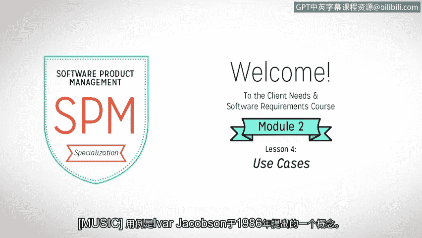
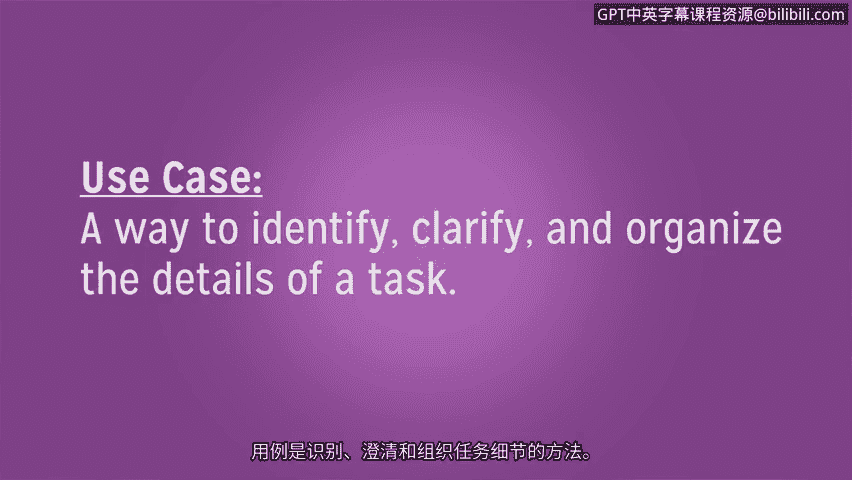
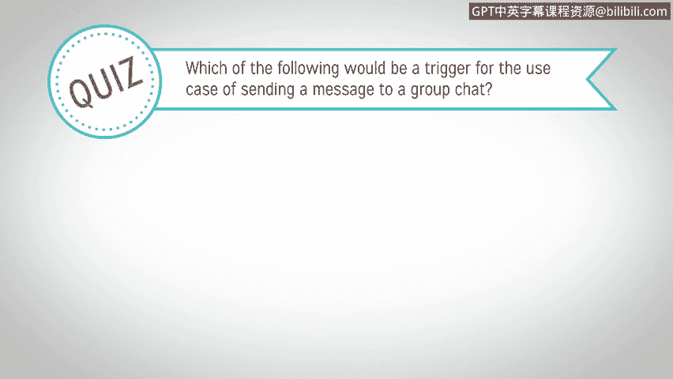

# 软件产品管理课程3：《客户需求与软件需求》：3.2.4：用例

在本节课中，我们将要学习一个重要的需求分析工具——用例。用例是一种描述产品功能所支持任务的有效方式，它能帮助我们识别、澄清和组织任务的细节。

## 什么是用例？

用例是由伊瓦尔·雅各布森在1986年提出的概念。自此，它成为一种描述产品功能所支持任务的流行方法。用例是一种识别、澄清和组织任务细节的方式。

用例由用户与系统之间一系列可能的顺序交互组成。它发生在特定的环境中，旨在实现一个特定的目标。这些描述可能听起来有些抽象，但通过实际例子会更容易理解。

## 用例描述的构成要素

让我们深入了解一个任务用例描述的具体构成要素。一个典型的用例由以下几部分组成：用例名称、参与者、目标、触发器、前置与后置条件、基本流程、异常情况和质量要求。

以下是每个要素的详细说明：

*   **名称**：首先，你需要为用例起一个名字。这个名字应该能描述任务，并且简单、简短。
*   **参与者**：接下来，需要识别参与者。参与者应该是角色，角色是个人承担的职责。例如：餐厅顾客、厨房厨师或服务员。参与者的名称应描述他们使用产品做什么，而不是参与者的真实姓名，我们需要的是通用情况。
*   **目标**：如前所述，用例的目的是实现一个特定目标。因此，你需要在用例中明确这个目标。
*   **触发器**：你还需要识别触发器。触发器是促使用例开始的事件。这可能是类似按下按钮这样的动作。
*   **前置与后置条件**：接下来，需要识别前置条件和后置条件。前置条件是在该用例发生前必须满足的条件。后置条件是在用例完成后满足的条件。
*   **基本流程**：基本流程是用例的重要组成部分，它是对用例中所有发生步骤的逐步说明。基本流程应代表一个“晴天场景”。“晴天场景”是最佳情况，或描述一切正常运行的场景。如有必要，任何其他场景可以作为替代流程来概述。
*   **异常情况**：你还需要概述任何异常情况。异常情况突出了该用例无法工作的任何情形。对于异常，你需要识别在基本流程中异常会发生的步骤，然后提供解决问题的替代步骤。
*   **质量要求**：最后，质量要求是你希望满足的任何质量规范。这些可能是非功能性需求，例如在特定时间内完成场景，或使用特定数量的内存。

总的来说，用例描述从相关参与者的角度概述了任务。它不涉及产品内部幕后的运作。同时，描述应该是技术无关的，因此不依赖于特定的用户界面平台。

## 用例示例分析

杰克正在使用一个即时通讯应用程序。他想给他的朋友莎莉发一条消息，告诉她他参加她的派对要迟到了。他打开应用程序，搜索她的名字。他点击他们的对话，然后输入消息：“嘿，莎莉，我要迟到了。待会儿见。”然后他按下发送键。莎莉看到了消息并回复了杰克。

如果你要为这个场景编写一个用例，你会列出哪些参与者？A. 消息发送者。B. 消息接收者。C. 莎莉 和/或 D. 杰克。

当你定义参与者时，你希望他们是通用情况，因此你不应该使用真实姓名。尽管莎莉和杰克是这个特定场景的最终用户，但并非每次用例发生时他们都是最终用户。我们需要更通用的描述。消息发送者和消息接收者是很好的参与者名称，因为两个用户都参与了这个场景。这意味着答案A和B是正确的。

## 应用：餐厅应用用例

既然你知道了用例描述的结构，让我们进一步将其应用到我们的餐厅应用示例中。一个好的起点是创建一个用例图。这是产品支持的所有任务的高级可视化表示。它识别了参与者以及他们参与的用例。

在餐厅场景中，我们有顾客、儿童顾客和厨房员工。他们各自的用例在图中与他们相连。边界内是产品可以支持的所有用例。

让我们选取其中一个任务并将其转化为一个用例。我们将查看允许顾客查看账单的需求。假设这是第一个用例，对应于产品待办列表中的需求，因此我们将给这个用例分配ID号1。

*   **名称**：我们将这个用例称为“查看账单”。
*   **参与者**：这个故事中唯一的参与者是最终用户，在我们的场景中，我们称他们为“顾客”。
*   **目标**：这个用例的目标是查看他们订单的账单。
*   **触发器**：如前所述，触发器是促使这个用例发生的事件。在这个场景中，顾客在应用程序中请求查看他们的账单。
*   **前置条件**：这个动作发生的前置条件包括：菜单上有菜单项、用户选择了一道菜、用户下了订单。
*   **后置条件**：这个动作的后置条件是顾客可以查看账单并支付账单。
*   **基本流程**：这个用例的基本流程是：1. 用户从应用程序请求查看账单。2. 用户查看账单。
*   **替代流程**：这个动作的替代流程是用户让服务员打印并带来账单。这不是“晴天场景”，因为它需要更多工作，但它完成了相同的任务。
*   **异常情况**：可能发生的异常情况是没有点任何菜。因此，用例的目标没有实现。在这种情况下，应该显示一条错误消息。我们基本流程的第2步是“顾客查看账单”。如果他们的订单没有菜，那么我们希望显示一条错误消息。我们会在用例中这样写：步骤2a：如果未点任何菜，则显示错误消息。
*   **质量要求**：一个质量要求可能是账单加载时间少于10秒。通常，质量要求是非功能性需求。它们有助于在整个开发过程中设定质量标准。

## 另一个练习

你正在使用一个允许用户创建和使用群组消息线程的软件产品。群聊参与者可以被添加到群聊中，这些参与者都可以看到在该线程中发送的消息。以下哪一项会是“向群聊发送消息”这个用例的触发器？

A. 参与者有一条想要发送给群组的消息。B. 参与者输入消息。C. 参与者打开群聊。或 D. 参与者点击发送按钮。

触发器是促使用例发生的事件。在这个场景中，我们的用例是“发送消息”。要触发这个事件，参与者会有一条想要发送给群组的消息。这促使参与者打开群聊、输入消息并按下发送键。因此，A是正确答案。答案B、C和D都是会发生的基本流程步骤。

## 总结

本节课中我们一起学习了用例。用例是你在建立需求时可以使用的绝佳工具。它们有助于组织和详细说明任务及其步骤，并指导开发。用例图可以帮助你获得整个产品的整体视图，包括它支持的所有任务和角色。

接下来，我们将看一些设计技术，这些技术可以帮助你组织和可视化产品的需求。