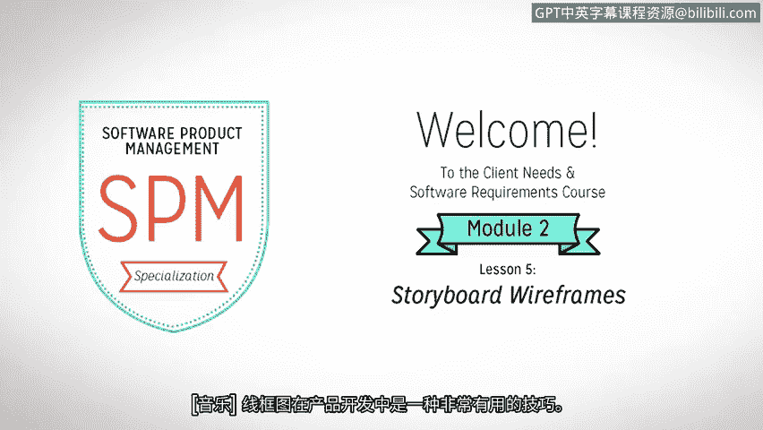
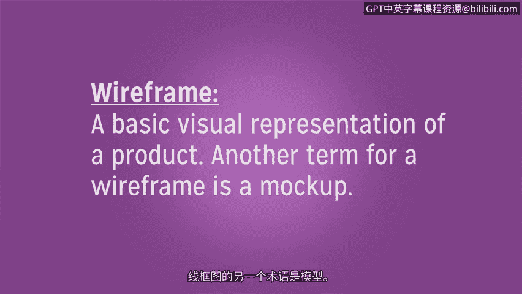
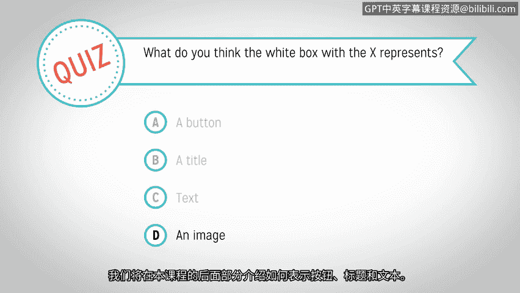

# 艾伯塔大学软件产品管理课程3：《客户需求与软件需求》｜client-needs-and-software-requirements｜ - P19：18_第3.2.5节 线框图.zh - GPT中英字幕课程资源 - BV1K94y1h7Tp

🎼。😊。

Wire frames are a very useful technique in product development。😊。

A wire frame is a basic visual representation of a product。Another name for a wire frame is a mockup。

Think of it like a blueprint for a house。A contractor needs to draw the black and white images of the house before it can be built。

This puts everyone on the same page as to what is being built。

Wire frames are not only a good place for visualizing requirements for the development team。

 They are also an invaluable technique for demonstrating ideas to your client。

After your development team discusses the requirements。

 they can quickly mock up a wire frame to show the client。This way。

 your client gets to see a version of the product very early in the process。

This will allow them to make changes， and it generally ensures that everyone shares the same vision of the product。

You want to keep wire frames very simple。This is not a demo of the interface， in detail。

This is a demo of the product。Flashy colors and images that will be implemented in the interface should not be put in the wireframe。

Wire frames focus on basic functions and end user tasks to be supported。

They can help you think about where you are going to put buttons， text fields， and images。

Their placement top to bottom should follow the flow of how a user performs each task。

Based on these ideas， it's later in the design and implementation phase of the project when the user interface design is fully mocked up or fully implemented。

Again， think of a blueprint for a house。 You cannot tell what color the walls will be or what the lighting or plumbing fixtures will look like。

 You get the basic idea of the outline and where the fixtures will be placed。

 but you don't get the complete picture of what the house will look like。😊。

We use wireframes to create this course。We would place where the presenter would be standing and where the images and text fields would appear。

Here is a wire frame from this course。As you can see。

 our wire frames look very different from our actual course。

We didn't include what the image looks like， we simply indicated where we wanted it placed and described what it would represent。

The image of the presenter also looks nothing like me， but it didn't have to。

 You get the idea that it's the person that's speaking。

We would send these wireframes to our production team so that they knew what our general idea for the course looks like。

And then they do their thing and make the beautiful flashy course that you see。

Let's take a look at a wire frame。This is a wire frame for a website that provides a biography about an author。

What do you think the white box with the X represents。A， a button， B， a title， C， text， or D。

 an image。In wire frames， a box with an X inside represents an image； therefore。

 D is the correct answer。You do not have to specify any details about the image。In a wire frame。

 this representation simply acts as a placeholder for where your image will go。

We will be covering how to represent buttons， titles， and texts later in this lesson。

So as you can see， wire frames can be used for many things。

You can use them to design what will be developed to demonstrate to your client and to communicate with the team。

Another common use of wireframes is for your client to communicate with you。

The client usually has an idea in their head of what their product does and looks like。

Sometimes it's easier for a client to express their ideas by drawing them out in wireframes。

I've had clients do this before， and it makes it easy to extract requirements from their wire frames。

You can consider this approach if your client is having a hard time expressing what they actually want。

In the last module， Bradley talked about the fine line between requirements and design。

Make sure this line is not crossed when eliciting requirements through a wireframe。

Some designing is okay， but you need to be careful that you are not prematurely developing a solution。

Wireframe should get the discussion going about what the problem is and what tasks the end user needs。

 There are many different tools out there for developing wireframes。

You can draw them on paper and digitally scan them， or you can use any drawing tool on your computer。

Either way， you'll want to allow paper and digital versions for easier communication and discussion。

We use Google Docs to draw our wire frames。Presentation tools like PowerPoint are also commonly used for dry and wireframes。

There are also many web applications that are designed for drawing wireframes。

 we will post some of these on our class resources。Let's go back to our restaurant example。

Here's what part of the entree page might look like。In wireframes。

 images are normally denoted with a square with an X inside it。

Text is normally simulated with the shaded box。You can add text to buttons and titles so that you have more to discuss with the client。

Use the shaded box for generic text。Buttons are normally simulated with the square。Next。

 we are going to look at a similar design technique， the storyboard。

