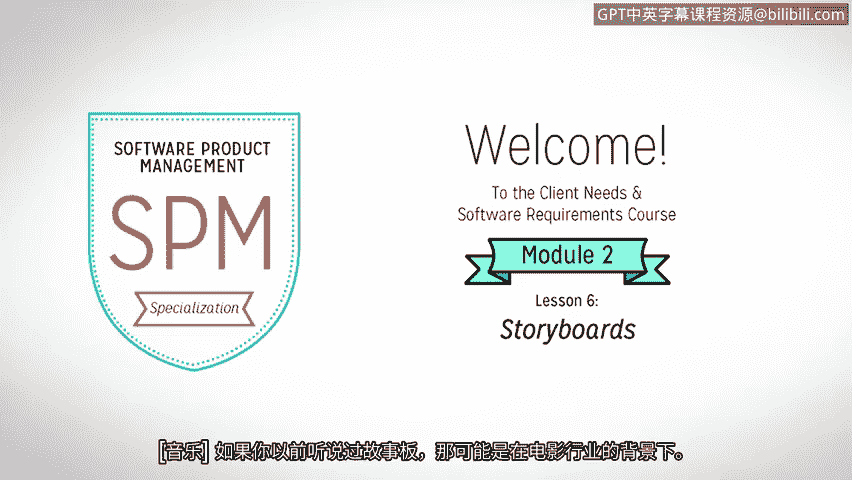
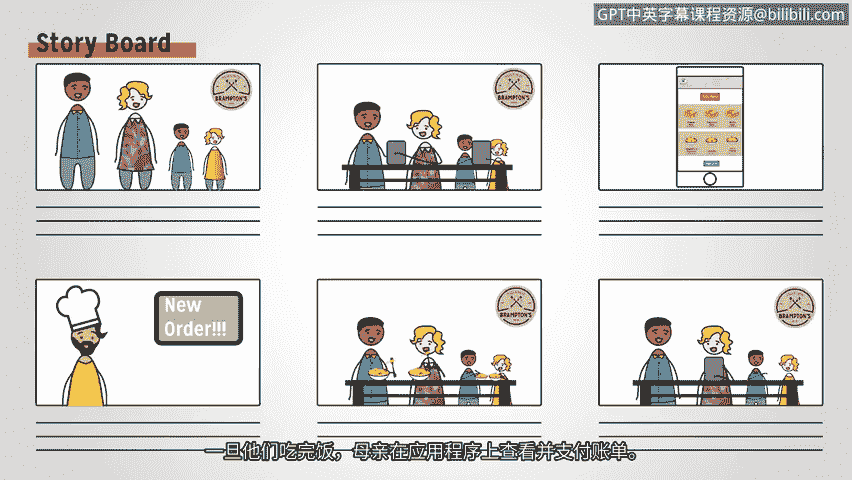
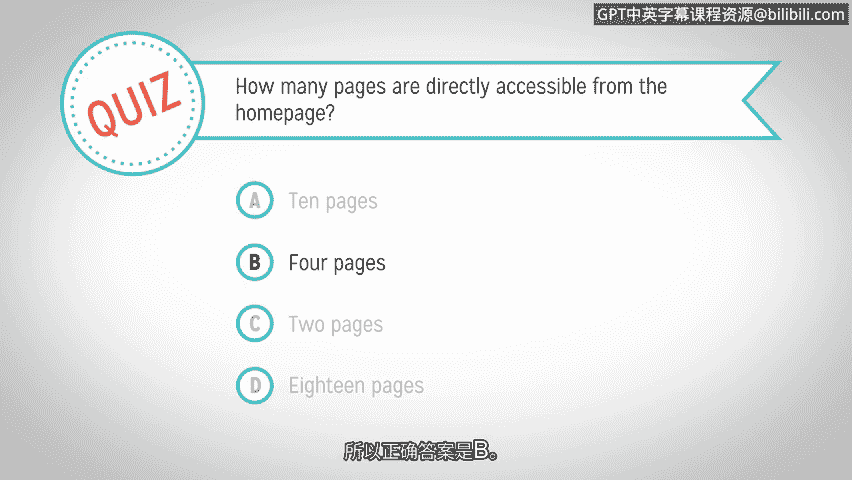

# 艾伯塔大学软件产品管理课程3：《客户需求与软件需求》｜client-needs-and-software-requirements｜ - P20：19_第3.2.6节 分镜头剧本.zh - GPT中英字幕课程资源 - BV1K94y1h7Tp

🎼。😊。

If you've ever heard of a storyboard before， it was probably in the context of the film industry。

That's because it's where the practice originated。Think about all the roles involved in making a movie。

Storyboards help to get everyone aligned around the director's vision。

A storyboard is the sequential visual representation of an interaction。

 A comic strip is a storyboard。It tells a story visually in a sequential order。In the film industry。

 storyboards are used to plan out where the elements will be in the frame。

 how the frame moves and provides a feel for the scene。They do this before investing in costumes。

 props， cinematography， effects， and editing。In software development。

 storyboards can be used in a couple different ways。No matter how they are used。

 they tell the story of how an end user interacts with the product in a sequential order。

The first way that storyboards can be used is similar to a movie storyboard。

This type of storyboard walks through the high level user experience。😊，First。

 you want to identify the actors involved and how they are going to be using the product。

These aren't movie actors we're identifying。If you recall the lesson on use cases。

 you'll remember we called the active user in the situation an actor。

If the product has multiple features， then you want to create a new sequence for each situation in which each actor uses the product。

Let's look at an example of this using our restaurant application。

The Smith family decided to go to Brampton P and pasta。

They are sitting at a table and use the tablets on the table to browse the menu。

They browse the dishes on the application and place their order。

The cooks in the kitchen received their order。The food is delivered to the table when it's ready。

 and the Smith family has a nice dinner。😊，Once they finish their meals。

 the mother views and pays for the bill on the application。

This type of storyboard covers the situations in which a product is used。

By looking at when and how each user will use the product。

 your development team can create or improve features。Like I said before。

 considering your users is an important part of development。

You could also expand the storyboard to add more backstory on the users by giving each a persona。

For example， with the Smith family scenario we just looked at， you could elaborate on their ages。

 favorite dishes， allergies， ethnic background and or income level。

You could refine this scenario to show the storyboard and requirements expanding to address some issue。

If a product has multiple features， you will want to make a storyboard for each one。For example。

 this application has a kidss menu that would need a new storyboard。

You would also cover the bill payment feature with another storyboard。

This movie style storyboard is also useful for getting the entire development team on the same page。

It helps keep the vision of the product in mind。Another use of the storyboard is for marketing or demo purposes。

 you can easily demonstrate to others how and when the product is intended to be used。

You are working on a roadside assistance application。

The application has a feature to check for road conditions。

Your development team provides you with a movie style storyboard for this feature。😊。

Frank is about to embark on a road trip and looks out his window and sees that it's snowing。

He wonders if the roads are snow covered and slippery as a result。

Frank opens his roadside assistance application and checks the road conditions for his route。

The application tells him that the shortest route is hazardous and that he should take an alternate route。

Frank takes the suggested route and arrives safely at his destination。Which of the following， if any。

 would be requirements associated with this storyboard？A， as a driver。

 I want to enter departure and destination locations and have the application calculate routes。B。

 as a driver， I want the application to track my travel and notify an emergency contact if I don't make it to the destination。

See， as a driver， I want hazardous routes to be highlighted in red。D， as a driver。

 I want safer routes to be suggested and or E as a driver。

 I want roadside assistance to be sent to my location automatically if my vehicle is stationary along a highway for 45 minutes。

From this storyboard， we can see that routes are calculated based on provided departure and destination locations。

High risk roots are highlighted in red， and sea roots are suggested。Therefore， A。

 C and D are the correct answers。B any may be features of the application。

 but they are not depicted in this particular storyboard。

Another way of storyboarding gets further into software design。

The purpose of this is to show how a user will interact with the user interface of a product in more detail。

This type of storyboard demonstrates all the sequences of interaction between the user and the product。

It is a combination of wire frames and the basic flow for use cases。

It shows each state of the product and how a user would get to that state。In most products。

 each state would be depicted by an individual wire frame or page in the user interface。

The user transition points between each state are depicted with an arrowed line。

Let's stick with our restaurant example and see what this type of storyboard looks like。

The first screen visible to the customer is the main page。From that page。

 the customer can tap a dish and go to a D detail page or tap the Kis menu button and go to the Kis page。

At a dish detail page， the customer can tap to order the dish and then proceed to a dish customization page。

Once the dish is customized， the customer can tap to place order and return to the main page。

This type of storyboard is a good way to visualize requirements before development。

 it provides an opportunity to discuss possible overcomp or missing elements needed to support a user's tasks。

Users should find it intuitive to know where they are and what to do next in the product。

The storyboard shows the wire frames。Wherever an arrow exists in the storyboard。

 the wireframe needs a user interface element like a button to get to the next wire frame。

Technical writers can also use the storyboard as a guide for creating and structuring training materials。

You are given a storyboard that has 10 different pages。From the homeage。

 there are four arrows that are each pointing to a different page。

There are two pages that have arrows pointing to the homeage。

There are 18 total arrows on the storyboard。How many pages are directly accessible from the home page。

A10 pages， B，4 pages， C，2 pages， or D 18 pages。In a storyboard， each screen represents a page。

The pages that are directly accessible from a specific page have arrows coming from that page and pointing to the accessible pages。

Therefore， since there are four arrows coming from the homeage and pointing to four different pages。

 that means there are four pages that are directly accessible from the homeage。

 so the correct answer is B， both types of storyboards are valuable as they help to form requirements and both focus on what the users do and what's needed in the product。

You'll find the visual representation of your product very helpful when discussing with your client and developers。

Demonstrating functionality with the storyboard will help you to elicit further requirements and to refine the existing ones。

The movie styleyle storyboard is good for simulating user interactions with the product at a high level。

It is also a good way to get the entire team behind the same vision when it comes to the purpose of the product。

The second type of storyboard is a glorified wire frame。

 It is used for determining the interactions with the product in more detail。

This type will be used more by the development team to design requirements。

It is a useful technique for making sure the entire development team is aware of the functionality and flow of a product。

In the next module， Bradley will be taking you through some agile practices that are used to express requirements。

