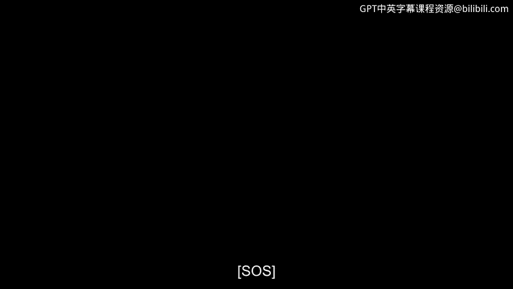
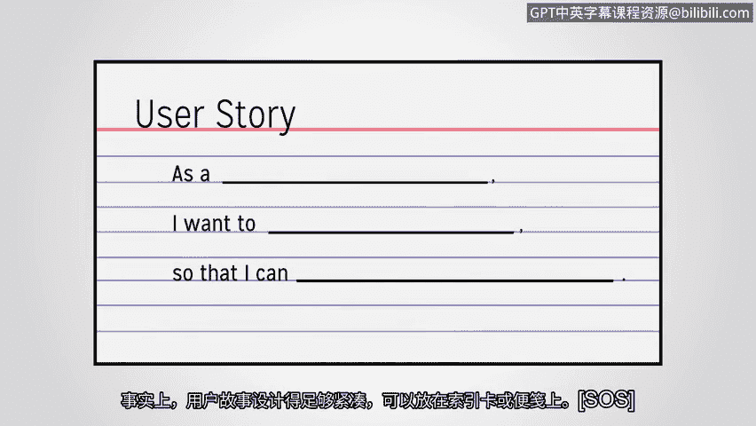

# 软件产品管理课程3：《客户需求与软件需求》：3.3.2：用户故事 📖

在本节课中，我们将要学习敏捷开发中表达需求的核心技术之一：用户故事。我们将了解用户故事的定义、结构、重要性，并通过实例分析来掌握如何编写高质量的用户故事。

上一节我们介绍了如何将传统需求与敏捷实践相结合。本节中，我们来看看一种具体的敏捷需求表达方式。

## 什么是用户故事？

用户故事是一种表达需求的简单方式。在之前的课程中，我们学习了用例、线框图和故事板等需求表达技术。用户故事是另一种实现相同目的的方法。

用户故事旨在将系统的所有需求保持为一致的格式。它们易于编写、阅读和评估。

## 用户故事的结构

用户故事遵循一个非常具体的格式：**`As a <角色>, I want <功能>, so that <价值>`**。

*   **`As a <角色>`**：这部分指明了需求是为哪个利益相关者角色而制定的。例如，可以是“管理员”或“访客用户”。在我们的餐厅菜单应用示例中，利益相关者是顾客和厨房员工。这有助于明确需求旨在支持谁，它指定了需求的“谁”。
*   **`I want <功能>`**：这部分指明了利益相关者希望使用产品解决的任务或功能。这是需求的核心，通常也是人们想到“需求”时最先想到的部分。它指定了需求的“什么”。
*   **`so that <价值>`**：这部分指明了最初为何需要这个用户故事。它提供了关于需求所提供的价值或好处的背景，并与产品的目标或愿景保持一致。它指定了需求的“为什么”。

一个完整的用户故事示例如下：
> **`As a child customer, I want to see the kids menu, so that I see what meals and games interest me.`**

你可以看到它如何作为一个整体结合在一起。

## 知识测验

假设你正在与客户合作一个手机游戏项目。他们给出了一个需求：“I want to be able to control my character using the arrow keys.”（我希望能够使用方向键控制我的角色。）

如何将这个需求构建成符合用户故事格式？以下是选项：
A. As a gamer, I want to be able to control my character using a directional input method so that I can navigate the game world.
B. I want to be able to control my character using a directional input method.
C. In order to navigate around the world, a character should be able to move using the arrow keys.
D. 不做任何更改，这已经是一个用户故事。

**正确答案是 A**。一个用户故事应该符合 **`As a <角色>, I want <功能>, so that <价值>`** 的格式。请注意，这个用户故事在描述输入设备时更加通用，专注于实际需求而非特定解决方案。

## 用户故事的优势

现在，将用户故事与一种常见的需求表达方式进行比较。通常，你会看到需求用模糊的语言表达，缺乏足够的描述。例如：“The user should be able to see a kid‘s menu.”（用户应该能够看到儿童菜单。）

了解了用户故事的创建方式后，你是否理解了它们为何如此结构化？它们为需求带来了极大的清晰度，而不会陷入技术细节的泥潭。你可以在一个简洁的小包裹中获得“谁”、“什么”和“为什么”。

拥有简短、简洁的用户故事还有一个额外的好处：你可以轻松地将它们写下来以便跟踪。事实上，用户故事的设计初衷就是足够紧凑，可以写在索引卡或便利贴上。

这样，所有的用户故事都可以以一种非常直观、物理化和信息丰富的方式被展示和组织。通过将故事写在索引卡上，它们可以轻松地按相关主题分组，并在需求不可避免地发生变化时进行重组。

本节课中，我们一起学习了用户故事。我们明确了用户故事是一种遵循 **`As a <角色>, I want <功能>, so that <价值>`** 格式的、简洁的需求表达方式。它明确了需求的利益相关者、具体功能和商业价值，使得需求更清晰、易于管理和沟通。掌握编写高质量用户故事的技巧，是进行有效敏捷产品管理的重要基础。