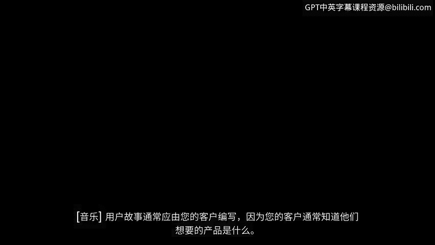
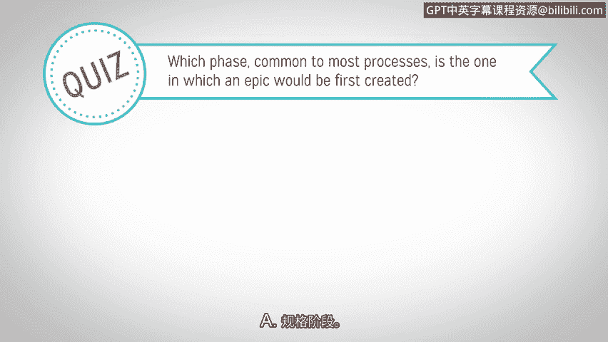

# 软件产品管理：3.3.2a：用户故事 📖

在本节中，我们将学习如何编写有效的用户故事。用户故事是描述软件需求的一种简洁方式，它从用户角度出发，说明他们希望通过产品完成什么任务。我们将重点介绍优质用户故事的特征，并了解如何避免创建过于庞大或模糊的“史诗级”故事。

---

用户故事本应由您的客户来撰写，因为客户通常最清楚他们希望产品具备什么功能。

然而，软件产品经理最终常常需要负责撰写用户故事。

这并非因为客户对指定产品功能不感兴趣。

通常是由于客户缺乏创建用户故事的经验或培训。

但这并不意味着您不应该请客户创建用户故事。

这意味着您和您的开发团队可能需要帮助他们以用户故事的形式表达需求。

这固然很好，但归根结底，您必须知道如何编写出真正有用的用户故事。

您可以将一个构思不佳的需求套入用户故事的形式。

但这并不会让它突然变成一个好的需求。那么，什么才是好的用户故事呢？

摩根将在下一个模块详细讲解优质需求的构成要素。

因此，这里我只简要介绍优质用户故事的特点。

一个好的用户故事应能清晰地勾勒出产品中一个具体的软件需求。

我们已经明确了这一点，但如何做到呢？业界广泛使用一个由比尔·韦克提出的助记符，可以帮助您记住优质需求的要素。

这个助记符是 **INVEST**。我将先解释每个字母代表什么，然后再详细说明。

*   **I** 代表 **独立**。
*   **N** 代表 **可协商**。
*   **V** 代表 **有价值**。
*   **E** 代表 **可估算**。
*   **S** 代表 **小**。
*   **T** 代表 **可测试**。

**INVEST** 中的 **S** 代表什么？A. 简单。B. 聪明。C. 稳定。D. 小。答案是 **D**。需求当然应该简单，但这不是我们这里要找的词。

---

上一节我们介绍了INVEST助记符，现在让我们逐一详细解读其含义。

**I 代表独立**
当一个用户故事是独立的，意味着它可以独立于任何其他用户故事进行开发，无论何时实施。这很重要，因为它允许您重新安排用户故事的开发顺序。如果两个用户故事紧密相关且相互依赖，您可以将它们合并成一个独立的用户故事。但需要注意平衡，避免用户故事变得过于庞大。

**N 代表可协商**
这意味着用户故事应该足够通用，以便您的团队和客户围绕其实现方式进行协商。由于可能没有唯一正确的实现方式，因此不要专注于满足需求的具体技术细节。相反，应关注需求的主要重要方面。情况可能会发生变化，这是可以接受的。

**V 代表有价值**
每个故事都应该为客户带来某种价值。不要制造空洞的、无意义的工作。

**E 代表可估算**
您应该能够估算设计和实现该需求需要多长时间。如果您无法估算开发所需时间，您可能指定了一个所谓的“史诗”。我将在本课稍后讨论什么是史诗。

**S 代表小**
这与需求应该可估算的理念相关。然而，即使您能估算某件事需要多长时间，这本身并不能使其成为一个好需求。如果您估算一个用户故事需要三个月开发，您会希望将其分解成更小的故事。用户故事之所以要小，是因为每个用户故事都旨在短时间内开发完成。此外，较小的故事其估算也应更确定。如果您遇到一个大型故事，请尝试尽可能将其分解，否则您将面临处理一个史诗的风险。

**T 代表可测试**
基本上，您需要验证每个用户故事在被视为“完成”之前是否符合一组特定的标准。这通常通过定义和使用验收测试来实现，我将在下一课中详细说明。

以上就是INVEST：独立、可协商、有价值、可估算、小和可测试。

---

我们已经多次提到要避免创建史诗。那么，究竟什么是史诗呢？

正如您可能从上下文中猜到的，史诗是一个几乎无法克服的巨大用户故事。

史诗肯定无法在短时间内完成。史诗是对需求的模糊、宽泛描述。

即使是最成熟的软件开发团队，其需求待办列表中也会出现史诗。

那么，史诗是如何产生的呢？通常，在项目最初描述未来要开发的功能时，史诗就被引入了。当客户希望在未来完成某项功能时，可能很难确切知道它应该是什么样子或应该如何完成。通常的做法是构建一个用户故事，大致勾勒出客户想要的功能。

如果您学习过《软件过程与敏捷实践》课程，请回想一下开发阶段。在大多数流程共有的哪个阶段中，会首次创建史诗？

A. 规格说明阶段。B. 架构设计阶段。C. 构建阶段。D. 过渡阶段。

正确答案是 **A. 规格说明阶段**。这是与客户创建和讨论需求的阶段。其他阶段构成了后续要完成的工作。如果您没有学习过《软件过程与敏捷实践》课程，您将在那里了解更多相关内容。

---

在本节课中，我们一起学习了用户故事的核心概念。我们了解到，优质的用户故事应符合 **INVEST** 原则：即具备**独立**性、**可协商**、能为客户带来**价值**、**可估算**、足够**小**且**可测试**。同时，我们认识到应避免创建过于庞大和模糊的“史诗”，它们通常产生于项目初期的需求规格说明阶段。掌握这些原则，将帮助您更有效地与客户沟通并管理软件需求。