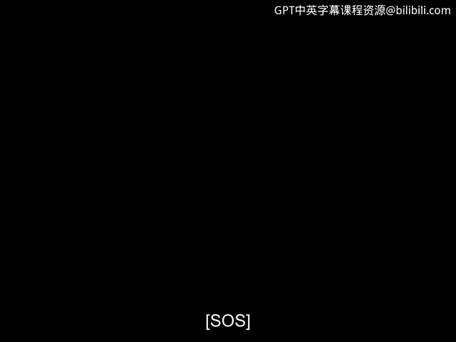
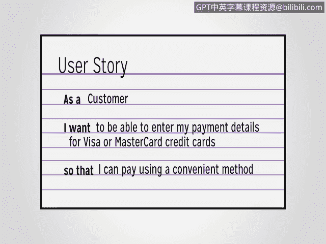
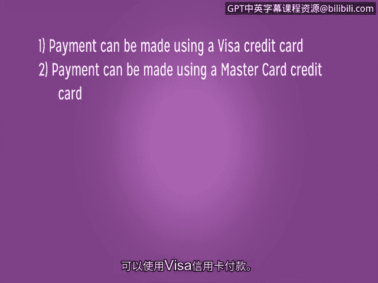
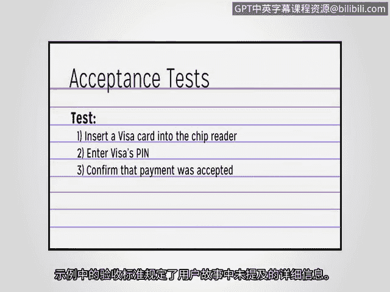

# 艾伯塔大学软件产品管理课程3：《客户需求与软件需求》｜client-needs-and-software-requirements｜ - P25：24_第3.3.3节 验收测试.zh - GPT中英字幕课程资源 - BV1K94y1h7Tp

In the last lesson， I talked about user stories。

I explained how to make a good user story by using the p mneummonicInvest。In this lesson。

 I'm going to talk about a concept which relates directly to the last letter of the pneummonic。

 testable。Since user stories should be testable， that must mean that there are tests for user stories。

 right？Remember how a user story is compact enough to be written on one side of an index card？Well。

 not only does that keep your user stories short and to the point。

It also allows you to write tests for each story on the back of that index card。

The kind of test which is written on the back of the card， is called an acceptance test。

So what is an acceptance test？An acceptance test is basically a check for whether a requirement is met。

Acceptance tests are used in almost all engineering disciplines。

 and software engineering is no different。An acceptance test specifies how your client will verify that a user story has been satisfied。

If the acceptance test passes， then the user story is considered satisfied。

An acceptance test is created based on the acceptance criteria。

An acceptance criterion is a specific condition which must be met。

 where an acceptance test is a method for verifying whether that condition has been met or not。

Just like a user story， an acceptance test is written using simple， straightforward language。

Each acceptance test should be an easy to understand action with a verifiable condition that the user story is implemented correctly。

Each test should verify one small part of the user story。If all the tests pass。

 then the acceptance criteria are considered past。Remember the user story we created in the last lesson。

As a customer， I want to be able to enter my payment details using Visa and Mastercard credit cards。

So that I can pay using a convenient method。

Here are some examples of acceptance tests for our user story。

You should be able to test this story with the following criteria。

Payment can be made using a visa credit card。Payment can be made using a Mastercard， credit card。

Payment can be made using an online financial service。When paying with a credit card。

 filling in the card number field， auto detects the card type。

The customer sees only the relevant input fields， depending on the selected payment method。

Those are just a few examples。There could be lots more。

 and the contents of the acceptance criteria are usually determined by your client's specific needs。

Notice how all of these criteria follow a similar structure， though。They're all simple。

 easy to verify， and all relate to paying with different payment types as specified in the user story。

Now， since all of these are criteria， we need acceptance tests in order to verify them。

Let's take the criterion of being able to make payments using a Vi credit card。

In order to turn this criterion into an acceptance test。

 we might write a few tests for this criterion， like insert a Visa card into the chipread。

Enter the Vi's pinIN number and confirm that payment was accepted。So by going through these steps。

 you verify the acceptance criterion。When you meet all the acceptance tests。

 then the acceptance criterion is considered past。If the acceptance tests are passed for all a user St's acceptance criteria。

 then the user story is successively acceptance tested。

Now that you've seen how acceptance criteria and acceptance tests are created。

Let's test your knowledge。You're working with a client to create a hotel management application。

And you have been given the following user story。As a room service staff member。

 I want to be able to mark a room as clean in the room overview screen so that I can keep track of my cleaning progress。

Which of the following would be considered an acceptance test for this user story？A。

 from the room overview screen， select mark Room as clean。B。

 a room can be marked as clean from the room overview screen。C， a room should be cleaned。Or D。

 as a room service staff member， I want to be able to clean a room。The correct answer is a。

This outlines a basic step in using the application in order to mark a room as clean。

It may be one of many steps， but it is still a test。

B is an acceptance criterion because it is a general condition which must be met。

The other two options are neither acceptance tests or acceptance criteria。 In fact。

 D is another user story entirely。The acceptance criteria from the example specifies details which aren't mentioned in the user story。

So by listing acceptance criteria， you're giving your development team a frame of reference for how the story should be broken down into developer tasks and eventually finished。

When your acceptance criteria and tests are written along with the user story which they accompany。

 you're making sure that the functionality you want to implement can actually have its implementation verified。

Just like user stories， acceptance criteria and tests should be formed by your client。However。

 it's also a good idea for your developers to create acceptance tests alongside your client。

This allows your client to give input on how they want to see the requirement working。

It also gives your development team the ability to work through what each requirement looks like from a user's perspective。

So your client gets a big say into what the product does。

 and the development team is able to visualize how each feature will be built。

By thinking through each requirement like this， it will also help you to avoid creating the ever feared epic user story。

Too many acceptance criteria for one user story probably suggest that you could break that user story up a little bit more。

So that's the acceptance test， it's just a list of simple conditions to check whether a user story is implemented correctly。

They can be verified in a straightforward way and make it easy for everyone in the project to really think about what each feature does。

In the next lesson， I'm going to introduce the product backlog。

 a popular scrum practice for keeping track of requirements。 See you there。

