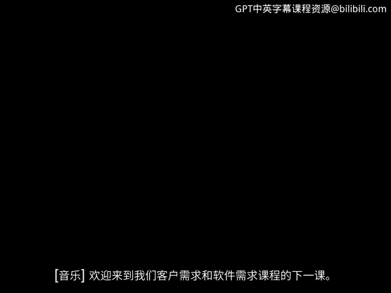
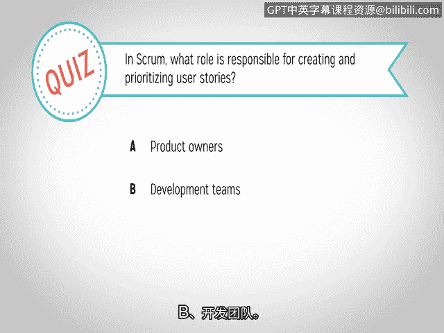

# 艾伯塔大学软件产品管理课程3：《客户需求与软件需求》｜client-needs-and-software-requirements｜ - P26：25_第3.3.4节 产品积压工作.zh - GPT中英字幕课程资源 - BV1K94y1h7Tp

Welcome to the next lesson in our clientient Needs and softwareft Requi course。

In the last lesson， I spoke about acceptance tests。

 which are a means to verify whether a user' story is satisfied。In this lesson。

 I'm going to introduce you to the concept of the product backlog。

It's a popular technique which is critical to the agile methodology of scrum。

So what is a product backlog？Basically， a product backlog is a list of software features which you and your team intend to develop。

Actually， their product backlog begins as a big unsorted list of items to do。

 then gets more refined over time。The product backlog consists mostly of user stories。

 which I defined a few lessons ago。However， the backlog isn't limited to user stories。

 you can include other things like work tasks， knowledge tasks， and bugs。

Work tasks include things like Se up product testing server。

They're basically physical to do items which aren't directly related to developing your product's features。

A knowledge task is similar。 It's a to do item for things that need to be learned。

So you might have review programming options for database connection as a knowledge item。And。

 of course。Bgs are simply errors in your product's code that require attention。

Which of the following items can be included in a product backlog？A， user requirements。B。

Non work related duties。C， bugs。And or D， product vision。The correct answers are A and C。

User requirements go into the backlog in the form of user stories， and bugs are listed there as well。

The product vision may guide how user requirements are created。

 but it's not explicitly listed in the backlog。The same goes for non work related duties。

User stories are by far the most common item of the product backlog。

When you write your user stories with your client， the first thing that will be done with them is that they will be placed into this list。

The product backlog is a scrum technique， which also means it's an agile technique。

That being the case， the product backlog should be dynamic and focus on client interaction。

The initial user stories you write with your client are gathered together and placed into the backlog。

There is no particular order to it。 In fact， the whole point of the backlog at the very beginning is that it's an unordered lump of all the things which would ideally be built into the end product。

When you create each user story to be put into the backlog。

 make sure you assign a unique user story identifier to it。

This is important because it gives everyone a frame of reference within the project。

Instead of having to recite the content of each story whenever you refer to it。

 all you have to do is reference a user story identifier。

It doesn't really matter what identifier are you assigned to any given story。However。

 a simple way is to use sequential numbers。Assign the first story you think of as a one。

 the second to two， and so on。Once you have your list。

 the next thing for you to do is to ask your client to give a priority to each story。

Then the client sorts a previously unsorted list of user stories from highest to lowest priority。

The goal is to have the most high valued features listed at the top of the backlog and the least important ones at the bottom。

This will jumble up your user stories so that they're not ordered by identifier， but that's okay。

The user story identifier is more of a tracking mechanism than a sorting device。

This gives your developers a sense of what's important for them to develop。

It gives them perspective and focus。All they have to worry about is pulling tasks from the top of the heap。

It gives your client perspective and focus as well。By going through every user story in the project。

 your client is forced to think about what they need and what they want。

This often leads to a dialogue between your client and your development team。

Your client tells your development team what they really need。

And your development team shows your client what can be done。

 given the technology and resources available。However。

 just because this dialogue can happen doesn't mean that it always does。

You can get the client focusing only on prioritizing the product backlog。

 while the developers focus only on estimating the efforts of implementing each user story。

This can create a kind of fence between them。In Agile， there should be discussion and collaboration。

This allows clients and developers to both understand the reasons why a user story has a certain priority and why an effort estimate has a certain value。

The best thing you can do is to try to collaborate with your client as much as possible and allow your development team to communicate with your client throughout prioritization and planning。

So you create a backlog with your client and everything is prioritized。😡。

All of your user stories are numbered and sorted from highest to lowest based on their priority to your client。

The next step is to start planning your project using these priorities as your reference point。

I'm not going to dive into this in much detail。Since it will be covered in the Agile Planning and softwareft Product course。

However， it's enough to say that user stories are taken from the backlog and placed into chunks of work。

 which will be done at certain time intervals called sprints。In ScRrum。

 what role is responsible for creating and prioritizing user stories？A product owners。B。

 development teams。

See， clients。Or D， team leads。The answer is a， product owners。In Scrum。

 product owners are responsible for making sure that the product backlog is up to date。Clients。

 team leads， or members from your development team may fill a product owner role。

 but they must be a product owner if they're to be responsible for changing the product backlog。

