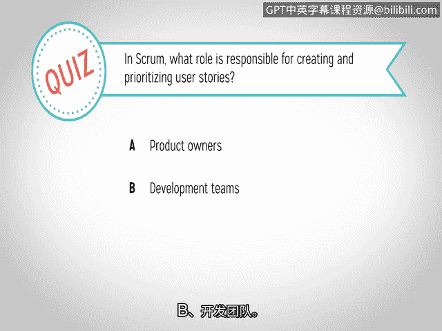

# 艾伯塔大学软件产品管理课程3：《客户需求与软件需求》：3.3.4：产品积压工作 📋

在本节课中，我们将要学习敏捷开发中的一个核心概念——产品积压工作。我们将了解它的定义、构成要素以及它在项目规划中的关键作用。

上一节我们介绍了验收测试，它是验证用户故事是否被满足的一种手段。本节中，我们来看看如何组织和管理这些用户故事，这正是产品积压工作的职责所在。

产品积压工作是一个在Scrum敏捷方法中至关重要的流行技术。本质上，它是一个你和你的团队计划开发的软件功能列表。实际上，产品积压工作最初是一个未排序的大型待办事项列表，随后会随着时间的推移变得更加精细。

产品积压工作主要由用户故事构成，我在之前的课程中已经定义过用户故事。然而，积压工作并不局限于用户故事，你还可以包含其他事项，例如工作任务、知识任务和缺陷。

以下是产品积压工作中可以包含的几种事项类型：

*   **工作任务**：包括诸如“设置产品测试服务器”这类事项。它们基本上是物理性的待办事项，与直接开发产品功能没有直接关系。
*   **知识任务**：与之类似，它是针对需要学习的事项的待办项。例如，“评审数据库连接的编程选项”可以作为一个知识项。
*   **缺陷**：这指的是产品代码中需要关注的错误。

那么，以下哪些项可以包含在产品积压工作中？A. 用户需求；B. 与工作无关的职责；C. 缺陷；D. 产品愿景。正确答案是A和C。用户需求以用户故事的形式进入积压工作，缺陷也会被列在其中。产品愿景可能指导用户需求的创建，但它不会明确列在积压工作中。与工作无关的职责也是如此。

用户故事是产品积压工作中迄今为止最常见的项目。当你与客户一起编写用户故事时，对它们做的第一件事就是将其放入这个列表中。

产品积压工作是一种Scrum技术，这也意味着它是一种敏捷技术。既然如此，产品积压工作应该是动态的，并专注于客户互动。你与客户一起编写的初始用户故事被收集起来并放入积压工作中。它没有特定的顺序。事实上，积压工作在最初阶段的全部意义在于，它是一个无序的集合，包含了所有理想情况下应构建到最终产品中的事项。

当你创建每个要放入积压工作的用户故事时，请确保为其分配一个**唯一的用户故事标识符**。这很重要，因为它为项目中的每个人提供了一个参考框架。每当引用某个故事时，你无需复述每个故事的内容，只需引用其标识符即可。为任何给定故事分配什么标识符并不重要，一个简单的方法是使用顺序数字。将你想到的第一个故事分配为1，第二个为2，依此类推。

一旦你有了列表，接下来要做的就是请你的客户为每个故事指定优先级。然后，客户将之前无序的用户故事列表按优先级从高到低进行排序。目标是让最有价值的功能列在积压工作的顶部，最不重要的列在底部。这会打乱你按标识符排序的用户故事顺序，但这没关系。用户故事标识符更多是一种跟踪机制，而非排序工具。

这为你的开发人员提供了开发重点的指引，给了他们视角和焦点。他们只需要担心从任务堆的顶部提取任务即可。这也为你的客户提供了视角和焦点。通过梳理项目中的每一个用户故事，客户被迫去思考他们需要什么和想要什么。这常常会引发客户与开发团队之间的对话。客户告诉开发团队他们真正需要什么，而开发团队则根据可用的技术和资源向客户展示可以做什么。

然而，仅仅因为这种对话可能发生，并不意味着它总会发生。你可能会遇到客户只专注于对产品积压工作进行优先级排序，而开发人员只专注于估算实现每个用户故事所需的工作量。这可能会在他们之间造成一种隔阂。在敏捷开发中，应该有讨论和协作。这能让客户和开发人员都理解为什么一个用户故事具有特定的优先级，以及为什么工作量估算具有特定的数值。你能做的最好的事情就是尽可能与客户协作，并允许你的开发团队在整个优先级排序和规划过程中与客户沟通。

现在，你已经与客户一起创建了一个已排好优先级的积压工作。所有的用户故事都已编号，并根据对客户的优先级从高到低排序。下一步就是开始以这些优先级为参考点来规划你的项目。我不会深入探讨细节，因为这将在《敏捷规划与软件产品》课程中涵盖。但可以说，用户故事会从积压工作中取出，并放入称为“冲刺”的特定时间间隔内要完成的工作块中。

在Scrum中，哪个角色负责创建用户故事并为其确定优先级？A. 产品负责人；B. 开发团队；C. 客户；D. 团队领导。答案是A，产品负责人。在Scrum中，产品负责人负责确保产品积压工作是最新的。客户、团队领导或开发团队的成员可能担任产品负责人的角色，但如果他们要负责更改产品积压工作，他们必须是产品负责人。

本节课中我们一起学习了产品积压工作的概念。我们了解到它是一个动态的、包含用户故事、工作任务、知识任务和缺陷的列表，并且需要与客户协作进行优先级排序，以为开发团队提供清晰的工作指引。这是连接客户需求与开发实施的关键桥梁。