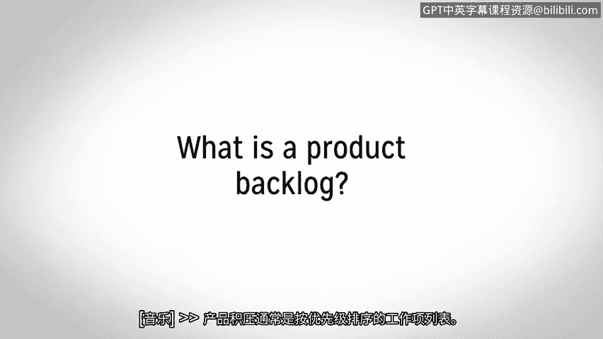
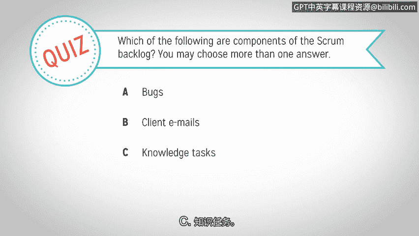

# 艾伯塔大学软件产品管理课程3：《客户需求与软件需求》｜client-needs-and-software-requirements｜ - P27：26_第3.3.4a节 产品积压工作.zh - GPT中英字幕课程资源 - BV1K94y1h7Tp

So the user stories which your client places as a high priority are planned to be completed earlier。

Less important stories are planned to be released later。However， since Scrum focuses on development。

 one sprint at a time， this leaves a lot of room for your plan to change beyond the current sprint。

All you need to focus on is planning for the next sprint。When that sprint is done。

 the client can add new user stories and reevaluate the priorities。

 then adjust your sprint planning accordingly。What I mean is that requirements can change from their originally planned priorities。

In fact， this is incredibly common。You'll often find that your development team is happily developing a set of user stories during a sprint when your client decides that something needs to change。

😊，Perhaps a requirement， which was previously low priority， is now extremely urgent。

Perhaps a requirement which was previously high priority， is no longer desired at all。

Or perhaps your client thinks of a new functionality and more user stories are added to the backlog。

This can end up shifting the priority of other items。And of course。

 you'll definitely find bugs which need to be addressed。Your backlog is bound to morph over time。

It will shift， grow， shrink and change order。 That's all O。 The only place in scrum。

 which doesn't allow for this sort of shift。Is during the current sprint where development work is set to be done。

Other than that， if you change plans to adjust to requirement changes， that's perfectly fine。

 In fact， it's encouraged。Just don't feel as though things are set in stone from the beginning。

Not only would that be unrealistic， it would set your project up for tons of problems。Next。

 let's take a look at an interview on how a product backlog is used in industry。

🎼うふ。🎼ふふ。Product backlog is usually a list of work items that's prioritized and delivers the value that a customer wants in a particular release or product。

The type of things that go in a product backlog include new features， enhancements。

 or even things that are wrong with the existing releases of the product that result in defects and other things like architectural work。

 technical debt are also items that a product backlog might contain。

The form of requirements on a product backlog are typically specified as user stories。

 user stories are composed of typically a customer。

 a need or a want and kind of the justification or value for what that user story would deliver for them。

Backlog prioritization can be thought of as being done through a process known as backlog grooming。

 and that's through examining the contents of a product backlog and trying to align those with the priorities of the business as well as the technical feasibilities and realities of working with the code itself。

🎼，The product backlog itself is fairly dynamic， so it's something that at the start of a release might resemble something quite different from the end of a release。

 the items that go on it might undergo transformation through backlog grooming itself。

 but also through changing business needs and priorities as well as the team itself having discovered new technical dependencies that they hadn't known about before。

 those are also items that will want to put on the backlog and make sure those are addressed in order to satisfyati the overall body of work that the backlog encompasses。

Which of the following are components of the Scrum backlog？You may choose more than one answer。

A bugs。B， client emails。C， knowledge tasks。

D， work tasks， and or E business requirements。The answers here are A， C， and D。Bugs。

 knowledge tasks and work tasks are all okay to be included in the Scrum backlog。

So that's the product backlog。 It's a very valuable tool， which is critical to scrum。

It allows you to organize your work。Easily see where the project's priorities lie and plan based on those priorities。

The product backlog works well within Agile because it gives a lot of flexibility to your client and your team。

In the next lesson， I'm going to talk about another method which is used to organize user stories。

 the story map。 I'll see you there。