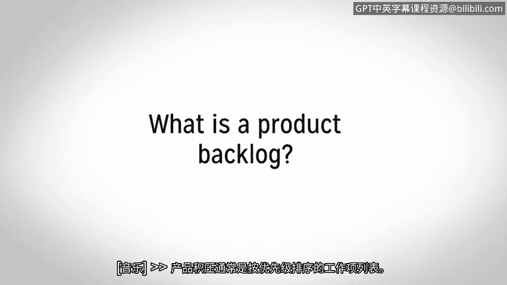
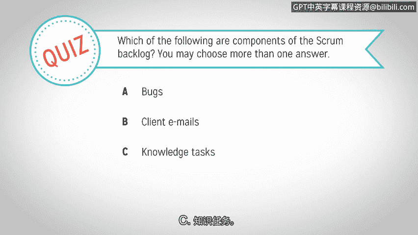

# 软件产品管理：3：《客户需求与软件需求》｜3.3.4a：产品积压工作 📋

在本节课程中，我们将学习Scrum框架中的一个核心工具——产品积压工作。我们将了解它的构成、动态特性以及如何在敏捷开发中有效使用它来管理用户故事和项目需求。

## 产品积压工作的规划与动态性

上一节我们介绍了用户故事，本节中我们来看看如何通过产品积压工作来组织和管理它们。

客户设定为高优先级的用户故事计划被更早完成。重要性较低的故事则计划在后期发布。然而，由于Scrum专注于一次一个冲刺的开发方式，这为当前冲刺之后的计划留下了很大的调整空间。

开发团队只需专注于规划下一个冲刺。当该冲刺完成后，客户可以添加新的用户故事、重新评估优先级，并相应地调整冲刺计划。这意味着需求可能改变其最初计划的优先级。

事实上，这种情况非常普遍。开发团队经常会在一个冲刺中愉快地开发一组用户故事时，客户决定需要做出改变。可能一个之前低优先级的需求现在变得极其紧急。可能一个之前高优先级的需求现在完全不再需要。或者客户可能想到一个新功能，从而有更多用户故事被添加到积压工作中。这最终可能导致其他事项的优先级发生变动。

当然，团队也肯定会发现需要解决的缺陷。产品积压工作必然会随着时间的推移而演变。它会变动、增长、缩减并改变顺序。这完全正常。在Scrum中，唯一不允许这种变动的地方是正在进行开发的当前冲刺期间。除此之外，根据需求变化调整计划是完全可行的，事实上，这是被鼓励的。不要认为事情从一开始就一成不变。这不仅不现实，还会给项目带来大量问题。

## 行业实践访谈：产品积压工作的应用

接下来，让我们通过一段访谈，看看产品积压工作在行业中是如何被使用的。

产品积压工作通常是一个按优先级排序的工作项列表，旨在交付客户在特定版本或产品中期望的价值。进入产品积压工作的内容包括新功能、增强功能，甚至是现有产品版本中导致缺陷的问题。其他如架构工作、技术债务等也可能是产品积压工作包含的项。

产品积压工作中的需求形式通常被指定为用户故事。用户故事通常由**角色（客户）、需求（需要或想要的东西）以及该用户故事将为他们带来的价值或理由**组成。

积压工作的优先级排序可以被认为是通过一个称为“积压梳理”的过程来完成的。这个过程包括检查产品积压工作的内容，并尝试使其与业务优先级、技术可行性以及代码本身的实际情况保持一致。

产品积压工作本身是相当动态的。在版本发布之初，它可能与发布结束时看起来大不相同。其中的事项可能会通过积压梳理过程本身发生转变，也会因为不断变化的业务需求和优先级，以及团队自身发现了之前未知的新技术依赖关系而改变。这些也是需要放入积压工作并确保得到处理的事项，以满足积压工作所涵盖的整体工作目标。

## 产品积压工作的构成

以下是关于Scrum产品积压工作构成的一个小测试。

**问题：** 以下哪些是Scrum产品积压工作的组成部分？你可以选择多个答案。
A. 缺陷
B. 客户邮件
C. 知识任务
D. 工作任务
E. 业务需求

**答案：** A、C 和 D。缺陷、知识任务和工作任务都可以包含在Scrum产品积压工作中。

## 总结与展望

本节课中我们一起学习了产品积压工作。它是一个非常有价值的工具，对Scrum至关重要。它帮助你组织工作，清晰地看到项目的优先级所在，并基于这些优先级进行规划。产品积压工作在敏捷环境中运行良好，因为它为你的客户和团队提供了很大的灵活性。

在下一课中，我将讨论另一种用于组织用户故事的方法——故事地图。我们下节课见。