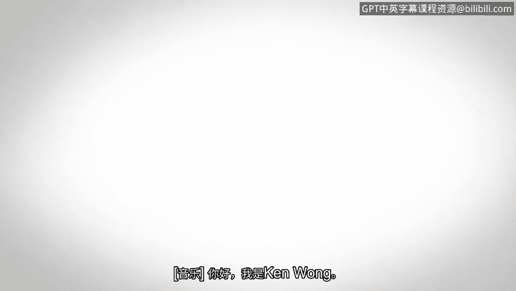
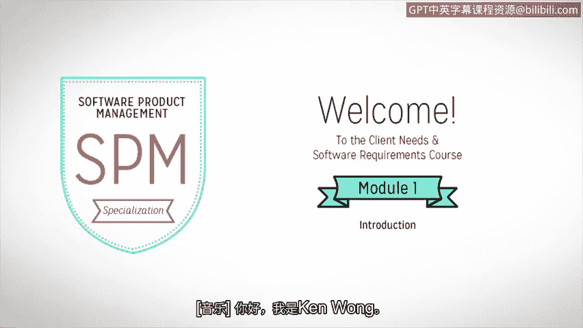

# 艾伯塔大学软件产品管理课程3：《客户需求与软件需求》｜client-needs-and-software-requirements｜ - P2：1_客户需求和软件需求简介.zh - GPT中英字幕课程资源 - BV1K94y1h7Tp

🎼。😊。

Hi， I'm Ken Wang， welcome to the clientient Needs and So requirementsquiments course within the Software Project Management specialization。

This course will deliver fundamental elements to the specialization and will serve as one leg in the inooksh that depicts the structure of the specialization。

In this segment， I'll give you a preview of what you'll learn this course。In the introductory course。

 I said that making better software involves three goals。And these goals were the right product。

 done right and managed， right。To identify the right product。

 you have to understand the needs of your clients and users， not just the ones。

What is a problem they need to solve？What are the tasks they need to do？

Who will use the software and how will the user interact with it？When you can answer these questions。

 you're able to help your development team build the right product。

To achieve doneright and managedright， software development must start with a clear set of software requirements which are later planned。

 designed， implemented， and tested。In this course， you will learn how to list needs from your clients and users。

You will also learn how to express these needs as a set requirements to initiate software development and planning activities。

In the first module， Bradley Pette will outline several types of health requirements。

And explain how to handle changes requirements。And ways to avoid scope creep。

It will also address the issue of a fuzzy boundary between requirements and design。

In the second module， Morgan Ptzel will describe issues when making products for people。

And percent effective ways to elicit their needs。She will also explain how to apply use cases to capture the tasks the project will need to support。

Then you'll provide an overview of how to apply two visual design techniques。

 wireframes and storyboards， which are useful in early discussions about the product。

In the third module， Bradley returns to talk about agile requirements techniques。In particular。

 he'll describe user stories to express requirements。Acceptance test to verify them。

A project backlog prioritize them and story maps to organize them。In the fourth and final module。

Morgan returns to outline several criteria that effective software requirements and user stories need to possess。

As well， she identify signs of ambiguity to watch out for。

To make sure that requirements are not misinterpreted。By the end this course。

 you have gained a practical set of techniques used to list the needs of your clients and users。

And to express the requirements really well。You want to apply these techniques to build a better software product。

 the right product。