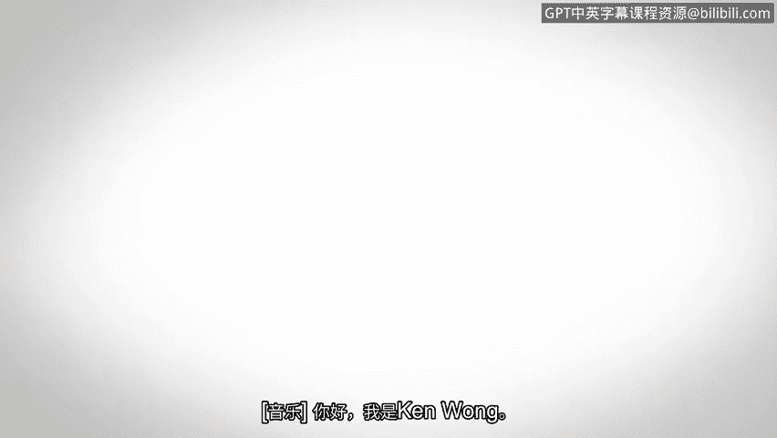
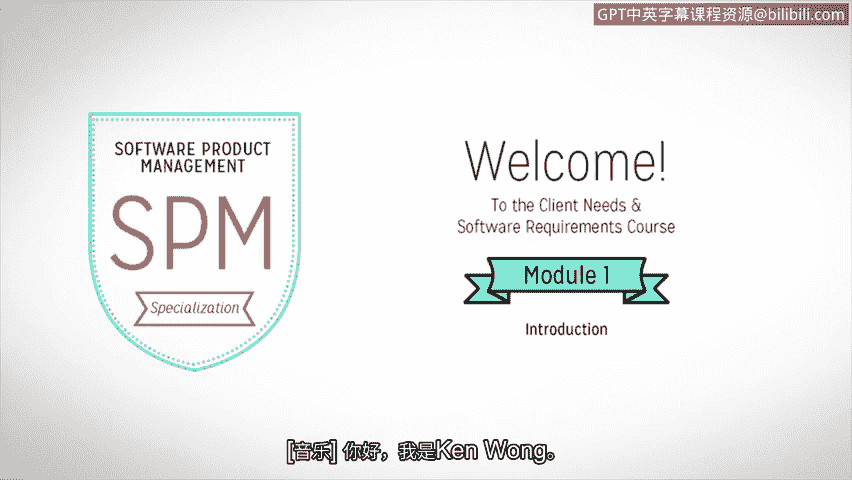

# 艾伯塔大学软件产品管理课程3：《客户需求与软件需求》｜client-needs-and-software-requirements｜ - P2：1_客户需求和软件需求简介

🎯 **课程概述**

在本节课中，我们将要学习《客户需求与软件需求》课程的核心内容与结构。课程将介绍如何识别客户与用户的需求，并将其转化为清晰的软件需求，从而指导开发团队构建正确的产品。

---

**课程内容预览**

大家好，我是 Ken Wang，欢迎来到软件项目管理专项课程中的《客户需求与软件需求》课程。

本课程将为整个专项课程提供基础要素，并作为描绘专项课程结构的知识支柱之一。

在介绍性课程中，我曾提到，打造更好的软件涉及三个目标。这些目标是：**正确的产品**、**正确地完成**以及**正确地管理**。

为了识别正确的产品，你必须理解你的客户和用户的需求，而不仅仅是他们口头提出的要求。他们需要解决什么问题？他们需要完成哪些任务？谁将使用该软件？用户将如何与之交互？当你能够回答这些问题时，你就能帮助你的开发团队构建正确的产品。

为了实现“正确地完成”和“正确地管理”，软件开发必须从一套清晰的软件需求开始，这些需求随后将被规划、设计、实现和测试。

在本课程中，你将学习如何从客户和用户那里收集需求。你还将学习如何将这些需求表达为一套需求规格，以启动软件开发和规划活动。

---

**模块一：需求基础与变更管理**

在第一个模块中，Bradley Pette 将概述几种类型的健康需求。他将解释如何处理需求变更，以及避免范围蔓延的方法。该模块还将探讨需求与设计之间模糊边界的问题。

---

**模块二：需求获取与可视化设计**

在第二个模块中，Morgan Ptzel 将描述为人们制作产品时遇到的问题，并介绍获取他们需求的有效方法。她还将解释如何应用用例来捕获项目需要支持的任务。

接着，你将获得一个概览，了解如何应用两种可视化设计技术——线框图和故事板。这两种技术在关于产品的早期讨论中非常有用。

---

**模块三：敏捷需求技术**

在第三个模块中，Bradley 将回来讨论敏捷需求技术。具体来说，他将描述如何用**用户故事**来表达需求，用**验收测试**来验证需求，用**项目待办事项列表**来排定需求优先级，以及用**故事地图**来组织需求。

---

**模块四：有效需求的特性**

在第四个也是最后一个模块中，Morgan 将回来概述有效的软件需求和用户故事需要具备的几个标准。同时，她将指出需要警惕的模糊性迹象，以确保需求不会被误解。

---

**课程总结**

在本节课中，我们一起预览了《客户需求与软件需求》课程的全貌。到本课程结束时，你将掌握一套实用的技术，用于收集客户和用户的需求，并出色地表达这些需求。你将能够应用这些技术来构建一个更好的软件产品——即正确的产品。