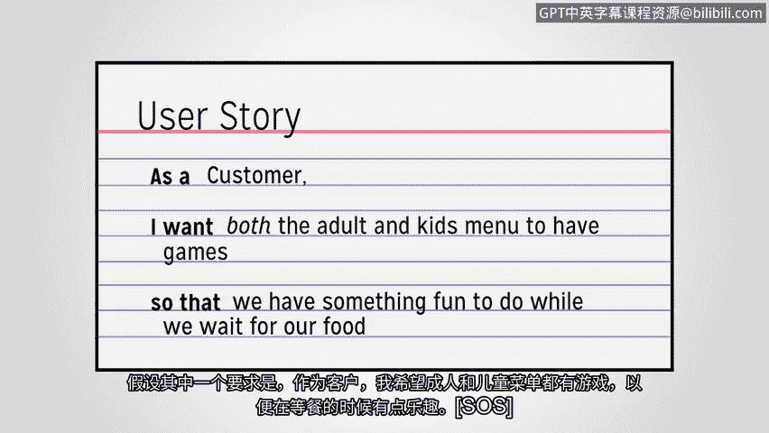

# 艾伯塔大学软件产品管理课程3：《客户需求与软件需求》｜client-needs-and-software-requirements｜ - P30：29_第3.4.1a节 用户故事标准.zh - GPT中英字幕课程资源 - BV1K94y1h7Tp

🎼。😊。

Next， we want user stories to be complete。This means that all the requirements that are necessary to describe the problem are included。

Since your development team will be developing a solution from the user stories in the product backlog。

 if there are requirements missing， then those features won't get made。

Tools like story mapps are useful for determining if user stories are missing。Next。

 let's go over how to make user stories clear。This means that the user stories are easy to understand and exact with only a single interpretation。

This criterion is asking a lot。It's really eye opening when you review user stories for ambiguities。

 You realize how many different ways a single sentence can be interpreted。

Hopefully you can see the dangers of having a user story that can be interpreted in many different ways。

What if the client interprets it one way， the programmer another way and the tester。

 yet a different way。It's hard to tell who is necessarily correct and what actually should be developed。

An important practice that can help to reduce ambiguities is conducting a requirements technical review and repair exercise。

What happens in this exercise is others preferably outsiders to the project review the requirements for all the criteria in this lesson。

A part of that would be reviewing for requirements for ambiguity。

We are going to go over how to write user stories without ambiguities in the next lesson。

 but let's look at an example here。Let's say one of the requirements was， as a customer。

 I want both the adult and kids menus to have games so that we have something fun to do while we wait for our food。

The word both causes ambiguity in this user story。This user story could mean that the kids's menu has kids games and the adult menu has adult games。

 but it could also be interpreted that the kidss menu and the adult menu have the same games。

Another approach to be more clear rather than just depending on natural language descriptions。

 is to supplement your requirements with visual descriptions such as wire frames and storyboards。

We will expand on how to recognize and fix ambiguous requirements later in this module。

Let's now talk about consistent user stories。Having consistent user stories means that the requirements don't conflict with one another。

This will obviously cause some issues later when development is occurring。

Your client and development team have completed a list of user stories。

 and they want you to review them before the next discussion meeting。In this pass。

 you are making sure that the user stories are consistent。

Which of these user stories conflict with each other？

Select the two user stories that are not consistent with each other。A， as a child customer。

 I want to order my own meal so that I get my desired meal。B， as a customer。

 I want to view the order once it's been placed so that I can assure we ordered correctly。See。

 as a kitchen staff， I want to view received orders so that I can know what dishes to prepare。

And or D， as a customer， I want to be able to order for my family so that I can monitor what they eat。

Answers A and D are not consistent。 Since in answer A。

 the child customer has the freedom to order their meal， and indeed， they do not。

All the other combinations are consistent with each other。 Therefore。

 answers A and D are the correct answers。 Next， let's talk about feasible user stories。

This means that each requirement can be implemented with the technology， tools， resources。

 and personnel that are available within the specified cost and schedule constraints。

If unrealistic user stories is something that you encounter often， I admire your ambition。

 but this is a risky criteria to not meet。You need to look honestly at your resources and team。

 as well as your schedule and budget。Can you realistically complete all the requirements you've promised？

Not meeting this criteria will result in additional costs and an unsatisfied client。Personally。

 those are two things that I like to avoid。The last criteria we want to meet is that user stories are traceable。

This means that each requirement is connected to associated design and implementation artifacts in some trackable way。

In simpler terms， for each requirement， there are corresponding code and tests for it。Also。

 each piece of source code corresponds to some requirement。

 and there are tests for each piece of source code。

Having your user stories traceable means that only necessary code is being written and that all your requirements are tested。

 Both are great qualities you want in your development。

You can have a unique identifier on each requirement to help developers refer to it within the code。

 tests， bugg reports， and change logs。Now you know the criteria that user stories should meet。

In the last module， you learned that user stories should meet the invest criteria。That is。

 they should be independent， negotiable， valuable，estimable， small and testable。In this lesson。

 you learned that user stories should also be correct， complete， clear， consistent。

 feasible and traceable。Improving your user stories to satisfy these criteria will prevent mistakes or unnecessary work in your project。

 and high quality user stories lead to high quality products。

