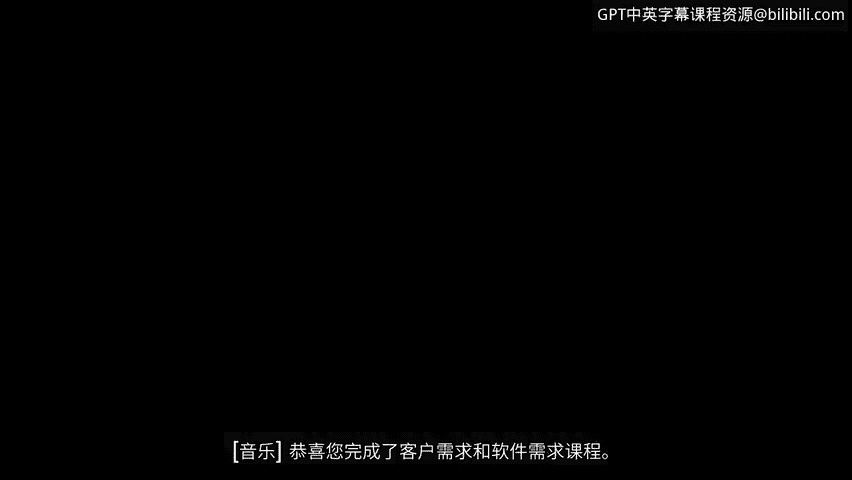
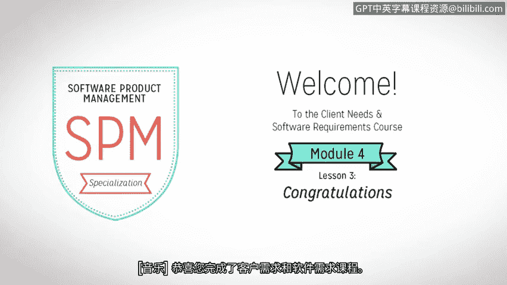
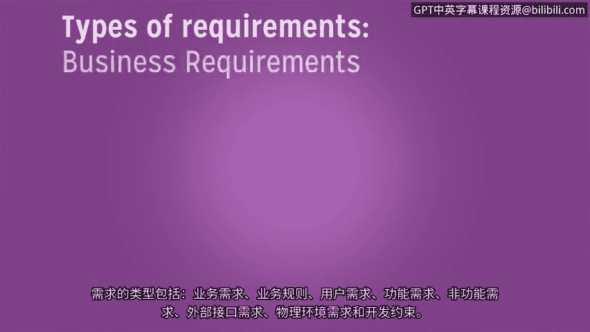
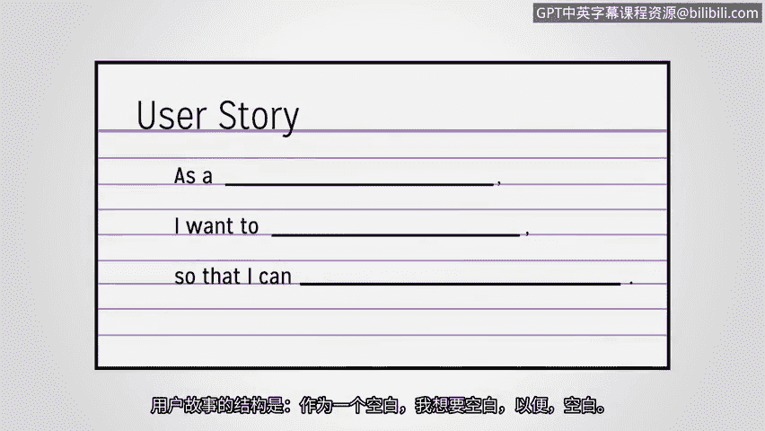

# 艾伯塔大学软件产品管理课程3：《客户需求与软件需求》：3.4.3：课程总结 🎯

在本节课中，我们将对《客户需求与软件需求》课程的全部内容进行回顾与总结。

恭喜你完成了关于客户需求与软件需求的课程。

如果你也学习了我们的《软件过程与敏捷实践》课程，那么你现在已经完成了我们在导论课程中提到的“INiP”结构中的两条“腿”。你已经拥有了一个可以继续构建知识的良好基础。

接下来，我们将为“INoKSH”结构添加的“身体”部分，这代表了《软件产品的敏捷规划》课程。如果你尚未学习《软件过程与敏捷实践》课程，你需要在继续前进之前完成那部分学习旅程。

现在，让我们花些时间来回顾一下本课程所涵盖的内容。

## 课程内容回顾

在本课程中，Bradley 在第一个模块首先介绍了需求的定义。他将需求定义为**对客户需求的特定描述**。你还学习了五个需求活动，分别是：**需求获取、需求表达、需求优先级排序、需求分析以及需求管理**。

Bradley 还在第一个模块中带你了解了不同类型的需求。这些类型包括：**业务需求、业务规则、用户需求、功能需求、非功能性需求、外部接口需求、物理环境需求以及开发者约束**。

接下来，你学习了软件开发中涉及范围变更的问题，以及**需求与设计之间的区别**。

在模块2中，我们回顾了不同类型的用户。以下是主要的用户类型：

*   **主要用户**：直接与产品交互的用户。
*   **次要用户**：偶尔使用产品或通过中介与产品交互的用户。
*   **三级用户**：受产品使用影响或对产品做出决策的人。

我们还讨论了用户可能遇到的约束或限制，以及如何设计产品以适应这些限制。

接着，我们探讨了如何在需求获取活动中让用户和客户参与进来。我们研究了应该向客户提出的好问题以及应避免的问题，并为你下一次客户会议做好了准备。

然后，我们介绍了在需求表达活动中表达需求的三种不同方式。这些方法是：**用例、线框图和故事板**。

随后，你进入了模块3。在这个模块中，Bradley 向你展示了更多表达需求的方法，以及它们如何融入敏捷开发。之后，Bradley 向你介绍了**用户故事**。你将在敏捷开发中频繁使用用户故事。

一个用户故事的结构如下：**作为一个 `<角色>`，我想要 `<功能>`，以便于 `<价值>`**。用户故事是一种简洁地展示“谁”、“什么”和“为什么”的便捷方式。

Bradley 还向你展示了**产品待办事项列表**，以及如何使用**故事地图**来对已获取和表达的用户故事进行优先级排序和组织。

在最后一个模块中，我们探讨了要使你的需求和用户故事被视为高质量所应满足的标准。我们还回顾了需求中常见的模糊语言，并向你展示了识别和澄清这些模糊语言的方法。

## 总结与展望

至此，本课程的内容已全部结束。

如果你也完成了《软件过程与敏捷实践》课程，那么你现在已经准备好进入《软件产品的敏捷规划》课程了。在那门课程中，你将学习许多用于规划软件产品的敏捷实践。这些技术在今天行业中普遍使用。

你将体验的一些实践将侧重于**估算、故事点和速度**。你还将学习如何创建**发布计划和迭代计划**，这有助于组织需求和开发任务。最后，你将有机会研究**风险计划**。我们已在本专项课程中多次提到风险管理，在下一门课程中，你将学习并应用一些风险管理技术。

我们期待在《软件产品的敏捷规划》课程中与你相见。