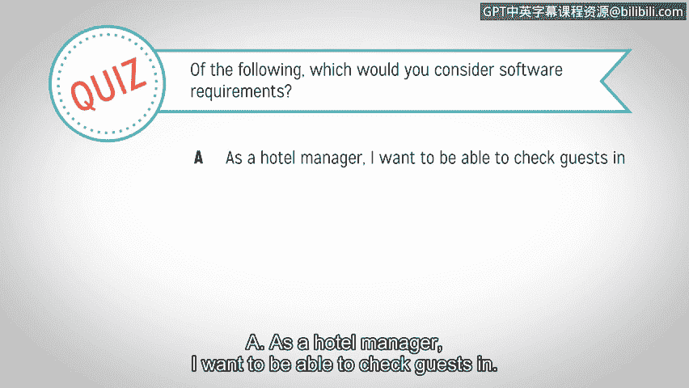

# 软件产品管理课程3：《客户需求与软件需求》：1：什么是需求？

欢迎来到《客户需求与软件需求》课程。

本课程是Coursera软件产品管理专项课程的一部分。在本课程中，我们将探讨软件产品管理中最关键的方面之一：需求。如果你是第一次加入我们，我是Bradley，我将作为你本课程的向导。我曾在许多软件项目中担任项目经理，并在阿尔伯塔大学学习了该领域广泛的技术。

在介绍课程中，我们提到了需求为何重要。它们帮助我们清晰地定义客户需求，在错误变得代价高昂之前及早发现它们，并最终确保你开发的产品满足客户的需求。

在本节课中，我将为你全面概述什么是需求，以及处理需求所涉及的活动。

如今，终端用户的要求越来越高，产品也变得越来越复杂。为了确保你得到正确的产品，并且产品被正确地完成，你需要确保从良好的需求开始。

存在多种定义，有些是技术性的，有些则不是。电气与电子工程师学会（IEEE）对需求有其详细的定义。你可以在我们的课程笔记中找到该定义。然而，该定义并不十分简洁。

因此，在本课程及本专项课程中，需求的定义是：**需求是对客户需求的具体描述**。

正如你将在本节课和本课程中看到的，需求可以采取多种形式。它们可以被很好地完成，也可能不尽如人意。事实上，你的需求定义和提炼的好坏，会极大地影响你成功的可能性。

正确获取需求始于了解发现它们的适当活动，以及编写良好需求的适当形式。在本课程结束时，你不仅将知道如何执行制定良好需求所需的活动，还将知道如何识别一个需求何时可以改进。

既然你已经了解了什么是需求，让我们看看你能否找出一些例子。

在以下选项中，你认为哪些是软件需求？
A. 作为酒店经理，我希望能够为客人办理入住。

B. 我需要让你签署一份合同。
C. 账户持有人将通过数字键盘输入其银行密码。
D. 用户是男性。

答案A和C是正确答案。它们都描述了客户需要实现的具体功能。其他两个则根本不是需求。

你如何确保你的需求做得好？实践需求活动是一个很好的起点。请记住，活动与软件开发的各个阶段相关联。我们将在本节课中讨论的活动，是与**规格说明阶段**相关的活动。这通常是流程中最早的阶段，因为在这个阶段，你需要定义你的产品将做什么以及如何做。

此阶段的五个重要活动是：**需求获取、需求表达、需求优先级排序、需求分析和需求管理**。

让我们首先谈谈需求获取。本质上，获取就是从客户那里获得需求的行为。然而，不要将此误认为是需求收集。**收集**和**获取**之间存在关键区别。这个区别在于你作为软件产品经理如何与客户互动。

“收集”一词通常用于描述向客户索要他们希望完成的事项列表的行为。而“获取”则是一个涉及更多、更具互动性和调查性的过程，能带来指数级更好的需求。更好的需求带来更好的软件。因此，花时间确保你正确完成这一点总是个好主意。

需求获取具体涉及什么？为了理解这一点，让我们看一个需求收集的例子。

想象一下，你是一名软件产品经理，被要求为客户构建一个系统。在第一次会议上，你问：“那么你想要什么？”他们准备充分，递给你一张纸，上面列出了他们希望在产品中看到的所有功能，并配有图片，详细说明了他们期望的界面外观。然后会发生什么？一个未经训练的软件产品经理及其开发团队可能会拿着这份列表，开始规划客户指定的确切产品。毕竟，你被雇来编程实现客户想要的东西，对吗？从技术上讲，是的。

然而，在大多数情况下，你的客户对软件如何构建或他们的产品成功所需的功能知之甚少。他们通常会向你提供一份他们希望产品包含的功能列表，但缺乏技术知识来了解他们真正需要什么。

接下来，让我们从行业角度看看“想要”和“需要”之间的区别。

🎼。😊，🎼嘟嘟嘟嘟嘟。

根据我自己的职业生涯经验，我发现询问客户他们想要什么会得到一个答案，而在他们自己的原生环境中观察他们往往会得到一个非常不同的答案，并且常常会显示出意想不到的情况。因此，我认为，找出他们真正需要的方法，是尽可能在接近客户原生环境的地方观察他们。

🎼正确的产品与正确的问题紧密相连。一个做得正确的产品可能确实做得正确，但它不一定解决了正确的问题。这就是区别。而你为确保拥有正确产品所花费的每一刻都是值得的。如果你的产品是正确的，即使它有一些缺陷，人们也会采用它。客户会原谅你，他们知道随着时间的推移你会修复缺陷。但是，如果你的产品是错误的，即使你以零缺陷构建了它，你也浪费了所有的努力，人们仍然不会采用你的产品。这就是一个正确的产品与一个仅仅为了做得正确而做得正确的产品之间的区别。

---

上一节我们介绍了需求的基本概念和重要性，本节中我们来看看如何确保需求做得好，以及“想要”与“需要”的根本区别。关键在于通过深入的互动和调查（即“获取”而非简单的“收集”）来理解客户的真实需求，并确保产品解决的是正确的问题，而不仅仅是正确地构建一个可能错误的产品。