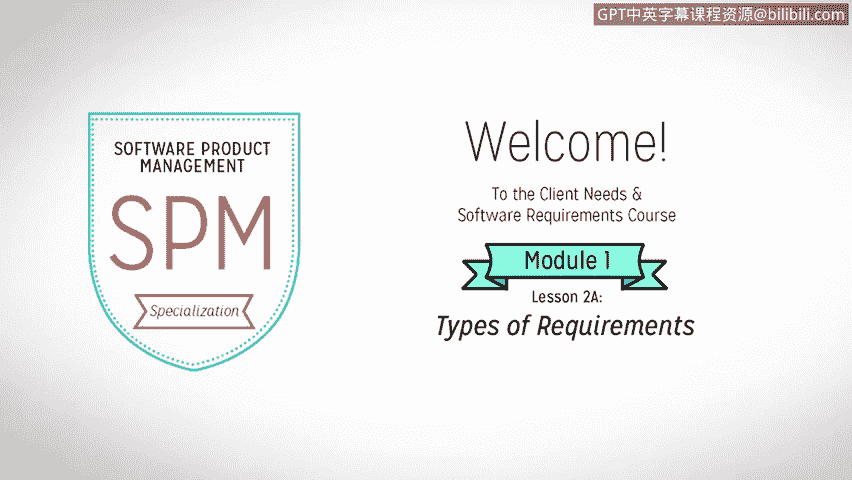
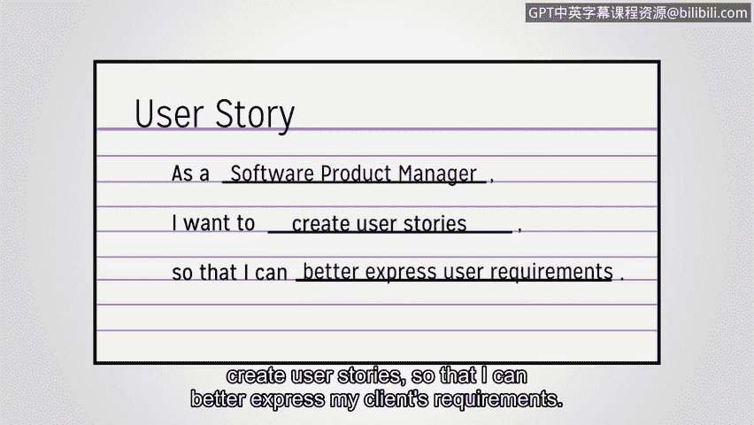
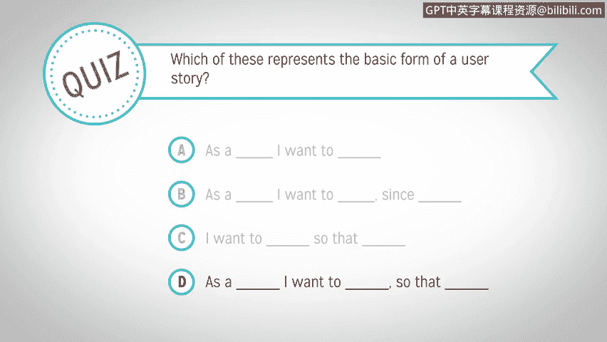

# 艾伯塔大学软件产品管理课程3：《客户需求与软件需求》｜client-needs-and-software-requirements｜ - P38：5_02_3-1-2a-user-requirements.en_subtitled - GPT中英字幕课程资源 - BV1K94y1h7Tp

🎼。😊。

The last two requirements， business requirements and business rules。

Have been focused on the product as a whole。Why does it need to exist in the first place and what rules do we need to follow when we build it？

It's useful for you to know these terms since they're bound to come up in your career。

Even if the product manager doesn't have any direct influence on their creation。

There are still multiple requirements types， which we will discuss that are directly influenced by product managers and their development teams。

Let's introduce the first one。The user requirement。

User requirements outline exactly what tasks the users can do with the product。

Users are those individuals who will end up using your software。

They're often called end users for that reason。Since end users are so critical to a product's success。

 a great deal of time is usually spent developing these requirements。😊，In fact。

 user requirements may very well be the most important requirements for a development team to get right。

Since these requirements define how the end user is to engage with the product。

They define what the product should do for the user。

These can be thought of as the core functionality of the product being developed。

Later in this course， we'll spend some time going over how we can properly elicit user requirements and develop them into specific。

 actionable developer tasks。We'll also talk about how to create good user requirements。

 as well as some different ways in which we can express them。

So user requirements are the tasks that users can do with your product。

These can be expressed in the form of use cases， like the one you see here。

Use cases are a good way to show the relationship between the system and the user。

We'll cover them more in the next module。😡，Notice， though， that in this use case。

 we're specifically showing the different user stories and the ways in which they can interact with the system。

User requirements can also be expressed in the form of a user story， like the one you see here。

We'll cover user stories in more depth later in this course。

But the general structure of the user story is as a blank， I want to blank， so that blank。

This allows us to word our requirements in such a way that we make sure we're thinking about the user needs first。

An example might be， as a software product manager。

 I want to create user stories so that I can better express my client' requirements。

Typically， though， client requirements come in this form。

 customers should be able to view and pay their bill within the system。I think that's it。

We're often given requirements in vagueG nonspec terms。This isn't the client's fault， of course。

But it is a common obstacle which the software product manager must address in order to ensure their development team knows how best to build the product。

For me， this is one of the most rewarding aspects of software product management。

Being able to refine your clients's needs into something tangible and real often comes with a sense of satisfaction and organization。

Like everything's in its right place。Which of these represents the basic form of a user story？

A as a blank， I want to blank。B， as a blank， I want to blank since blank。See， I want to blank。

 so that blank。Or D， as a blank， I want to blank。 So that blank。The correct answer is D as a blank。

 I want to blank， so that blank。They follow this form so that we can make sure we capture the who。

 what， and why of the requirement。

