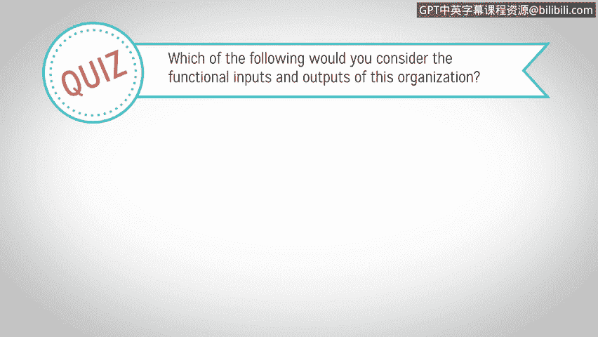

# 艾伯塔大学软件产品管理课程3：《客户需求与软件需求》｜client-needs-and-software-requirements｜ - P39：6_03_3-1-2b-functional-requirements.en_subtitled - GPT中英字幕课程资源 - BV1K94y1h7Tp

Another requirement type， which falls under the scope of the development team。

 is a functional requirement。

A functional requirement is a behavior that the product should do or support。

They can be expressed with inputs and outputs and a description of the behavior itself。

Imagine a client approaches you with a proposed project。They want a mobile point of sale product。

 which takes credit card payments through the client's proprietary credit card reader。

It then sends a receipt back to the user with the transaction details。

The client also mentions that this product should meet the highest standards of security as well as visual design。

Remember， functional requirements involve inputs and outputs。So in this simple example。

 we have one input， the data from the credit card reader， and one output。

 the receipt from the transaction。So you could say the system must read data from the credit card reader。

 and the system must also send a transaction receipt to the end user。

Keep in mind that to keep things simple， we've removed quite a few functional requirements。

One might imagine that the system should take as input。

 the transaction information from the merchant。Then upon some confirmation action。

 the system should present the buyer with information about the transaction and ultimately take their pin information。

You could think of quite a few functional requirements in the scope of this example。

Requirements can also have a certain depth to them。A functional requirement。

 which states that a user should be able to pay using a pinpad is not specific。

This could be broken into a few deeper， more specific requirements。

 like a user should be able to swipe a debit or credit card。

A user will be able to insert a credit card or debit card into a chipread。

And a user will be able to enter their pin when their card has been swiped or inserted。

If you don't get specific enough， this could lead to problems in your planning。

You might think that you have very little work to do when really you actually have quite a bit。

This is something into which I'll dive more in detail later in this course。

 Just be aware that requirements have depth。One way to represent functional requirements is by using an information flow diagram。

Like you see here。Information flow diagrams give you a graphical way of displaying the data flow and dependencies of all the system components。

Basically， this is just how individual components of the system are stitchs together。

This gives you an idea of how the system functions as a whole。

An information flow diagram provides the context in which you can review the whole thing logically。

If you would like to learn more about information flow diagrams， check out the course resources。

Imagine a scenario in which you're building a not for profit organization that rebuilds bicycles for low income commuters in your neighborhood。

You receive bicycles from donors， which are made of aluminum， as well as money to buy tools。

You then use these things to make the bikes work again and deliver them to your customers。

Which of the following would be considered the functional inputs and outputs of this organization？

A input， donated bicycles and purchase tools， output customers。B， input， donated money， output。

 working bicycles。C， input， donated money and bicycles。

Output working bicycles or D input aluminum from the bicycles and donated money。

 output working bicycles。The answer here is C。 The organization receives money and bicycles。

 which it then repairs and delivers to customers。The inputs are donated bicycles and money because the tools are purchased using the money donated。

These tools are then part of the process， which is used to fix the bicycles。

