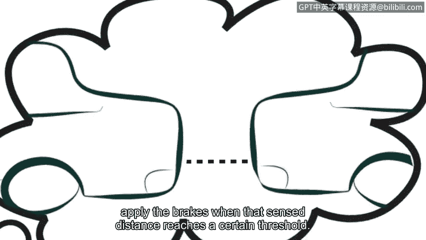
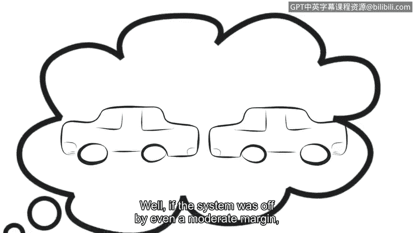
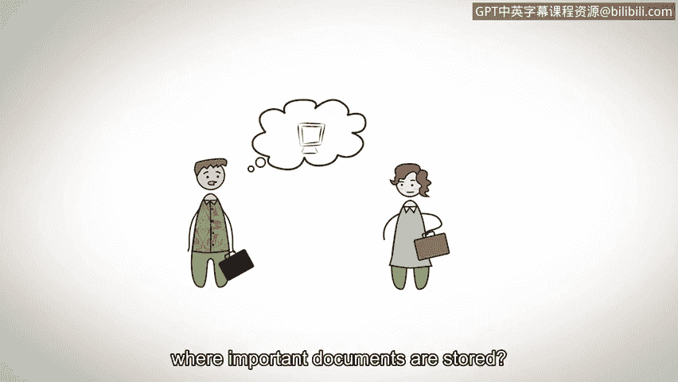
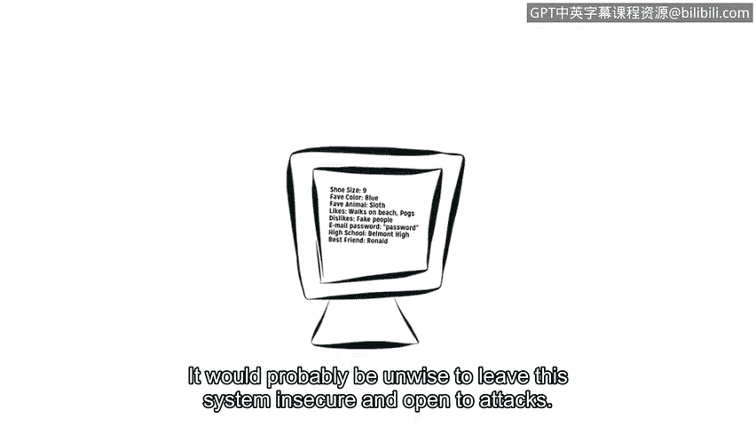
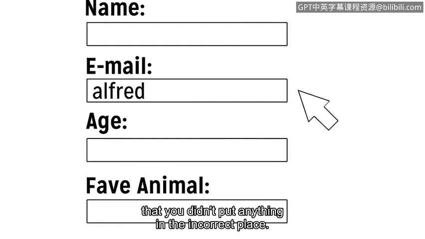
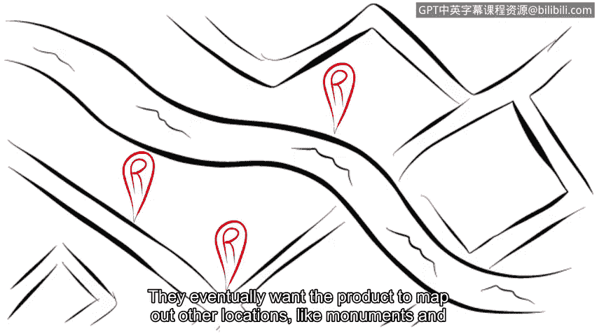
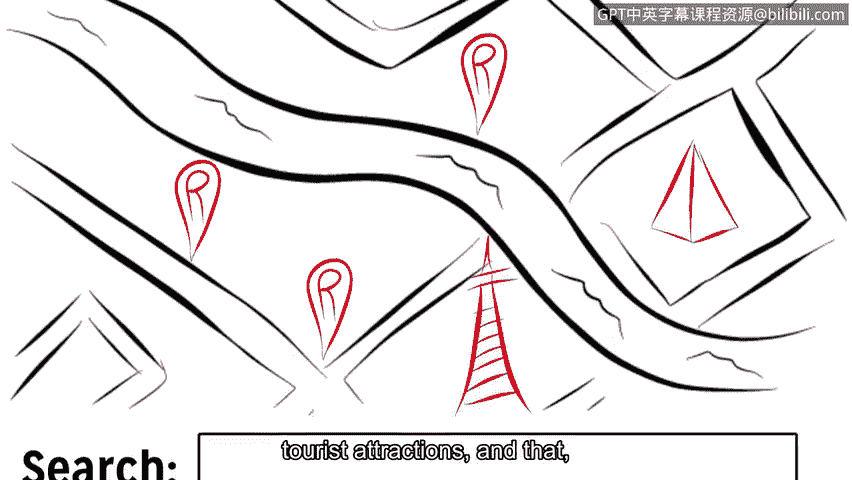
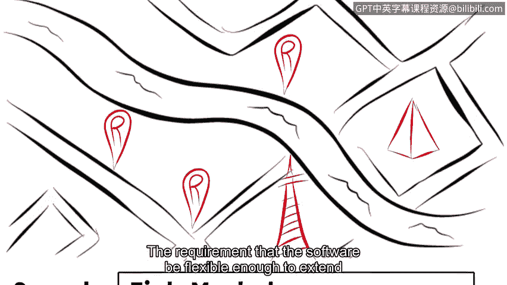
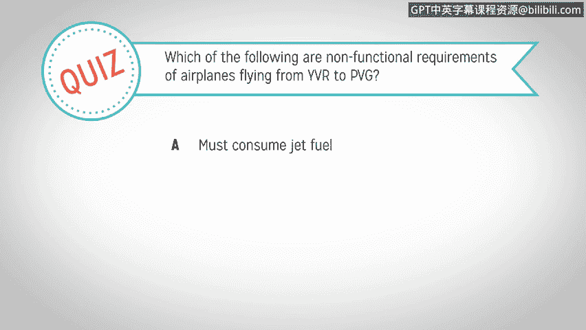

# 艾伯塔大学软件产品管理课程3：《客户需求与软件需求》｜client-needs-and-software-requirements｜ - P40：7_04_3-1-2c-non-functional-requirements.en_subtitled - GPT中英字幕课程资源 - BV1K94y1h7Tp

So we covered functional requirements。We gave an example of what a functional requirement is by giving an example of a mobile point of sale system。

Recall that we outline the requirements given to you by the client。Let's review those details。

The system should take credit card payments through the client's proprietary credit card reader and then send a receipt back to the user with the transaction details。

The client also mentions that this product should meet the highest standards of security as well as visual design。

That last part， the bit about the product meeting the highest standards of security。

 as well as visual design， are what we call non functional requirements。

Non functional requirements serve as a description of how well a product must perform。

You can think of non functional requirements as being complementary to functional requirements。

If functional requirements are what a product should do。

 non functional requirements are how well a product should do them。

Non functional requirements really address the quality factor of the product。In fact。

 they're sometimes even called quality requirements for this very reason。

Let's look at some examples of non functional requirements。

Say a client approaches you wanting to build a driver assistance system。

The system senses the distance between the vehicle ahead of the user's vehicle and applies the brakes if the user's vehicle is too close to the other vehicle。

One of the non functional requirements for this system would be the accuracy of the system sensors。

It would not be enough to say that the system should read a distance and apply the brakes when that sense distance reaches a certain threshold。

Why。😮，Well， if the system was off by even a moderate margin， the results could be catastrophic。

So we say that accuracy and safety requirements are non functional requirements。

How about a system in which the client would like to create a database where important documents are stored？

This system would need to be able to recover from disaster to avoid data loss。

Dependability requirements like this are non functional requirements。

What if this database stored sensitive documents with personal information of its users？

It would probably be unwise to leave this system insecure and open to attacks。

In this case， you would want to establish strong encryption on the information。

 as well as make the entire system difficult to break into。

These security requirements are non functional requirements。

How about something as simple as an email signup form on a website？

You may have seen such forms where the validity of the user's email is checked to minimize the risk that typos were made。

Without this error checking， many emails could potentially not make it to their intended recipients。

Was it easy to navigate the signup form and figure out where everything needed to go？

I'm sure it had labels for where your name should go so that you didn't put anything in the incorrect place。

These two requirements， error prevention and ease of use or learnability， are， of course。

 non functional requirements。They're also known as usability requirements。Okay。

So now what about a case where a client approaches you with an underwater research device。

 which runs on battery power？It must be small and light enough to store in a small boat。

 but efficient enough to provide sufficient battery life for at least a few hours underwater。

All of its instruments must be able to carry out their functions in real time without delay。

And its battery should charge quickly。All of these requirements， space， power， time。

 and resources are efficiency focused non functional requirements。

What about performance requirements？Those are nonfunction requirements， too。

Performance requirement examples include。A system needing to maintain a certain response time or handling a certain number of responses in a short period of time。

Finally， imagine you're approached by a client who wants a piece of software which queries a database of local restaurants and places them onto a map for easy navigation。

The client mentions that they also envision extending this software for another product。

They eventually want the product to map out other locations like monuments and tourist attractions。

 and that when a location is entered， it should appear on the map。

The requirement that the software be flexible enough to extend beyond the original purpose is a maintainability requirement。

You guessed it， that's a nonfunction requirement too。

So non functional requirements clearly make up a large part of software planning as well。

Let's review the types of nonfunction requirements we mentioned quickly。Accuracy， dependability。

Security。Usesability。Efficiency。Performance。And maintainability。

Airplanes fly from the Vancouver International Airport or YVR in Canada to the Shanghai Pudong International Airport or PVG in China daily。

These airplanes have schedules to which they must adhere。

 and their range is limited by the amount of fuel that they can carry。

Which of the following are non functional requirements of airplanes flying from YVR to PBG？

A must consume jet fuel。

B， flight schedule must not be delayed。C must be able to travel between YVR and PVG on a single tank of fuel。

And or D， a full load of passengers can be evacuated in no more than 90 seconds。

C and D are the correct answers。There are performance and usability nonfunctional requirements。

 respectively。The other two answers are not non functional requirements。

A concerns the input of an airplane， and B concerns the schedule of the flight。

 not anything to do with the airplane itself。