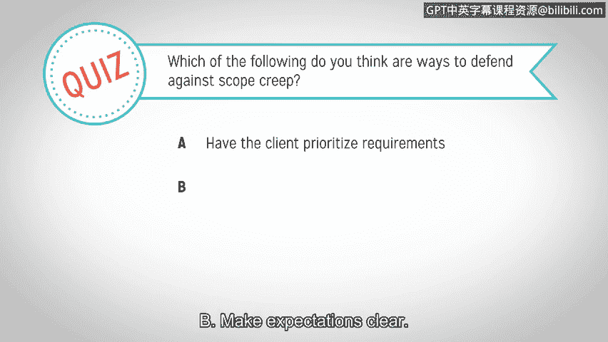
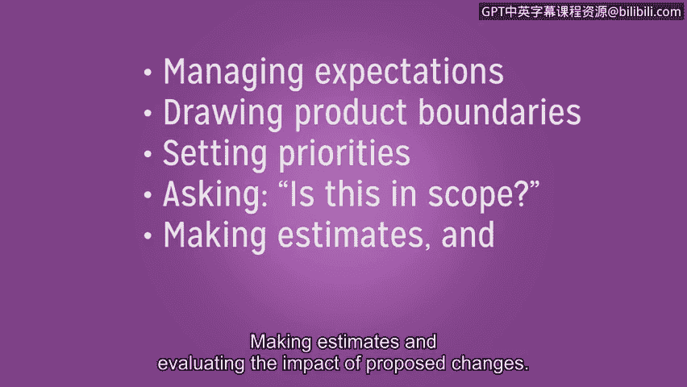

# 艾伯塔大学软件产品管理课程3：《客户需求与软件需求》｜client-needs-and-software-requirements｜ - P42：9_01_3-1-3-controlling-scope.en_subtitled - GPT中英字幕课程资源 - BV1K94y1h7Tp

🎼。😊，Welcome back。Last time we talked about all the different types of requirements。

 along with an example of each。Now that we know all about the different types of requirements。

 we're going to talk about some of the challenges associated with forming and maintaining a set of requirements。

It's important to take time and be cautious when defining the requirements。That said。

 it's also important to know that we can't expect them to stay stable throughout the development process。

It is certain that requirements will change。When we accept that they will change。

 we can better respond to these changes when they happen。According to Robert Glass。

 a well known expert in software engineering， one of the two most common reasons that software projects get out of hand is unstable requirements。

Many project managers find themselves in this situation where the development team begins work on a specific set of requirements。

 when partway through the project， the client changes their mind on one thing or another。

All of a sudden， the development team has to change their priorities midstream。

What do you do in this common， and I mean common situation？

If the development team changes their direction every time a client makes a change。

 the project can quickly spin out of control。This creates a massive backlog of developer tasks and degrades the product quality。

Not only that， your developer's morale can go down the drain too。However。

 if the product team sticks with the original plan and makes no adjustments。

 the end product is not likely to satisfy the client's needs。

That would be a waste of development team's time and the client's money。

There is a balance to be found between these two extremes and will help you find it。

Let's start at the beginning when the idea for the product is first conceived。

What is the purpose of the product to begin with？What problem does the client want to solve？

This is the product vision。Carl Wiys， an author and consultant in the field of software engineering。

 describes product vision as the long term strategic concept of the ultimate purpose and form of a new system。

Basically， product vision is what outlines the product's value to the client and its place among competitors in the market。

What does vision have to do with your product？Think of product vision as the guiding principle for the product。

No matter what changes with the product， the product's design should still support its vision。

However， that doesn't mean that the product's vision is always something that's realistically achievable。

Let me explain with an example。Imagine you've being approached by a client with a project for a mobile game。

Based on the requirements， you and your development team estimated that it will take you three months。

The vision you are given for the product is that it will create a uniquely immersive gaming experience by simulating project management from the perspective of a project manager。

Now， imagine you are a month into development and everything is going well when your client approaches you。

They tell you that because of recent improvements made in virtual reality。

 they want to begin developing for virtual reality platforms。Technically。

 switching platforms would allow you to follow the original vision of the product。

 just as you would have before。However， this switch would mean a significant shift in the product and developer resources and therefore not be realistically achievable。

We would call this type of shift， which the client is asking for a change in scope。

In the previous scenario， the client changed scope by suggesting that you switch platforms。

Which of the following would constitute a change in vision。A。

 the client chooses to switch to mobile gaming instead of virtual reality。B。

 your development team decides to change some product implementation details。C。

 your project runs over budget and is forced to be put on hold。Or D。

 your client decides that the product will no longer be a mobile game about project management。

Instead， choosing to create an app that allows clients to design custom furniture。The answer is D。

 When your client chooses to create a product with a completely different guiding principle。

 they are changing the vision。By choosing to make an app for designing furniture。

 instead of a game about project management， the vision for the product has changed。

Scope and vision are interrelated。While vision encompasses what the product will eventually do to satisfy a user's need。

The scope encompasses what can realistically be achieved within the current project。

While the client's overall purpose of the product has not changed。

 what is being asked of the developers has changed。

So it is scope that affects development teams and their product managers the most。Therefore。

 scope is one of the most important things to consider when we think about a software product。

Let's quote Carl Wis， again。The scope draws the boundary between what's in and what's out for the project。

😡，Okay， simple enough。Scope tells you what you will and won't do。

But how do you decide what that means for a specific project and how do we make sure we stay within it？

The best place to start is during the requirements elicitation phase of your project。😡。

Discuss with your client what to expect from the product。

If you avoid over promising on the features of your product。

 you can avoid disappointments down the line for both the clients and the development team。

Think about it。You tell your client what you can develop。

And that you can develop it within three months。But then halfway through。

 you realize that there is no way you can deliver that product。

What do you think your client would say， given their expectation that you'd be able to deliver a full product？

If you want to maintain happy clients， that's not the way to do it。😡。

It's far better to manage expectations with your clients early so that you can avoid situations that result in disappointment。

One way to do this is to identify the capabilities which a user might expect from your product。

But that you will not include in the current project。For example。

Say you're creating a website for a music band。Users of the website might expect to be able to message other fans and purchase concert tickets。

However， if you think that these things will be too much for your team to implement in the amount of time given before your deadline。

That it is perfectly acceptable to say so to your client。In this way。

 you can manage expectations and help ensure that nobody comes away from the project disappointed。

Managing expectations sounds fine， but how exactly do we do this？

Let's talk about some techniques to defend against scope creep。And scopecope creep， by the way。

 is what happens when the product's requirements build up。

Unmanaged scopepe creep can make the likelihood of project success significantly lower over time。

Before we cover the different ways we can defend against Spe creep。

 which of the following do you think are ways to defend against Spe creep？A。

 have the client prioritize requirements？B， make expectations clear。

C。Draw the scope with your client。And or D ask， is this in scope？Actually。

 all of these answers are correct。All of these techniques are effective。

 especially when used in combination with each other。

The first technique to defend against SpeCre is to make expectations clear between the customer and yourself。

That is， make sure everything has a clear start and end date and try to stick to it as much as possible。

Second， draw the scope with your client。Employ a use case diagram to show the expected interactions between different user roles and the tasks supported by the product and design around that。

Third， ensure that the client prioritizes the requirements。

When the client specifies which requirements are the highest value？

It is easy to ensure that the most important parts of the product are developed early。This way。

 should time or funding for the project be reduced， you'll still have satisfied the key requirements。

When forming the requirements， ask the question， is this in scope？

It's easy to overlook the time wasted on refining unnecessary requirements。

If you force yourself to ask about the relevance of each of the requirements。

 you can determine what's in the current project， as well as note capabilities for future releases。

When developing requirements， it's also important to estimate the amount of effort required to fulfill each requirement。

This becomes easier as you and your developers become more experienced with building products。

Over time， you can discover the average productivity of your team and base your estimates off that。

When you estimate the amount of effort involved in completing a product's requirements。

 you can then sum up the estimates and see if you can meet your deadline。

This helps you to decide whether a requirement is realistically doable or not。

When it change is proposed for the product。Spend time to evaluate the implications of that change。

How will it affect your personnel resources？Funding。😊，Product quality， schedule。

Likelihood of success。All of these will play a factor when considering a change。Of course。

 when a change is accepted。You should revise your estimates and plans to reflect the change。

Understanding this， it would be easy to go overboard and reject all proposed changes for simplicity's sake。

Changes are usually introduced to increase the project's business success。

Evaluating each change individually and making decisions on a case by case basis will give you the freedom to expand your product while also maximizing the chances of its success。

It's also a core principle of the Agile manifesto。Let's recap what we learned in this lesson。First。

 we define what vision is and how it relates to software projects。

Then we define what scope is and how it can get out of hand。

Then we talked about techniques for avoiding scope creep by。Managing expectations。

Drawing product boundaries。Setting priorities。Asking， is this in scope？Making estimates。

And evaluating the impact of proposed changes。In the next lesson。

 we will discuss requirements in design。I'll see you there。

