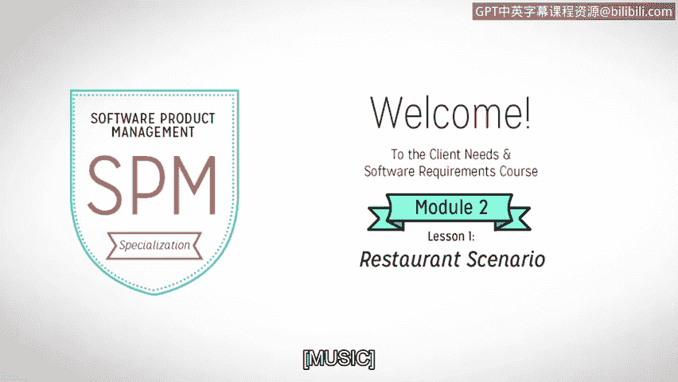

# 艾伯塔大学软件产品管理课程3：《客户需求与软件需求》：1：课程概述与客户介绍

在本节课中，我们将学习如何将客户的需求转化为具体的软件需求。我们将通过一个贯穿整个课程的连贯示例，来展示需求活动从开始到结束的完整过程。

## 客户介绍与项目背景

现在，你已经认识了你的客户并听取了他的初步构想，让我们开始构建一些需求。

以下是客户Jamie的自我介绍与项目初步想法：

*   Jamie是一家名为Brampton‘s Pizza and Pasta的家庭连锁餐厅的高管。
*   他们希望为旗下餐厅开发一套内部使用的软件。
*   项目的核心目标是**使餐厅的点餐流程更加高效**。

## 客户的初步需求

上一节我们介绍了客户的基本情况，本节中我们来看看客户提出的具体想法。

以下是Jamie描述的系统应具备的功能：

*   顾客应能查看所在餐厅的菜单。
*   顾客准备好后可以下单。
*   应有一个儿童页面，展示儿童菜单，可能包含一些游戏，但最重要的是**易于使用，让儿童可以自己下单**。
*   顾客应能指定对餐点的任何修改要求。
*   顾客在向厨房提交订单前，应能列出他们可能有的任何饮食限制。
*   厨房应能查看实时进来的订单。
*   顾客应能在系统内查看并支付账单。

本节课中我们一起学习了客户Jamie的背景及其对餐厅点餐系统的初步构想。这些想法是我们后续进行需求分析、细化并最终形成软件需求文档的起点。在接下来的课程中，我们将逐步把这些想法转化为清晰、可执行的需求。