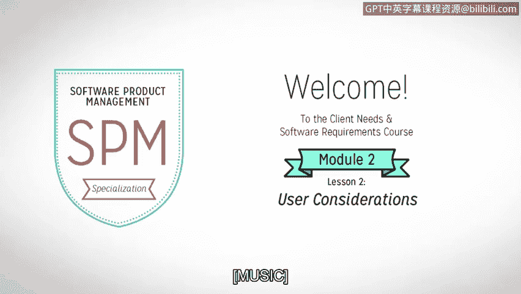
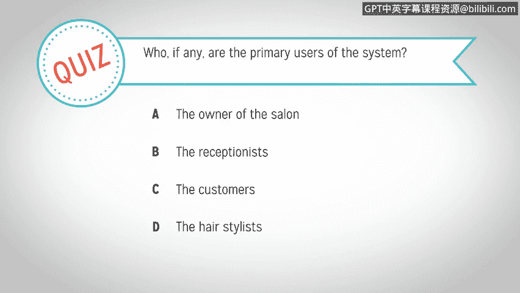

# 艾伯塔大学软件产品管理课程3：《客户需求与软件需求》｜client-needs-and-software-requirements｜ - P45：12_01_3-2-2-user-considerations.en_subtitled - GPT中英字幕课程资源 - BV1K94y1h7Tp

🎼。😊。

One of the most important things to consider when developing software is the end user。

Who are you making this product for。Who's going use this product。

You could develop what you think is the greatest product ever。

 but if the user doesn't like the product or if they can't navigate the product， it's going to fail。

In the technology industry， especially， users have so many choices。

If there is a similar product on the market that is easier for the end user to use。

 they'll choose that one。think about all the task management applications on the market。

Take a second and search Task Manager on the app Store on your phone。

There are thousands of different apps， some are great， some are really bad。But as you can see。

 users have options if they don't like one application， they'll move on to the next one。

It is perhaps even more critical for web applications。Competitors are just a mere click away。

 there is no need to download and install new applications。As you can see。

 keeping your end user in mind is very important。That's what we're going to talk about in this lesson。

What user aspects do you have to consider when you're developing a product？First。

 let's go over some of the terminology that I'm going to be using。

The end user or user is anyone that is going to be directly using the product。

A stakeholder is anyone who is affected by or has an effect on the success of a project。

This does include the end user， but it also includes others such as the client。

 managers of the end user， and system administrators。

A user interface or UI is anything that the end user will be interacting with。

Think of an application。 There are many things going on in the background to make it function。

 but none of it is the user interface。The user interface is everything that you can see when you're using the application。

 for example， elements like the windows， buttons， scroll bars。

 check boxeses and text boxes all make up the user interface。

Let's look at the stakeholders in more detail。Stakeholders are usually classified into three types of users。

 primary users， secondary users， or tertiary users。

Primary users are the people who will actually be using the product。

We will refer to primary users as end users。Secondary users are people who will occasionally use the product or those who use it through an intermediary。

Let's look at an example of a secondary user。In the context of our example。

 Waittaff could be considered secondary users。They are not who the product is intended for。

 but they must have a working knowledge of the product in order to assist customers。

 They may also use the application to aid a customer with their order。

Tertiary users are people who will be affected by the use of the product or make decisions about the product。

 Your client would be a tertiary user。Let's look at our example again。

 specifically the kid friendly page for children aged  four to 12。

The client specified that this page show the kids menu， has games to play。

 and is easy enough for a child to select their own food。For this page。

 the child is the primary user， since theyre the ones intended to use the page。

The guardian of the child would be a secondary user。

The guardian needs to know how the page works so that they can help the child。

 but they are probably not going to be the one using the page most of the time。Your client， Jamie。

 is a tertiary user， but also the restaurant owners are tertiary users since they are affected by the success of the application。

Successful products take into account the needs of all stakeholders。

Let's look at our kids menu example in more detail。If the primary user， the child。

 cannot figure out how to use the menu， they will lose interest。

The attention span of a child isn't very long， so you have to engage them quickly。

If the food choices are not kid friendly， or if the child is able to select more than one meal。

 then the guardian， the secondary user， probably won't allow the child to use the application。

If the application is too difficult to use and affects the business for restaurant owners。

 then they will not be satisfied and reject the product。Let's look at another stakeholder example。

You produced an online booking system for a hair salon。

The system was requested and funded by the owner of the salon。

The system allows customers of the salon to call or visit and have the receptionist book their appointments on the system。

Customers also have the option to create an online account and book their own appointments from the salonss website。

Hairtylist can also ask the receptionist to check when they have appointments on a particular day。

Who， if any， are the primary users of the system？A， the owner of the salon。B， the receptionist， C。

 the customers and or D， the hairstylist。

Since the owner of the salon requested and funded the system。

 they are the client and a tertiary user。The hair stylists use the system through an intermediate。

 the receptionist， so they are secondary users。Customers can also be considered secondary users when they call the salon and have the receptionist book the appointment for them。

Both the receptionist and the customers have direct access to the system。If they use it regularly。

 then they are both primary users， therefore， answers B and C are the correct answers。

