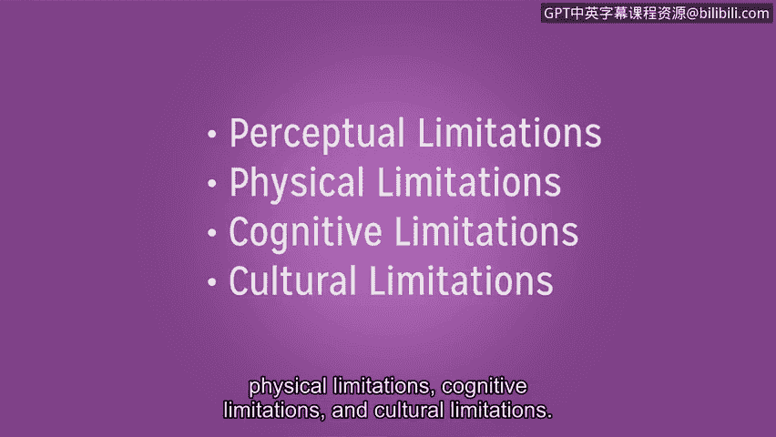

# 艾伯塔大学软件产品管理课程3：《客户需求与软件需求》｜client-needs-and-software-requirements｜ - P47：14_03_3-2-2b-user-considerations.en_subtitled - GPT中英字幕课程资源 - BV1K94y1h7Tp

🎼。😊。

Humans have many limitations。We can only read so fast， run so far or play video games for so long。😊。

There are many human characteristics that can limit what a user can do with a product。

It is important to consider these limitations when designing software。

Good software products accommodate their target audience。😊。

Some examples of human limitations are perceptual limitations， physical limitations。

 cognitive limitations， and cultural limitations。

Let's look at these in more detail。We'll start with perceptual limitations。

The restrictions upon our five senses impact how well we perceive our surroundings。Therefore。

 our perceptual limitations are those that are restricted by our senses。

Perceptual limitations are sometimes referred to as sensory limitations。

Many perceptual limitations can affect how people interact with technology。

A common example of a perceptual limitation is colorbldness。Approximately 4。

5% of the entire human population suffers from colorblness。

Around 8% of males are colorblind compared to only 0。5% of females。

A colorblind person has difficulty telling certain colors apart。

So color images can appear differently to them。From a development aspect。

 the best way to account for colorbldness is to increase the contrast of your product。

Using light colored backgrounds with dark text or vice versa accommodates not only colorblindness。

 but most visual limitations。You could also test a color scheme through different forms of colorblindness to see whether it is acceptable。

There are UI libraries and graphic design tools that support this。

We could teach a whole course on how to design for perceptual limitations。

Examples include using visual cues or vibrations to accommodate for auditory limitations。

Let's now talk about physical limitations。This could be anything that affects how a user physically interacts with the product。

For example， children are not the same as adults。Products specifically created for children should account for their lower dexterity。

 shorter height， and smaller hands。They need big buttons and controls they can reach and grasp。Also。

 left and right handededness is a physical limitation。

You can make your product more user friendly by having a left handed option。

Many interfaces are designed to be easy to use by right handed people。

They'll have most of the buttons and menus on the right hand side。

 which is easier to click with the right thumb。You could design a product to be easy to use by a left handed user by having an option that places buttons and menus on the left hand side of the screen。

How developed a game to be played on a mobile device？

The game involves users clicking in colorful circles before they disappear。

The music in the game would speed up when circles are about to disappear。

The phone would vibrate when a circle was clicked。How was reading the feedback that he received about his game。

Most of the feedback was positive， however， there were a couple complaints about usability。

Which of the following complaints represent a physical limitation？

A， I can't see some of the circles because the circle and the background colors are too similar。B。

 I have limited hearing and I feel like I'm at a disadvantage because I can't hear the music well。

See。I hate that the phone vibrates when I press a bubble， it's really annoying。Or D。

 I can only play the game for so long before my hand gets tired。Answers A， B。

 and C all represent perceptual limitations as they interact with the senses。

Answer A is a visual limitation， and answer B is an auditory limitation。

Answer C is a tactile limitation， since it has to do with the touch sense。

Answer D is correct as it represents a physical limitation。

A user cannot physically interact with the product for long periods of time without experiencing fatigue。

Next， let's talk about cognitive limitations。Cognitive limitations are commonly based on memory limitations。

For example， it is often easier to recognize something than it is to recall from memory。

So user interfaces should have visible elements that are familiar or suggestive to promote recognition。

A Harvard psychologist George A。 Miller， proposed a famous concept about the magical number seven。

He suggests that the average human has a short term memory with enough capacity to hold seven items。

 plus or minus2。Basically， what I want you to take from this notion is that the working human memory can hold five to nine items at a time。

This gets worse with distractions。You should keep this limitation in mind during development。

For example， you don't want to have the end user carry a bunch of arbitrary items in their memory from one screen to the next in your product。

Finally， let's talk about cultural limitations。These tend not to be limitations per se。

 but more like cultural differences。For example， think about what colors mean in different cultures。

In Western culture， the color white is used in weddings and represents peace。However。

 in many other cultures， the color white is representative of death and mourning。Also。

 the color pink is considered a feminine color in many cultures， but not all。

There are many aspects of design， aside from color that can change from culture to culture。

Things like language translation， symbols and icons。

 layout and multimedia could all differ between cultures。

Another example of a cultural difference relating to software development is the use of X's in checkboxes。

Think of election ballots where you mark your choice of candidate with an X beside their name。

I have read that in Japan they use an Omarc called a Marjuushi to denote selection。

They use an X mark to represent rejection。So X can have a very ambiguous meaning。Consequently。

 modern user interfaces now use a check mark in checkboxes to mark a choice。

Check out our course resources for more information on cultural limitations and software development。

This is where I want to open it up to you。 We have an international classroom with learners from many different areas of the world。

😊，Let's talk about some cultural differences in the discussion forum。

What are elements of your culture that may be important to consider when developing software？

Maybe we can get someone from Japan to elaborate on the Marrajuushi。

