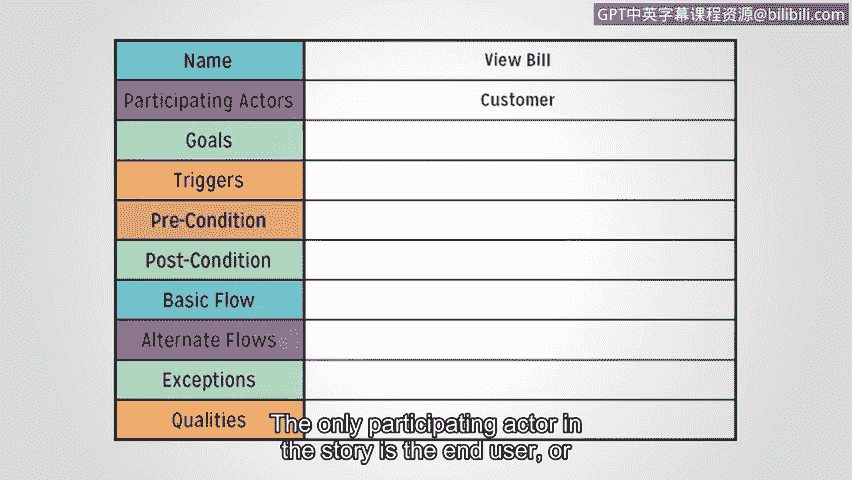
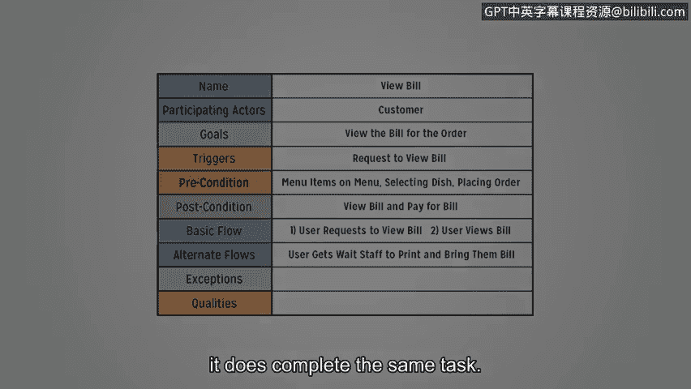
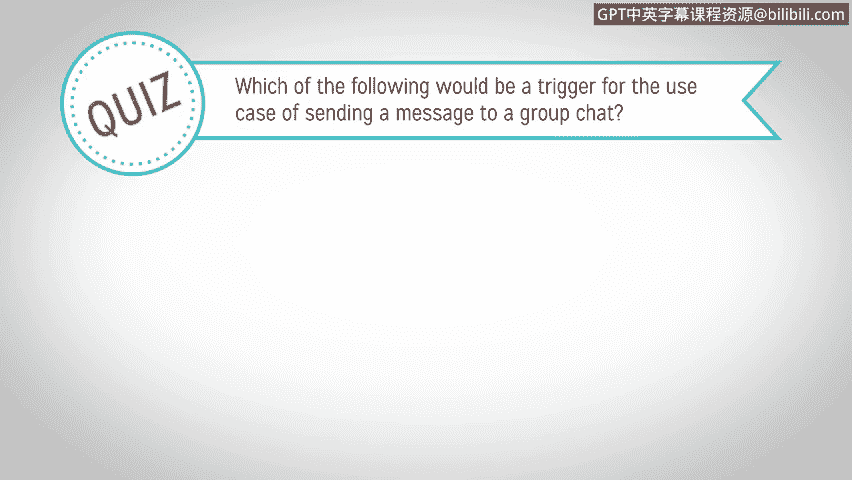

# 艾伯塔大学软件产品管理课程3：《客户需求与软件需求》｜client-needs-and-software-requirements｜ - P50：17_01_3-2-4-use-cases.en_subtitled - GPT中英字幕课程资源 - BV1K94y1h7Tp

🎼。😊，A use case is a concept developed by Ivar Jacobson in 1986。 Since then。

 it's become a popular way to describe a task supported by the function of a product。

A use case is a way to identify， clarify and organize the details of a task。

They consist of a set of possible sequential interactions between users and systems。

A use case takes place in a particular environment in order to achieve a particular goal。

This is all a lot of talk that doesn't make much sense until you see it in action。

 Let's jump into the elements of a use case description for a task。

A use case is typically made up of a name for the use case， the participating actors， the goal。

 the triggers， the pre and post conditions， the basic flow， exceptions， and qualities。First。

 you need to give your use case a name。You want this to be descriptive of the task， simple and short。

Next， you need to identify participating actors。These actors should be roles。

 a role is a duty that a person takes on。Example rules are a restaurant customer， kitchen cook。

 or waitstaff。You want the names of the actors to be descriptive of what they do with the product and not the actual names of the actors。

 they need to be in the general case。I mentioned earlier that a purpose of a use case is to achieve a particular goal。

So you specify the school in your use case。You also need to identify triggers。

 triggers are events that prompt the use case to begin。

This could be something like the push of a button。Next。

 you need to identify preconditions and post conditionsditions Preconditions are conditions that must be met before this use case can occur。

Post conditions are conditions that are met once the use case is complete。

The basic flow is an important part of a use case， the basic flow is a walkthrough of all the steps that occur in the use case。

You want the basic flow to be representative of a sunny day scenario。

A sunny day scenario is the best case scenario or a scenario that describes everything working properly。

Any other scenarios can be outlined as alternate flows if necessary。

You will also want to outline any exceptions。Exceptions highlight any situation where this use case would not work。

With exceptions， you want to identify the step in the basic flow where the exception would occur。

 then provide alternative steps to resolve the problem。Finally。

 qualities are any quality specifications that you want to meet。

These could be non functional requirements， such as creating the scenario in a certain time or using a certain amount of memory。

Overall， the use case description outlines the task from the perspective of the actors involved。

It's not about what happens behind the scenes within the product。Also。

 the description should be technology independent， so it's not tied to some particular user interface platform。

Jack is using an instant messaging application。He wants to send his friend， Sally。

 a message telling her that he is running late for her party。

He opens the application and searches her name。He clicks on their conversation and then types up the message。

 Hey， Sally， I'm going to be late。 See you later。Then he presses send。

 Sally sees the message and replies to Jack。If you are going to write a use case for this scenario。

 who would you list as the participating actors？A message sender。B message recipient， C。

 Sally and or D。 Jack。When you define the participating actors。

 you want them to be in the general case， so you do not want to use the actual names。

Even though Sally and Jack are the end users in this particular scenario。

 they will not be the end users every time the use case occurs。 We want it to be more generalized。

Message sender and message recipient are good actor names since both users are participating in this scenario。

That means that answers A and B are the correct answers。

Now that you know the structure of a use case description。

 let's apply this further to our restaurant application example。

A good place to start is to create a use case diagram。

This is a high level visual representation of all the tasks supported by the product。

It identifies the actors and their use cases in which they participate。In the restaurant scenario。

 we have the customer， the child customer， and the kitchen staff。

Each of their respective use cases are linked to them in the diagram。

Inside the boundary are all the use cases that the product can support。

Let's take one of these tasks and turn it into a use case。

We'll look at the requirement that allows the customer to view their bill from our restaurant example。

Let's say that this is the first use case and that corresponds to the requirement in the product backlog。

 so we will give this use case the ID number one。For name， we call this use case view Bill。

The only participating actor in the story is the end user or in our scenario。

 we'll call them the customer。

The goal of this use case is to view the bill for their order。As I said before。

 a trigger is an event that prompts this use case to happen。In this scenario。

 the customer requests to view their bill in the app。

Preconditions for this action to occur would include having the menu items on the menu。

 the user selecting a dish and the user placing an order。

A post condition for this action would be that the customer can view the bill and pay the bill。

The basic flow for this use case would be。Number one， use a request to view Bill from app。Number two。

 Use Views Bill。An alternate flow to this action would be the user gets the wait staff to print and bring them the bill。

This is not the sunny day situation as it would require more work。

 but it does complete the same task。

You are using a software product that allows users to create and use group messaging threads。

Group chat participants can be added to a group chat。

 and these participants can all see the messages sent in that thread。

Which of the following would be a trigger for the use case of sending a message to a group chat？

A participant has a message they want to send to the group。B， participant types Out message。C。

 participant opens the group chat。Or D， participant taps the send button。

A trigger is an event that prompts a use case to happen。In this scenario。

 our use case is sending a message。To trigger this event。

 the participant would have a message that they would want to send to the group。

This triggers the participant to open the group chat， type their message and press send。 Therefore。

 a is the correct answer。Answers B， C， and D are all steps of the basic flow that would occur。

An exception that could occur is that there were no dishes ordered。

So the goal of the use case is not achieved。In this case， an error message should be displayed。

Step two of our basic flow was customer view the bill。If their order has no dishes。

 then we want an error message to be displayed。We would show this in our use case by writing step 2 a display error message if no dishes were ordered。

Finally， a quality could be that the bill takes less than 10 seconds to load。Typically。

 qualities are non functional requirements。They help to set a quality standard throughout development。

Use cases are a great tool to use when you are establishing requirements。

They can help to organize and elaborate on tasks and their steps， as well as guide development。

A use case diagram can help you to get an overall view of the entire product with all the tasks and rules that it supports。

Next， we are going to look at some design techniques that can help you to organize and visualize requirements for a product。

