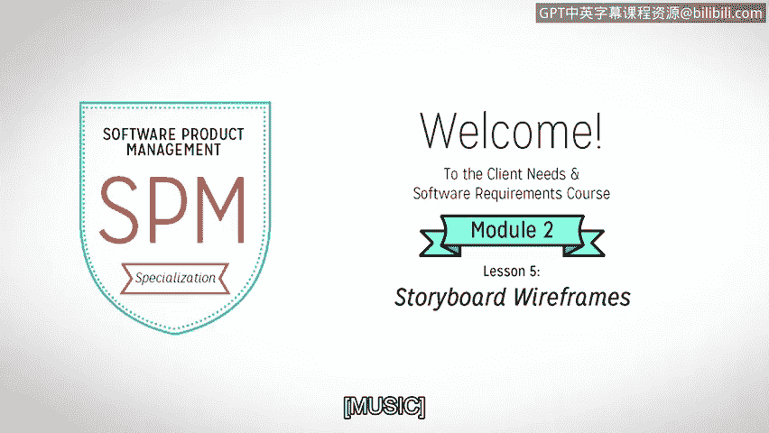
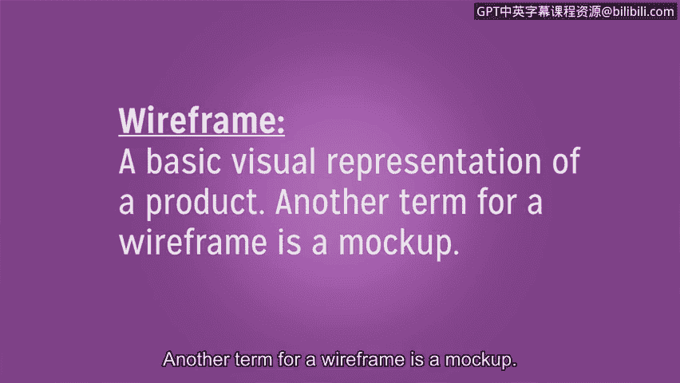
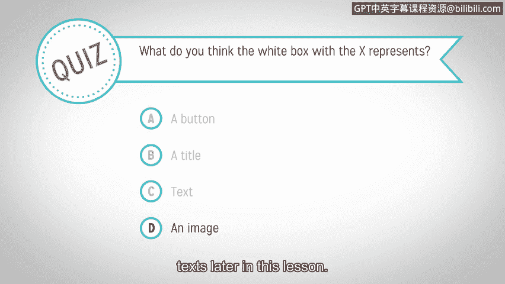

# 软件产品管理：3：客户需求与软件需求｜P51：18_01_3-2-5-线框图

在本节课中，我们将要学习产品开发中一个非常有用的技术——线框图。我们将了解线框图是什么、它的作用、如何创建以及需要注意的事项。通过本节内容，你将掌握使用线框图来沟通需求、验证想法并与团队协作的基本方法。

## 什么是线框图？

线框图是产品的基本视觉表示。线框图的另一个名称是模型。

你可以把它想象成房屋的蓝图。承包商在建造房屋之前，需要绘制房屋的黑白图像。这能让所有相关人员对将要建造的东西达成共识。

## 线框图的作用

上一节我们介绍了线框图的基本概念，本节中我们来看看它的具体作用。

线框图不仅是开发团队可视化需求的好工具，也是向客户展示想法的宝贵技术。

在开发团队讨论需求之后，他们可以快速制作一个线框图来展示给客户。这样，客户就能在开发过程的早期看到产品的雏形。这允许他们提出修改意见，并确保所有人对产品有共同的愿景。

## 如何创建线框图

了解了线框图的作用后，我们来学习如何创建它。

你需要保持线框图的简洁性。这不是界面的详细演示，而是产品的演示。不应在线框图中放入将在界面中实现的华丽颜色和图像。

线框图侧重于要支持的基本功能和最终用户任务。它们可以帮助你思考按钮、文本字段和图像的放置位置。从上到下的布局应遵循用户执行每个任务的流程。

基于这些想法，在项目的设计和实施阶段后期，才会完全模拟或实现用户界面设计。

再次以房屋蓝图为例。你无法知道墙壁的颜色，也无法知道照明或管道装置的外观。你只能了解轮廓的基本概念以及固定装置将放置的位置，但无法获得房屋外观的完整画面。

## 线框图示例

我们使用线框图来创建本课程。我们会确定演示者站立的位置以及图像和文本字段出现的位置。

以下是本课程的一个线框图。如你所见，我们的线框图与实际课程看起来非常不同。我们没有包含图像的具体样子，只是简单地指出了我们希望它放置的位置并描述了它将代表什么。演示者的图像也完全不像我，但这没关系。你能明白那是正在讲话的人。

我们会将这些线框图发送给制作团队，以便他们了解我们对课程的大致构想。然后他们进行制作，创造出你所看到的精美课程。

让我们看一个线框图示例。这是一个提供作者传记的网站的线框图。

你认为带有X的白色方框代表什么？A， 一个按钮；B， 一个标题；C， 文本；或 D， 一张图像。

在线框图中，内部带有X的方框代表一张图像；因此，D是正确答案。你无需指定有关图像的详细信息。在线框图中，这种表示法只是作为图像放置位置的占位符。

我们将在本课后面介绍如何表示按钮、标题和文本。

## 线框图的其他用途

如你所见，线框图可以用于许多事情。你可以使用它们来设计将要开发的内容、向客户演示以及与团队沟通。

线框图的另一个常见用途是让客户与你沟通。客户通常对他们产品的功能和外观有一个构想。有时，客户通过绘制线框图来表达他们的想法会更容易。

我曾有客户这样做过，这使得从他们的线框图中提取需求变得容易。如果你的客户难以表达他们真正想要的东西，你可以考虑这种方法。

## 注意事项与工具

在上一模块中，Bradley谈到了需求与设计之间的细微界限。确保在使用线图引出需求时不要跨越这条线。进行一些设计是可以的，但你需要小心，不要过早地开发解决方案。线框图应该引发关于问题是什么以及最终用户需要什么任务的讨论。

以下是可用于创建线框图的工具类型：

*   **手绘与扫描**：你可以在纸上绘制它们并进行数字扫描。
*   **绘图软件**：你可以使用计算机上的任何绘图工具。
*   **在线应用**：也有许多专为绘制线框图设计的网络应用程序，我们会在课程资源中发布一些。

我们使用 Google Docs 来绘制线框图。像 PowerPoint 这样的演示工具也常用于绘制线框图。

## 实践案例：餐厅示例

让我们回到我们的餐厅示例。以下是主菜页面部分内容在线框图中可能的样子。

在线框图中，图像通常用内部带有X的正方形表示。文本通常用阴影框模拟。你可以在按钮和标题上添加文本，以便与客户有更多讨论内容。使用阴影框表示通用文本。按钮通常用正方形模拟。

## 总结与过渡

本节课中我们一起学习了线框图。我们了解了线框图是一种产品的低保真视觉表示，就像房屋的蓝图。它主要用于在早期阶段沟通需求、验证想法并与客户和团队协作，强调功能布局而非视觉细节。创建时应保持简洁，并注意不要过早陷入具体设计。

接下来，我们将要学习一个类似的设计技术——故事板。