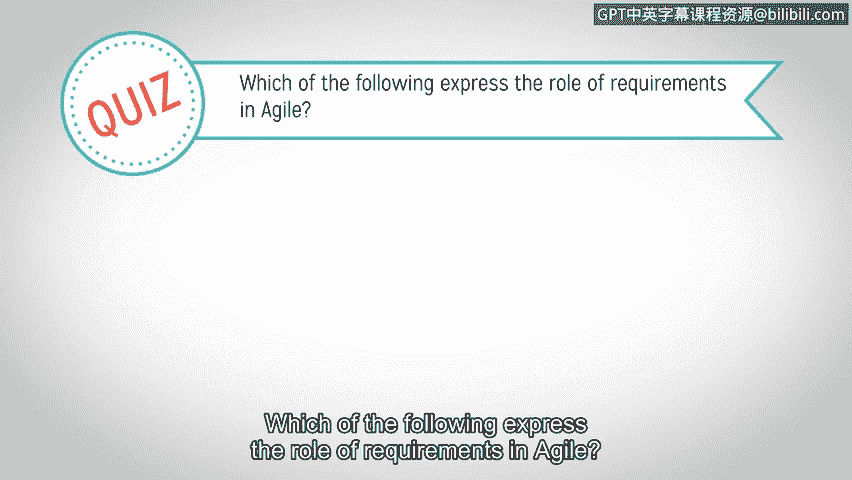

# 艾伯塔大学软件产品管理课程3：《客户需求与软件需求》｜client-needs-and-software-requirements｜ - P53：20_01_3-3-1-agile-requirements.en_subtitled - GPT中英字幕课程资源 - BV1K94y1h7Tp

🎼。😊。

Welcome to this module on our clientient Needs and Soft Requirements course。

We're going to extend upon what has already been covered in the previous modules。In the last module。

 Morgan provided detail on user considerations。She described how to both involve clients and end users to help make sure that you're building the right product for them。

She also spoke about ways in which you can express these requirements through use cases， wireframes。

 and storyboards。In that module， we outlined how to determine the client's needs。In this module。

 I'm going to outline how to represent those needs by framing them within Agile。

I'm going to show you how requirements fit into the scope of Agile software development。

I'll also show you a variety of ways in which requirements are expressed。

 as well as how to manage them。In the introduction course。

 Morgan talked about Agile and its 12 core principles。

Let's do a quick recap of those principles in the order in which Morgan presented them。

The first is satisfying the customer through early and continuous delivery。

The second is delivering working software frequently。

The third is using working software as the primary measure of progress。

The fourth is welcoming changing requirements。The fifth is attention to technical excellence and good design。

The sixth is promoting sustainable development at a constant pace。

The seventh is focusing on simplicity in order to maximize the amount of work not done。

The eighth is building projects around motivated individuals。

The9 is focusing on self organizing teams。The 10th is daily collaboration between business people and developers。

The 11th is encouraging face to face interaction。And finally。

 the 12th is reflecting on the team's behavior and adjusting accordingly。

Out of the 12 Agile principles， which are most related to requirements。A。

 welcoming changing requirements。B， encouraging face to face interaction。C， focusing on simplicity。

And or D， delivering working software frequently。Actually， all of these answers are correct。

They each reflect requirements in different ways。However。

 there are two which I want to specifically point out for the purpose of talking about requirements and agile。

The first is welcoming changing requirements。It might be obvious， but it's critical。

Agile is based on the concept that software is dynamic。

That it's an open ended thing that can't be defined once。And then built off that single definition。

Frequently， your client will change their mind about how our product should function right in the middle of development。

This can be catastrophic for projects which don't take into account the inevitability of changing requirements。

The agile principle of welcoming changing requirements is critical when you're conceptualizing your requirements。

Form them with the full intention of following through。

Just don't fool yourself into thinking that they won't change as the product grows。

It's just the nature of how software is developed。Which of the following express the role of requirements in Agile。

A requirements are moderately important。 It's more important to define deadlines。B。

 requirements are not at all important， Agile is a process for writing code。C。

 requirements should be defined up front and do not change。

Or D requirements are important and should be able to change throughout development。😡。

Requirements are incredibly important and agile。 They help us to understand our clients and to make sure that we're building the right product for our customers。

They also help us to ensure that we're building the product right。 Thus， the correct answer is D。

The second principle I'd like to highlight is encouraging face to face interaction。

This one is also critical for getting the right requirements。According to Agile。

 requirements should be elicited from your client in an open and collaborative setting。

Your product's vision should be decided by your client。

Then it's your job as a software product manager to work through the problem of refining that vision to see what requirements are in scope for the project。

You do this together。 It's all about getting everyone in the same room。

Here you can talk openly about items that would be nice to have in the product。

You can identify things which can or must be done。Not only does it allow you to work out things of value more effectively in the moment。

 it also sets a precedent for future communication between your team and the client。

Sitting down with your client and discussing requirements which will inevitably change is a practice frequently used in Scrum。

Scrrum is an agile methodology which we cover in great detail in the So processessses and Agile Practices course。

 don't miss it。What I wanted to outline in this lesson is that requirements are an integral part of Agile。

On the flip side， Agile also adds a great deal of quality to requirements。

As long as you follow its practices when creating them。

So now that we've made a bit of a connection between Agile and requirements。

 let's move on to the next lesson。There， I will tell you all about the most common form of expressing agile requirements。

 they use your story。See you then。