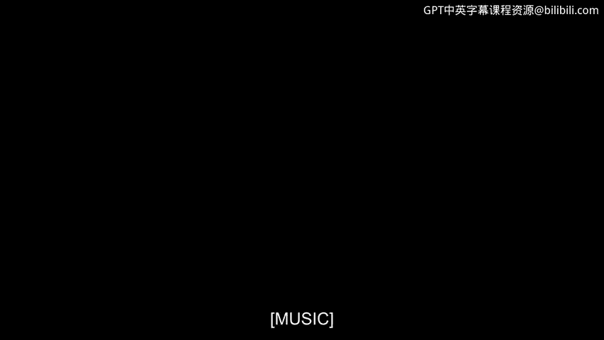
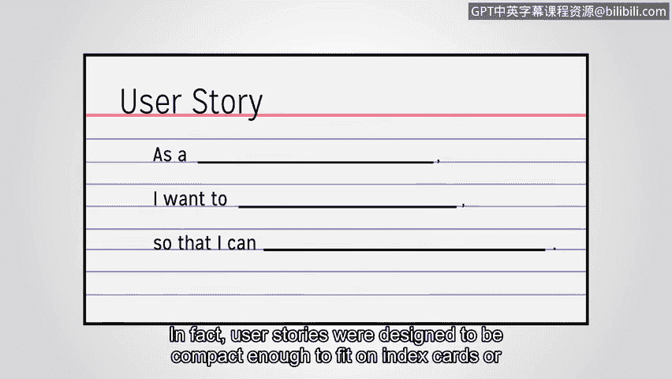

# 艾伯塔大学软件产品管理课程3：《客户需求与软件需求》｜client-needs-and-software-requirements｜ - P54：21_01_3-3-2-user-stories.en_subtitled - GPT中英字幕课程资源 - BV1K94y1h7Tp

Welcome to the next lesson in the Client Needs and Software Require course。

In the last lesson， I bridge the gap between requirements as they are relicited in the last module and Agile practices。

I explained that requirements become much more useful when we apply agile practices to them。

Let's dive into one of the main agile techniques of expressing requirements。The user story。

In this lesson， I'm going to outline what a user story is。

Why we need them and how to recognize what makes a good user story。

We'll end off by analyzing some user stories in order to learn how we can improve upon them。

You might be asking， what is a user story？A user story is just a simple way of expressing requirements。

Remember how in the last module， Morgan talked about use cases， wireframes， and storyboards。

Those were the first techniques covered in this course for expressing requirements。

A user story is another way of doing that same thing。What's so special about user stories？

User stories are meant to keep all of the requirements of your system to a consistent format。

They're easy to write， easy to read and easy to evaluate。User stories follow a very specific format。

As a blank， I want a blank， so that blank。The first blank signifies the stakeholder role for whom the requirement is being formed。

You might use words like administrator or guest user here。

In our example of the restaurant menu application， the stakeholders are customers and kitchen staff。

These don't have to be specific people you have in mind。

 just a general audience for their requirements。😡，This helps to narrow down who the requirement is meant to support。

It specifies the who of the requirement。The stated requirement is written as if from a stakeholders's point of view。

The second blank signifies the task or function the stakeholder wants to resolve using the product。

This is the meat of the requirement and is usually what people think of most when they think requirement。

This part specifies the what of your requirement。Here are some of the specific tasks desired for a restaurant application example。

I want to browse the menu for restaurants that I'm in。I want to see the kids menu。

Or I want to view received orders。All of these are examples of specific functions used by a stakeholder。

The final blank of the user story。Specifies why the user story is needed in the first place。

This is often skipped when user stories are created。

 but it offers a key insight into the requirement。It gives context to the requirement about the value or benefit it offers。

 which aligns with the product's goals or vision。This part specifies the why of the requirement。

So a full user story might look like this。As a child customer。

 I want to see the kids menu so that I see what meals and games interest me。

You see how it all comes together as one whole。Let's test your knowledge on how user stories are structured。

You're working on a mobile game project with your client。They give you the requirement。

 I want to be able to control my character using the arrow keys。

How would you structure this requirement to fit the form of a user story？A， as a gamer。

 I want to be able to control my character using a directional input method so that I can navigate the game world。

B， I want to be able to control my character using a directional input method。C。

 in order to navigate around the world， a character should be able to move using the arrow keys。Or D。

 change nothing。 This is already a user story。The correct answer is a。

A user story should fit the form as a blank。 I want a blank， so that blank。

Notice that this user story is more general in describing the input device to focus on the actual need and not a particular solution。

Now， compare this to a common way in which the requirements are expressed。Oftentimes。

 you will see requirements expressed using vague language without much in the way of description。

You'll see requirements like the user should be able to see a kid's menu。

Having seen the way user stories are created。Does it make sense why they're structured the way they are？

They bring a lot of clarity to a requirement without bogging it down in technical detail。

You get the who， the what， and the why， all in a neat little package。As a bonus to having short。

 concise user stories like this。You can easily write them down to keep track of them。In fact。

 user stories were designed to be compact enough to fit on index cards or sticky notes。

This way， all the user stories could be laid out and organized in a very visual。

 physical and informative way。By having the stories on index cards。

 they can be easily clumped into related groups and reorganized when the requirements inevitably change。

