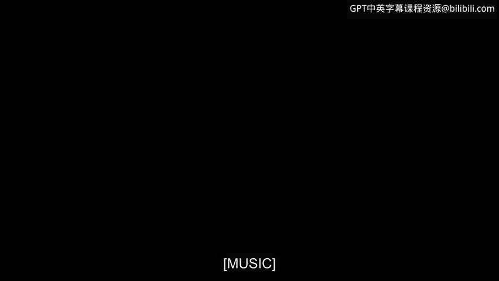
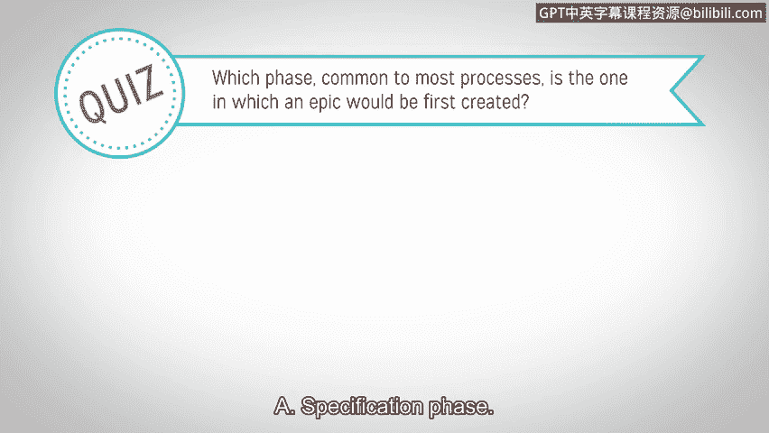

# 艾伯塔大学软件产品管理课程3：《客户需求与软件需求》｜client-needs-and-software-requirements｜ - P55：22_02_3-3-2a-user-stories.en_subtitled - GPT中英字幕课程资源 - BV1K94y1h7Tp

🎼。😊。

User stories are meant to be written by your client because your client usually knows what they want in the product。

However， the software product manager often ends up writing user stories。

This isn't because clients aren't interested in specifying what their product should do。

 It's usually due to a lack of experience or training in creating user stories。

This doesn't mean you shouldn't ask your client to create user stories。

It means that you and your development team may be required to help them express their needs in user story form。

That's all well and good， but when it comes down to it。

 you have to know how to write user stories in such a way that they're useful。

You could take a poorly conceived requirement and put it into user story form。

But that doesn't all of a sudden make it a good requirement。So what makes a good user story？Well。

 Morgan is going to tell you all about what makes a good requirement in the next module。

So I'll just briefly touch on what makes a good user story here。

A good user story is one which clearly outlines a specific software requirement in the product。

We've established that much， but how？There's a mneummonic first thought of by Bill Wake。

 which is used in the industry a lot， which can help you remember what makes a good requirement。

Invest。I'll go through what each letter stands for first and then explain it afterward。

The I stands for Independent。The N stands for negotiable。The V stands for Val。

The E stands forestimable。The S stands for small。And the T stands for testable。

What does the S in invest stand for？A simple。Be smart。C， stable or D， small。The answer is D。

 small requirements should certainly be simple， but that's not the word we're looking for here。

Let's start with I for Independent。When a user story is independent。

 it means that it can be developed separately from any other user story。

 regardless of when it's implemented。This is important because it allows you to rearrange the development of your user stories。

If two user stories are closely related and dependent。

 you could combine them into a single independent one。However。

 you'll need to balance this against making too big a user story。The N is for negotiable。

This means that they should be general enough for your team and your client to work around the implementation。

Since it's possible that there is no right implementation。

 don't focus on the specific technical details of how the requirement is to be satisfied。Instead。

 focus on the main important aspects of the requirement。Things could change and that's okay。

The V for valuable。Means that each story should bring some sort of value to the client。

Don't make fluffy busy work。The E is estimable。You should be able to estimate how long it will take to design and implement the requirement。

If you can't estimate how long it takes to develop， you've probably specified what is called an E。

I'll talk about what an epic is a little later in this lesson。S for small。

 is related to the idea that requirements should be estimated。However。

 even if you can estimate how long something will take。

 that doesn't make it a good requirement on its own。

If you estimate needing three months to develop a user story。

 you're going to want to break it down into smaller stories。

User stories are meant to be small because each user story is meant to be developed in a short time period。

Besides， estimates should be more certain with smaller stories。

If you find yourself with a large story， try to break it down as much as possible。

 or else you'll risk wrestling with an epic。Finally， T is for testable。Basically。

 you need to verify that every user story meets a certain set of criteria before it can be considered done。

This is usually achieved by defining and using acceptance tests。

 which I'll outline more in the next lesson。And that's invest。Independent， negotiable， valuable。

 estimable， small and testable。Now， I mentioned a few times already that we want to avoid creating epics。

So just what is an epic？As you might have guessed from the context。

 an epic is a user story that is nearly insurmountable。

An epic certainly can't be accomplished in a short time period。Epics are vague。

 broad descriptions of a requirement。Epics make their way into requirement backlogs。

 even on the most mature software development teams。How。Well。

 epics are usually introduced into projects at the very beginning when describing functionality。

 which is to be developed later on。When a client wants functionality completed down the road。

 it can be difficult to know exactly what that might look like or how it should be done。

What usually happens is a user story is built that outlines a general idea of the functionality that the client wants。

If you have taken the softwareft processessses and Agile Practic course。

Think back on phases of development。Which phase common to most processes is the one in which an epic would be first created。

A specification phase。B， architecture design phase。C， construction phase。Or D， transition phase。

The correct answer is a specification phase。This is the phase in which requirements are created and discussed with a client。

The other phases constitute work to be done later on。

If you didn't take the Softer Processes and Agile Practices course。

 this is something you'll learn more about there。