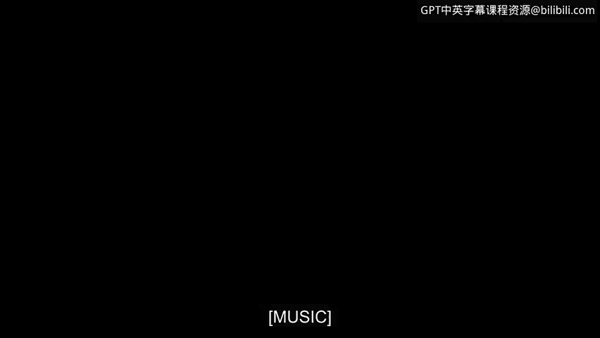
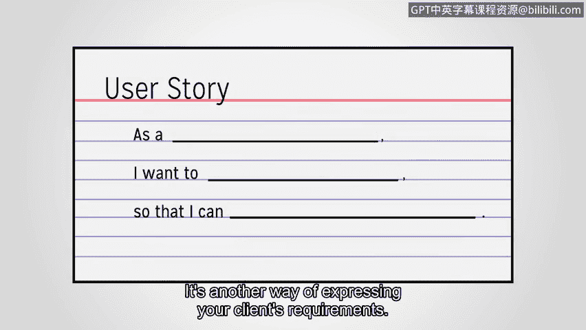

# 艾伯塔大学软件产品管理课程3：《客户需求与软件需求》｜client-needs-and-software-requirements｜ - P56：23_03_3-3-2b-user-stories.en_subtitled - GPT中英字幕课程资源 - BV1K94y1h7Tp

In our example of the restaurant application， this could look like the user story as a customer。

 I want to pay for my bill so that I can settle what I owe quickly。

This seems simple enough， but what else is needed？Does a user pay for their bill within the app？

What methods of payment are accepted？These are all questions not addressed by the story。

 And so the amount of effort， which would be required to implement the story is unclear。

This story would be considered an epic。I said a few seconds ago that epics are usually defined at the beginning of the specification phase。

The problem is that estimates usually follow a pattern called the cone of uncertainty。

We'll cover more about the cone of uncertainty in the Agile planning course。But basically。

 this is the idea。Time estimates to develop a user story get less and less accurate。

 the further into the future， the feature is intended to be developed。

So if you're planning for a feature to be developed a few months down the road。

 you can be certain that your estimate will be less accurate than the estimate you make for a feature to be developed this week。

To avoid writing ethics， the first step is to be aware of when you may be creating one。

A good practice is to give just enough information that the story can be understood well enough for a developer to implement it。

But not so much that you begin to specify implementation details。

If you break epics into multiple smaller stories， you will find it easier to manage。

I mentioned an epic earlier。As a customer， I want to pay for my bill so that I can settle what I owe quickly。

A way to break this epic down is to write a few smaller stories to describe it like this。

As a customer， I want to be able to see a bill with all of the items in that order so that I can see how much my order will cost。

As a customer， I want to be able to select a pay now option when I view my bill so that I can pay the bill immediately。

And as a customer， I want to be able to enter payment details for Vi or Mastercard credit cards so that I can pay using a convenient method。

All of these are under the broad topic of paying for a bill。

But they're much more specific and helpful。Imagine that you're building a software product in which users are able to choose eyeglasses to purchase from the client's website。

Which of the following user stories would be considered epics for this product。A。

 as an eyeglass wearer， I want to see so that I can slay dragons。B， as an eyeglass wearer。

 I want to purchase new eyeglasses so that I can get them in the mail quickly。C。

 as an eyeglass wearer， I want to view a list of eyeglasses available for purchase。😡，Or D。

 as an eyeglass wearer， I want to see the prices of eyeglasses available for purchase。

The correct answer is B。 A is not an epic because it's not really even a user story that's related to this product。

C and D are both stories which outline specific functionality without diving into the technical details。

And that's the user story。In this lesson， I covered what a user story is。

It's another way of expressing your client's requirements。

Then I covered what makes a good user story。I introduced theInvest pneummonic。

 which stands for Independ， Negotiable， valuable，estimable， small and testable。Finally。

 I covered what an epic is and how to avoid it。In the next lesson。

 I'm going to talk about how to make user stories testable and introduce the concept of acceptance tests for user stories。

See you there。