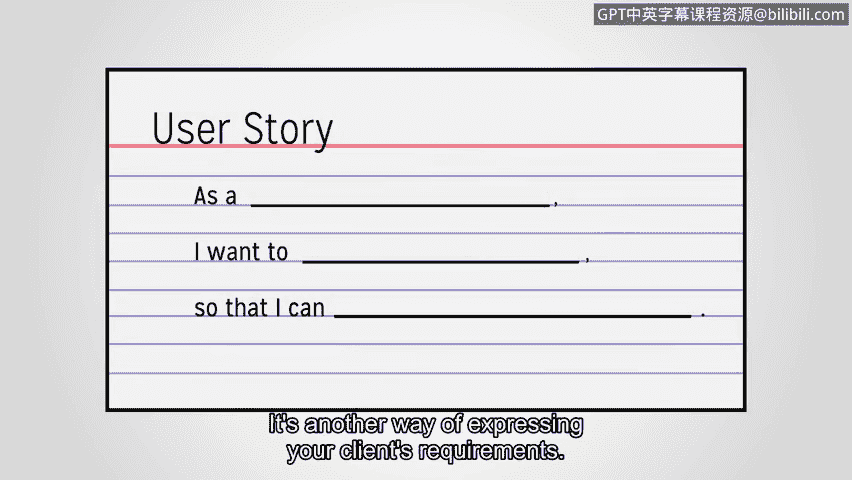

# 软件产品管理课程3：《客户需求与软件需求》：3-3-2b：用户故事 📝

在本节课中，我们将要学习用户故事的概念，了解如何编写高质量的用户故事，并认识一种需要避免的、过于宽泛的故事类型——史诗。

上一节我们介绍了需求的不同形式，本节中我们来看看如何用一种更贴近用户视角的方式来描述需求，即用户故事。

## 什么是用户故事？

用户故事是从最终用户角度描述软件功能的一种简洁方式。它通常遵循一个简单的模板：

**作为 [用户角色]，我想要 [执行某个操作]，以便于 [实现某个价值或目标]。**

在我们的餐厅应用示例中，一个用户故事可能如下所示：

> 作为一名顾客，我想要支付我的账单，以便于我能快速结清欠款。

## 如何编写好的用户故事？

一个好的用户故事应该清晰、具体，并且能为开发团队提供足够的信息。为了帮助记忆好故事的特征，我们可以使用 **INVEST** 助记符。

以下是 **INVEST** 原则所代表的六个关键特性：

*   **独立的**：故事应尽可能独立于其他故事。
*   **可协商的**：故事的细节应在开发团队和客户/产品负责人之间讨论确定。
*   **有价值的**：故事必须为最终用户或业务带来明确的价值。
*   **可估算的**：开发团队应能估算完成该故事所需的工作量。
*   **小的**：故事应足够小，以便在一个迭代周期内完成。
*   **可测试的**：必须能够定义明确的验收标准来验证故事是否完成。

## 什么是史诗？如何避免？

虽然上面的支付账单故事看起来很简单，但它遗漏了许多关键问题：支付是在应用内完成吗？接受哪些支付方式？由于这些问题未被解答，实现该故事所需的工作量是不明确的。

这种过于庞大、模糊、无法准确估算的用户故事被称为 **史诗**。史诗通常在需求规格说明的初期被定义。

问题在于，对未来的估算遵循一种称为“不确定性锥”的模式。我们将在敏捷规划课程中详细讨论它。其基本思想是：对一个用户故事的开发时间估算，距离计划开发的时间越远，其准确性就越低。

因此，如果你计划在几个月后开发某个功能，可以确定你的估算将比本周要开发的功能的估算更不准确。

为了避免编写史诗，第一步是意识到你可能正在创建一个。一个好的实践是提供**刚好足够**的信息，让开发人员能够理解并实现它，但又**不要过多**，以至于开始指定实现细节。

将史诗分解为多个更小的故事，你会发现管理起来更容易。

我之前提到了一个史诗：“作为一名顾客，我想要支付我的账单，以便于我能快速结清欠款。”

分解这个史诗的一种方法是编写几个更小的故事来描述它，例如：

1.  作为一名顾客，我想要能够看到包含订单所有项目的账单，以便于我能了解我的订单将花费多少钱。
2.  作为一名顾客，在查看账单时，我想要能够选择“立即支付”选项，以便于我能立即支付账单。
3.  作为一名顾客，我想要能够输入Visa或Mastercard信用卡的支付信息，以便于我能使用一种便捷的方式付款。

所有这些都属于“支付账单”这个广泛主题，但它们更加具体和有帮助。

## 小测验

假设你正在构建一个软件产品，用户可以在客户网站上选择购买眼镜。

以下哪个用户故事会被视为该产品的史诗？

A. 作为一名戴眼镜的人，我想要看到，以便于我能屠龙。
B. 作为一名戴眼镜的人，我想要购买新眼镜，以便于我能快速收到它们。
C. 作为一名戴眼镜的人，我想要查看可供购买的眼镜列表。
D. 作为一名戴眼镜的人，我想要查看可供购买的眼镜的价格。

**正确答案是 B。**

A不是一个史诗，因为它甚至不是一个与产品相关的有效用户故事。C和D都是概述了特定功能、没有深入技术细节的故事，符合好故事的标准。

## 总结

本节课中我们一起学习了用户故事。

*   首先，我介绍了什么是用户故事——它是表达客户需求的另一种方式。
    
*   接着，我讲解了构成一个好用户故事的要求，并引入了 **INVEST** 助记符，它代表独立、可协商、有价值、可估算、小和可测试。
*   最后，我介绍了什么是史诗以及如何避免它。

在下一节课中，我将讨论如何使用户故事可测试，并介绍用户故事验收测试的概念。