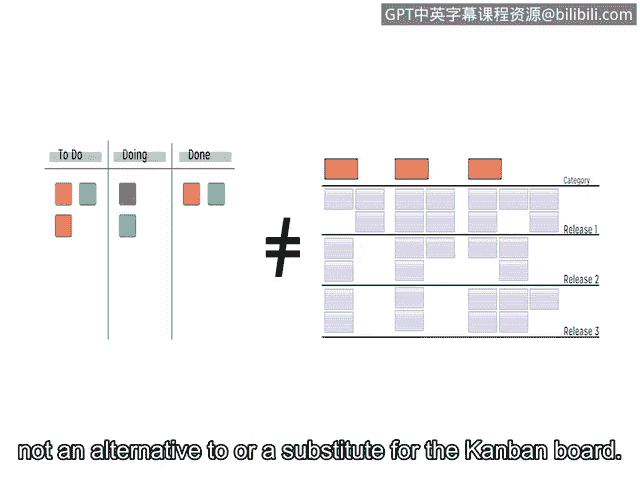

# 艾伯塔大学软件产品管理课程3：《客户需求与软件需求》｜client-needs-and-software-requirements｜ - P60：27_01_3-3-5-story-maps.en_subtitled - GPT中英字幕课程资源 - BV1K94y1h7Tp

🎼。😊。

Welcome to the next lesson of the Client Needs and Soft Requiments course。In the last lesson。

 I talked about the Scrum product backlog and how it can be used to prioritize and organize expected work。

In this lesson， I'm going to talk about another tool which is used to organize your requirements。

The story map。Story mapps are a great way of representing your product's backlog with more visual detail。

When it comes down to it， a story map is just a method for taking user stories from your backlog and grouping them into more specific functional categories。

Here's an example of how a story map might look。Say you're developing a simple email program。

Your client gave you a list of requirements， which include user stories like。As an author。

 I want to compose text only messages with a recipient， a subject line， and a body。

 so that I can direct and convey the content of my message in a basic way。As a reader。

 I want to be able to open emails when they're received so that I can read my most recent messages。

As a reader， I want to be able to store messages in an archive so that I can keep messages for future reference。

As a reader， I want to be able to search for messages in my archive so that I can quickly find relevant messages without manually browsing for them。

As an author， I want to be able to attach files to my messages so that I can add extra information to my messages。

As a reader， I want to be able to open any attached files on my messages so that I can view the extra information on received messages。

You might already be able to see how these stories could be grouped together。

You could use the product's basic functionalities as category headings。

The basic functionalities here are composing and sending。Reading。

 receiving and storage and searching。So if you dropped each story into its respective category。

 you can immediately see what fits where and what might be missing。

Then the client could prioritize these stories within the categories as they see fit。Now。

 all of a sudden， a potentially daunting list of requirements becomes a manageably organized set of features to be implemented。

Now that you've seen how a story map is created。Think for a moment about what benefits creating a story map might bring to your projects。

Please select the answers， which you think reflect the benefits of a story map。

A saves time in the initial planning stages。B simplifies prioritization。

C gives you an overall view of how the project will develop。😡。

And or D provides a detailed development plan。The correct answers are B and C。

The story map simplifies prioritization and gives you an overall view of how the project will develop。

We'll talk about that next。It doesn't save much in the initial planning stages。

 but it could save time later on down the road。And remember， the story map is not a development plan。

Those are a few benefits of the story map。What other improvements does a story map offer over the classic product backlog？

The story map offers a lot of improvements onto the classic product backlog。For one。

 it gives your backlog a more trackable， visual feel。

Instead of trying to keep track of the priorities of one big list。

 you're forced to break things down into categories。

Another improvement is that it gives you perspective on how individual user stories relate。

Instead of dealing with a pile of prioritized requirements。

 the story map allows you to see how these requirements fit together。

By being able to visualize the links between your requirements。

You can really easily see if there's something missing。

It's easy to see if there are any holes in your requirements and then fill those holes accordingly。

Another great benefit to the story map is that it gives your developers an idea of how the product should be built as a whole。

😊，A lot of products have multiple categories or functionalities。

 which could be considered main functionalities。In the classic one dimensional product backlog。

 it's easy for user stories from one functionality group to outweigh user stories from another。

However， with the story map， all user stories in the top row of the map take on the same level of importance。

Not only does it simplify things when it comes to prioritization。

 it also gives you an idea of what your product does at each pass。

If you consider each horizontal row to be a release of your product。

Then you can see how the product would evolve and grow as you move down the map row by row。

So in the example I gave earlier， your product might go from only supporting text based interactions to supporting the transfer of multimedia files。

You don't build your product by focusing on only one category。

The story map makes sure that you focus your effort evenly across functionalities。

Instead of building the functionality in one category which may not satisfy your client entirely。

 the story map gives context to your developers work。

It shows that simple functionality may best be implemented before moving on to more complex work。

You wouldn't build an email system which can send emails using multimedia and text。

 but have no way of reading them。The story map provides the context which is sometimes required to see those dependencies。

This is a great example of the agile principle of building working software in action。😊。

Instead of building an arbitrary list of requirements。

 you're actually showing how the whole product would fit together at excessive stages。

If you took our software process and Agile Pra course before this。

 you would have seen what a can banborn looks like。

I want to specifically point out that a story map is not an alternative to or a substitute for the Kban board。

Cananban is a way of displaying your project's current state and tracking progress on tasks。

A story map is a way of planning and organizing user stories in a two dimensional structure。Actually。

 you can use both a story map and a canban board together in unison to plan and track your projects。

 it's certainly not unheard of。So at the heart of it。

 a story map is just a method for making your requirements better。

It gives context to each individual requirement in your project。

And brings a greater amount of organizational structure to your project。Story maps， of course。

 still support the inevitable change in a software product。

You could say that they support change even better than the classic product backlog。

They give your developers and your clients a sense of the product's entirety。

 offering a quick idea of how things fit together。In the next module。

 Morgan is going to talk to you about more ways in which you can improve your requirements。

You're going to learn a lot， so I hope to see you there。

