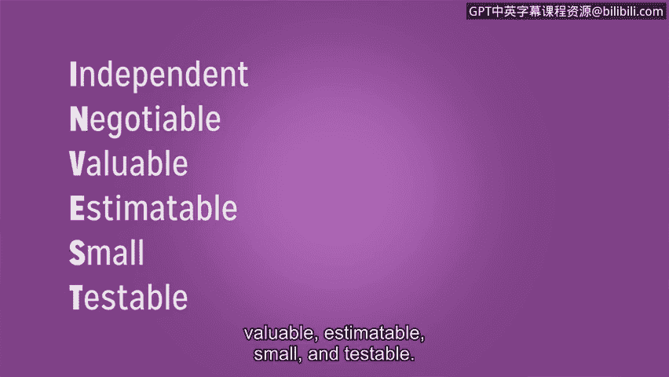

# 软件产品管理课程3：《客户需求与软件需求》：P62：29_02_3-4-1a-用户故事的标准

在本节中，我们将学习如何评估和撰写高质量的用户故事。用户故事是描述软件需求的常用工具，但并非所有用户故事都同样有效。为了确保开发过程顺利并最终交付符合预期的产品，用户故事需要满足一系列明确的标准。

我们将逐一探讨这些标准：**正确性**、**完整性**、**清晰性**、**一致性**、**可行性**和**可追溯性**。掌握这些标准将帮助你创建出对团队和客户都有价值的用户故事。

## 完整性

上一节我们介绍了用户故事的正确性，本节中我们来看看完整性。完整的用户故事意味着包含了描述问题所必需的所有需求。

由于你的开发团队将根据产品待办事项列表中的用户故事来开发解决方案，如果需求缺失，相应的功能就不会被实现。

像故事地图这样的工具对于判断用户故事是否缺失非常有用。

## 清晰性

接下来，让我们讨论如何使用户故事清晰。这意味着用户故事易于理解、精确且只有单一的解释。

这个标准要求很高。当你为了消除歧义而审查用户故事时，会发现一个句子可以有多种不同的解释方式，这确实令人大开眼界。

希望你能看到用户故事存在多种解释方式所带来的风险。如果客户用一种方式理解，程序员用另一种方式理解，而测试人员又用第三种方式理解，就很难判断谁是正确的，以及究竟应该开发什么。

以下是减少歧义的一个重要实践：

*   **进行需求技术审查与修复练习**：在这个练习中，最好由项目外部人员根据本课的所有标准来审查需求。其中一部分工作就是审查需求的歧义性。

我们将在下一课详细讲解如何撰写没有歧义的用户故事，但这里先看一个例子。假设有一个需求是这样写的：“**作为一个顾客，我希望成人和儿童菜单上都有游戏，以便我们在等待食物时有有趣的事情可做。**”

“都有”这个词在这个用户故事中造成了歧义。这个用户故事可能意味着儿童菜单上有儿童游戏，成人菜单上有成人游戏；但也可能被解释为儿童菜单和成人菜单上有相同的游戏。

除了依赖自然语言描述，另一种使需求更清晰的方法是使用视觉描述来补充你的需求，例如线框图和故事板。

我们将在本模块后面进一步探讨如何识别和修复有歧义的需求。

## 一致性

现在我们来谈谈用户故事的一致性。一致的用户故事意味着需求之间不会相互冲突。

这显然会在后续开发过程中引发问题。

你的客户和开发团队完成了一份用户故事列表，并希望你在下一次讨论会议前进行审查。在这次审查中，你需要确保用户故事是一致的。

以下哪些用户故事相互冲突？请选择两个彼此不一致的用户故事。

*   A. 作为一个儿童顾客，我希望自己点餐，以便得到我想要的餐点。
*   B. 作为一个顾客，我希望在点餐后查看订单，以确保我们点得正确。
*   C. 作为厨房员工，我希望查看已收到的订单，以便知道要准备哪些菜肴。
*   D. 作为一个顾客，我希望能够为我的家人点餐，以便监控他们吃什么。

**答案A和D不一致**。因为在答案A中，儿童顾客有自由点餐的权利，而在D中，他们没有。所有其他组合都是彼此一致的。因此，答案A和D是正确答案。

## 可行性

接下来，我们讨论用户故事的可行性。这意味着每个需求都可以在指定的成本和进度约束内，利用现有的技术、工具、资源和人员来实现。

如果你经常遇到不切实际的用户故事，我欣赏你的雄心，但这是一个不满足就会带来风险的标准。你需要诚实地审视你的资源、团队、进度和预算。你真的能完成所有承诺的需求吗？

不满足这个标准将导致额外的成本和客户的不满。就我个人而言，这是我希望避免的两件事。

## 可追溯性

我们希望满足的最后一个标准是用户故事的可追溯性。这意味着每个需求都以某种可追踪的方式与相关的设计和实现工件（如代码、测试）相关联。

简单来说，对于每个需求，都有对应的代码和测试。同时，每一段源代码都对应某个需求，并且每一段源代码都有测试。

让你的用户故事可追溯，意味着只编写必要的代码，并且所有需求都经过测试。这两点都是你希望在开发过程中具备的优秀品质。

你可以为每个需求设置一个唯一的标识符，以帮助开发人员在代码、测试、错误报告和变更日志中引用它。

## 总结

现在你知道了用户故事应该满足的标准。

在上一模块中，你了解到用户故事应该满足 **INVEST** 标准，即它们应该是**独立的**、**可协商的**、**有价值的**、**可估算的**、**小的**和**可测试的**。

在本节课中，你学习了用户故事还应该是**正确的**、**完整的**、**清晰的**、**一致的**、**可行的**和**可追溯的**。

改进你的用户故事以满足这些标准，将能防止项目中出现错误或不必要的工作，高质量的用户故事会带来高质量的产品。

