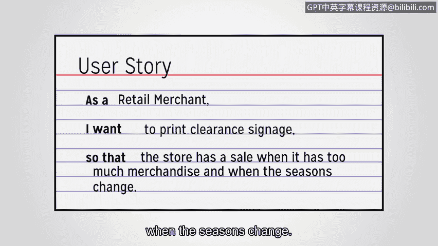

# 艾伯塔大学软件产品管理课程3：《客户需求与软件需求》｜client-needs-and-software-requirements｜ - P63：30_02_3-4-2-ambiguous-requirements.en_subtitled - GPT中英字幕课程资源 - BV1K94y1h7Tp

🎼。😊。

As I mentioned in the last lesson， ambiguous requirements can lead to many problems because they can be interpreted in different ways。

This can cause miscommunication and eventually lead to software being built incorrectly。

This wastes resources like time and money。What does it mean for a requirement to be ambiguous。

How can you identify these ambiguous requirements？That's what we are going to go over in this lesson。

We will look at some categories of words that often cause ambiguities。

Look at examples and then explore methods that you can apply to avoid ambiguities。

With that being said， written natural language is going to have ambiguity at some level。

Make sure that you are not removing ambiguity for the sake of perfect language。

The goal is to get to a good enough point where the meaning of the requirement or user story is accurately understood by the developers。

If you discover ambiguities in your requirements， the agile approach suggests having conversations with the stakeholders to make sure that you have the correct interpretation of the requirement。

Besides providing additional detail， sometimes how they pronounce stress or gesture certain words in a phrase will help in understanding。

In this lesson， we will be looking at some examples。

If you want more examples or more detailed descriptions， please check out our course notes。

We understand that many of our learners are not native English speakers。

 which is why we will be talking about categories of words that could signify ambiguity in some statement。

Hopefully you will be able to form similar rules in your own language。

An ambiguous requirement is one that can be interpreted in more than one way。

It may not always provide clear or enough detail to make the proper interpretation。

We will be looking at 11 different categories of words that may lead to ambiguous requirements。

Keep in mind that using these words will not always lead to ambiguity。

They just need to be considered carefully， and you may need to add some additional information to remove the ambiguity。

Our 11 categories are indirect words， vague words。Persuasion words。 completion words。Qualifiers。

 comparatives。Quantities。Pronouns。Positional words， temporal words， and joining words。

Let's start by talking about the use of indirect words。

This is the use of words that suggest the possibility of something happening。

But not specifically how or when。Examples of indirect words are should， could， may， and will。

The words should and could might signify ambiguity if the statement does not explain the circumstances that must be present in which an event should or could happen。

If you include those circumstances in the requirement， then not remove the ambiguity。

The word may work similarly， as well。Consider the example as an online poker player。

 I may win money so that I am rewarded for winning games。In this example。

 it is unclear as to the circumstances in which the online poker player wins money。

You clarify this user story by specifying that information。

Better is rewriting this user story to be as an online poker player。

 I receive money when I win a game of poker against my opponents so that I am rewarded for winning games。

😊，Finally， the last word we will cover in the indirect words category is will。

Will is a sign of ambiguity If the statement does not specify when the event will happen。

Is it all of the time or just some of the time？If an event will occur every single time。

 it is better to use the word must。If the event only occurs some of the time。

 specify the conditions in which it does。Consider the user story as an online store owner。

 I want all purchases for an order to be processed so that we can complete the order。

In this user story， one of the words processed is causing ambiguity。

What category of ambiguous words do you think the word processed belongs in。A vague words， B。

 persuasion words， C， completion words， or D qualifier words。

The word processed belongs in the vague words category。

It is an example of a vague action because it offers no information about what occurs when something is being processed。

It would be better to elaborate on what specifically occurs。 Therefore， a is the correct answer。

Bake words are commonly actions， object names or sayings that lack detail in the description。

It's not that there could be multiple interpretations to decide among。

There's not enough specifics to make any interpretation。Processed， handled。

 and operated are examples of vague actions。Examples of vague object names are nouns like item。

 entity， or unit。Either replace these terms with a more descriptive name or ensure that the term is defined in the product glossary and used consistently。

As appropriate， where applicable， and within reason are examples of vague sayings that imply there is missing detail。

What specifically determines appropriateness， applicability， or reason？

The next category that we will look at is completion words。Examples of these words are and so on。

 and so forth， and et ce。These words often imply that there are more members in a list that could be named。

 but are not for brevity。Make sure that when you are listing things。

 you give the necessary detail of what belongs to the list。

The general rule for what belongs may not be obvious， so do not leave the rule up for interpretation。

Another word that falls into this category is also。

This word typically appears in some addition to an existing statement。

An ambiguity may result from getting the added clause out of context or not aligning with the preceding statements。

So make sure that if you use the word also in a requirement that you provide the context as to what the also clause means。

Consider the user story as a document creator， I want to also store the text document in the desktop folder so that I can easily access it。

Which of the following interpretations may be true with respect to this user story。

A that the text document appears somewhere else other than the desktop folder。

B that another document appears in the desktop folder along with the text document。

See that in addition to what I was doing， I also stored the text document in the desktop folder。

 or D all of the above。All of these interpretations may be true with respect to this user story。

In fact， all three answers could occur at once。Therefore， D is the correct answer。As you can see。

 it is very important to provide context when you are using the word also。

The next category of words that you want to avoid are persuasion words。These are words like clearly。

 certainly， and obviously。😊，If a statement is obvious， is it truly obvious to all readers？

Why should the reader believe it？Is the statement asserting an opinion and not fact？

User stories should not need to persuade， so avoid these words。So far。

 the categories and examples that we have looked at caused ambiguity because they lack information。

Now we are going to look at words that may signify ambiguity because they qualify or modify some condition。

Some examples of qualifiers are all。Every。😊，Only。Noan。Never always， sometimes， often， and usually。

The words all and every cause ambiguity for similar reasons。

Consider the following user stories As an admin， I want all social media users to use an account so that I can track their usage。

 and as an admin， I want every social media user to use an account so that I can track their usage。

Both of these user stories could imply that all social media users are using the same account。

 or they could imply that each user has their own account。 Next。

 we are going to look at the word only。Use this word carefully， especially in the English language。

 because depending on where you put the word only in a sentence。

 it could cause the meaning to be totally different。Consider the sentence。

 premium account holders are allowed to read the full online article。

We can insert the word only into the sentence to make it mean different things。First。

 let's place it at the beginning of the sentence to make the statement only premium account holders are allowed to read the full online article。

This means that no other account holder is allowed to read the full online article。

If we move the only to after the word R， we get the statement premium account holders are only allowed to read the full online article。

This now means that premium account holders are not allowed to read anything but the full article。

We can also get this meaning by moving the only to the end of the sentence to create the statement。

 premium account holders are allowed to read the full online article only。

Now let's put the word only after the in our example。We now get the statement。

 premiumium account holders are allowed to read the only full online article。

This means that there is only one full online article available and premium account holders are allowed to read it。

When using the word only， be careful that you are using it to modify the sentence for the correct meaning。

You are a product manager working on a social network application。

You are reviewing user stories and you come across the user story as an administrator。

 I want every end user to have access to a guest account so that they don't need to create a personal account。

You recognize that this user story is ambiguous because it could be interpreted that there is only one guest account that every end user has access to。

 which is not the case。Which of the following is the best way to write this user story。A。

 as an administrator， I want each end user to have access to a guest account so that they don't need to create a personal account。

B， as an administrator， I want each end user to have access to their own guest account so that they don't need to create a personal account。

C， as an end user， I want to access the guest account so that I don't need to create a personal account or D as an end user。

 I want to access my own guest account so that I don't need to create a personal account。

Answers A and C are incorrect， since it is still ambiguous whether there is one guest account or a guest account for each end user。

Answer B removes the ambiguity of the guest account。

 but user stories should be written in the perspective of the primary user of the feature。

Since the administrator is not the primary user of the guest account。

 answer B is not the best way to write this user story。

Answer D is free of ambiguity and is written in the correct perspective。 Therefore。

 answer D is the most correct answer。Next， let's look at comparatives and why they are signs of ambiguity。

Comparatives are phrases that are comparing two or more things。

If we use the example of comparing the sizes of two vehicles。

 we could use the phrases Car A is the same as car B。Car A is bigger than car B。Car A is the biggest。

 Car A is more spacious than car B， or car A is as big as a truck。

 Each of these phrases is ambiguous， or lacks detail。😊，When we are comparing car A to car B。

 are we talking about physical overall size， height， width， interior space， cargo capacity。

 headroom or engine size？Be sure to be specific when you are comparing two objects。

What specific attribute of the objects is being compared？Also。

 watch out if you use a word that ends in ER， such as bigger， smaller or wider。

Or a word that ends in E S T， like biggest， smallest or widest。

Words that involve quantities can also cause ambiguities。Examples of these words are a or an sum。

 most and few。 A or an are words that you encounter frequently。

If you consider the example as a crossword puzzle solver。

 I want the application to have a crossword puzzle so that I can challenge myself in a diversion I enjoy。

Does a crossword puzzle mean that there is only one crossword puzzle on the application or does it mean that there will be at least one crossword puzzle on the application？

To avoid ambiguities with the words A or an， use quantifiers such as a specific number or at least some minimum amount。

For example， you could say， as a crossword puzzle solver。

 I want the application to have at least one crossword puzzle so that I can challenge myself in a diversion I enjoy。

The words some most and few signify ambiguity if the statement does not give a specific quantity or to which items are involved。

We mentioned at the beginning of this lesson that one of the categories of words that could signify ambiguity was pronouns。

These are words such as he， she， it， we， you， they us， our， this and that。

Why do you think that pronouns may lead to ambiguous statements。A。

 because you don't know if you are using the appropriate pronoun。B。

 because it could be unclear which noun the pronoun is representing or C。

 because they could add gender to the role of the user story。

Pronouns lead to ambiguous phrases because it could be unclear the noun that the pronoun is representing。

For example， in the user story， as a virtual farmer。

 I want it to grow so that I can sell it for virtual funds。 It is unclear what the word it refers to。

The word it could refer to the virtual farm itself， the virtual crops or the virtual farm animals。

Instead of using pronouns， you should define and use more specific terms to avoid confusion。

We are now going to look at positional words。Examples of positional words are after， before。

 following and last。For these words， let's use the example of database entries。

If we say that entry A appears before entry B in the database。

 that could mean that entry A appears directly before or anywhere before entry B in the database。

Similarly， we could say that entry B appears after entry A in the database or that entry B appears in the database following entry A。

All of these phrases are ambiguous for the same reason。

 you need to specify where the entry appears more explicitly。Let's look now at the phrase。

 I am making changes to the last entry。The word last in this phrase leads to a lot of ambiguity。

This could mean that I am making changes to the previous entry。

 or it could mean that I am making changes to the entry that appears at the very end。

 or it could mean that there are no more entries that are going to be added。

 and this entry will be the final entry。Next， we are going to look at a category that is similar to positional words。

 and that is temporal words。They relate to time or events。Examples of temporal words are when。

For until from current and latest。You could also include the positional words in this category if you are referring to time instead of position。

Let's start by looking at the word when。Consider the example as a runner。

 I want the lap timer to set to0 when I start a lap around the track so that I can monitor my pace。

This could be interpreted to mean that the timer is set to0 at the time the runner starts a lap。

It could also mean that the timer set to zero， the first time the runner starts a lap。

But it could also mean that the timer set to 0 each time the runner starts a lap around the track。

 Next， let's look at the word 4 in the example， as a camper。

 I want the product to show the weather for the next three days so that I can see what the weather will be while I'm camping。

😊，This user story can be interpreted in two different ways。

One way is that the product shows a three day weather forecast。

But another way is that the product displays the daily weather during the next three days and stops displaying after that。

You are the software product manager for a to do list application。

The user is able to add and delete tasks， as well as mark them complete。

You are reviewing the requirements and come across one that says， as a user。

 I want to be able to delete the last task so that it no longer appears in the list。

You recall in a discussion with potential users， the last task refers to the most recent task that a user created。

What would be a better way to write this user story？A， as a user。

 I want to delete tasks so that they no longer appear in the list。B， as a user。

 I want to delete the task I just created so that it no longer appears in the list。C， as a user。

 I want to delete the last task created so that it no longer appears in the list or D as a user。

 I want to delete the last task shown in my list so that it no longer appears in the list。

If you phrase the user story to be as a user， I want to delete the task I just created so that it no longer appears in the list。

 Then you remove ambiguity， but you do not lose any detail。 Therefore， answer B is correct。

With the answer A， you have gotten rid of the ambiguity， but the user story is now less specific。

Which tasks are you deleting？With answer C， the user is able to delete the last task created in the application。

 whether it was theirs or not。As you can imagine， this could cause some issues。

Answer D refers to the task at the bottom of the list。

The final category that we are going to look at is joining words。

These are words that combine two or more phrases or objects。Examples of joining words are， and。Or。

 and both。First， let's look at the ambiguities that may arise from the word and。

Let's consider the user story as a retail merchant。

 I want to print clearance signage so that the store has a sale when it has too much merchandise and when the seasons change。

So does this mean that the store has a sale when they have too much merchandise and they have the sale when the seasons change。

Or does it imply a double condition in which the store only has a sale when the store has both too much merchandise and the season is changing。

In the first case， it is clear to break the requirement into two separate requirements to satisfy independently。

Finally， the word or also causes ambiguities。The issue with the word。

 or is that it doesn't distinguish what happens in the case that both conditions are true。

Scanning your user stories for specific words as signs of ambiguity is not the only way to determine if you have unclear requirements。

Another great way to make sure both your requirements and your glossary are free of ambiguities is to replace terms from your user stories with their glossary definitions。

Do your user stories still make sense？Does your glossary definition represent the term properly？

By doing this， you may discover that you need to add more terms to your glossary。

 redefine terms in your glossary， or rewrite some of your user stories。😊。

Do you have any other methods for revealing ambiguities in your user stories？

Perhaps there are similar categories of ambiguity in your native language。

 or maybe your language removes some of these categories of ambiguity。 Let's talk about it。

 in the course discussion。