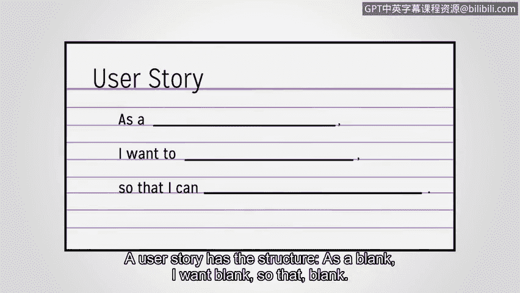

# 艾伯塔大学软件产品管理课程3：《客户需求与软件需求》｜client-needs-and-software-requirements｜ - P64：31_01_3-4-3-course-summary.en_subtitled - GPT中英字幕课程资源 - BV1K94y1h7Tp

Congratulations on completing the course on client Nes and software requirements。

If you have also taken our course on software processes and agile practices。

 you have now completed the legs of the inip structure that we mentioned in the introductory course。

You have a good base to continue to build knowledge upon。

The next piece of the inoksh that we will add is the body。

This body represents the course on agile planning for software products。

If you have not taken the softwareft Prosses and Agile Practices course。

 you'll need to complete that leg of your journey before moving on。

Now let's take some time to examine what we've covered in this course。In this course。

 Bradley started off the first module by introducing the definition of a requirement。

He defined a requirement to be a specific description of your client's needs。

You also examined the five requirements activities。 These activities were eliciting requirements。

 expressing requirements， prioritizing requirements， analyzing requirements。

 and managing requirements。😊，Bradley also took you through the different types of requirements in the first module。

The types of requirements were business requirements， business rules， user requirements。

 functional requirements， non-functional requirements， external interface requirements。

 physical setting requirements and developer constraints Next。

 you covered issues involved with changing scope in software development。

 and the difference between requirements and design。In moduleule 2。

 we reviewed the different types of users。Primary users were users that explicitly interact with the product。

Secondary users are users who occasionally use the product or interact with the product through an intermediary。

A tertiary user is a person who will be affected by the use of the product or make decisions about the product。

We also covered the constraints or limitations that users might experience and how you can design products to accommodate for these limitations。

Next， we talked about involving users and clients in the eliciting requirements activity。

We examine good questions to ask your client and questions to avoid。

We also prepared you for your next client meeting。Then we covered three different ways that your requirements can be expressed in the expressing requirements activity。

These methods were use cases， wireframes and storyboards。You then arrived at Mo 3。

Where Bradley showed you more ways to express requirements and how they fit into agile development。

After that， Bradley showed you the user story。You'll use user stories very frequently in Agile development。

A user story has the structure as a blank。 I want blank， so that blank。

A user story is an easy way to demonstrate the who， what， and why， in a neat little package。

Bradley also showed you the product backlog and how to use story maps to prioritize and organize the illlicited and expressed user stories。

In this last module， we looked at the criteria you should meet in order for your requirements and user stories to be considered high quality。

We also reviewed ambiguous language that commonly occurs in requirements。

We then showed you ways that you can recognize and clarify that ambiguous language。And here we are。

If you've also completed the Software Proes and Agile Practices course。

 you're now ready to move on to the Agile Planning for Software Product course。In that course。

 you're going to learn about many agile practices that are used for planning software products。

These techniques are commonly used in the industry today。

Some of the practices that you will experience will focus on estimates， story pointss and velocity。

You'll also learn how to create release and iteration plans。

 which help to organize requirements and developer tasks。Finally， you'll get to examine risk plans。

We've mentioned risk management a few times already in this specialization。In the next course。

 you'll get to learn and apply some risk management techniques。

We look forward to having you in our Agile Planning for Software Product course。 I'll see you there。

😊。