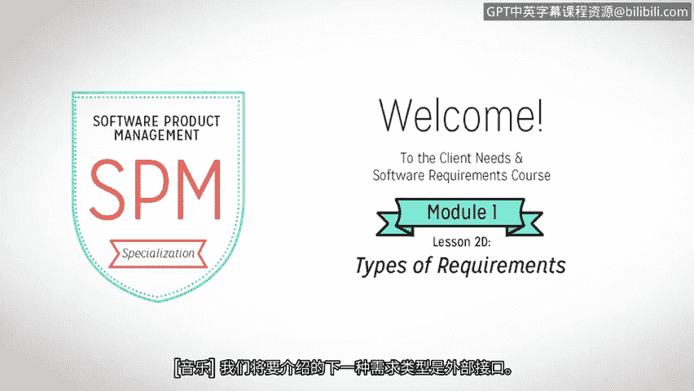
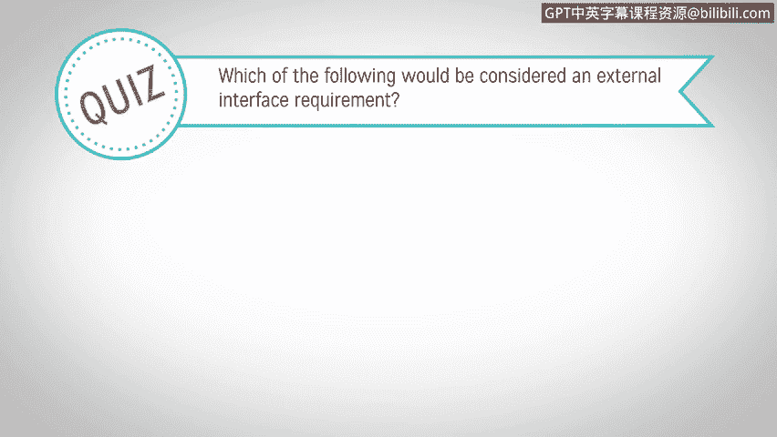

# 艾伯塔大学软件产品管理课程3：《客户需求与软件需求》｜client-needs-and-software-requirements｜ - P9：8_第3.1.2d节 其他需求类型.zh - GPT中英字幕课程资源 - BV1K94y1h7Tp

🎼。😊。

The next type of requirement， which we will cover is an external interface。

The idea behind this requirement is simple。Often， your product belongs to a larger system。

 External interfaces simply outline where the product is situated。

 We don't mean this in terms of physical location， but in terms of where the product sits logically among other entities outside the product。

The interfaces also describe the way in which these connections are made through media， protocols。

 formats， and levels of compatibility。Simply put， this just means that an external interface shows how the product itself。

Relate to something else in the system。Say you had a software application which displayed information to an end user and access the remote database。

The application sits between the database and the end user and has an external interface to each one。

The external interfaces which show the protocols which the application needs to interact with the database。

As well as how the information should be presented to the user。

External interfaces are often identified on data flow diagrams。

A data flow diagram is one which shows all the components of a product in one place and makes explicit reference to how data is passed to and from outside entities in the whole system。

External interfaces then are just a description of the logical placement of your product。

Among other entities within an entire system。Don't confuse external interfaces with the physical location of the product。

This is actually a separate type of requirement called the Product's physical setting。

Physical setting requirements describe how the product should be designed around its physical environment。

For example， if you were to develop a GPS tracker for construction equipment in the Sahara。

You would want to make sure that I can withstand extreme heat， dust。Noise and vibrations。

If you were developing this system for applications in Antarctica。

 then you would want the product to withstand extreme cold。

All of these are considerations made when specifying physical setting requirements。

Which of the following would be considered an external interface requirement？

A， the product must be able to communicate to a customer database and an ad server。B。

 the product must be able to remain on battery power for six hours。C。

 the product must be able to withstand impact from a drop of no less than 50 meters。Or D。

 the product must withstand full sunlight for 10 hours per day。The answer is a。Remember。

 an external interface is a requirement which specifies how the product is to communicate or connect with other components of the system。

So by communicating with a customer database and an ad server。

 the product's external interfaces are being defined。

Sa you've specified all the requirements we talked about earlier。

Is your development team capable of creating the product you designed？

Knowing the answer to this question is very important。

Development constraints outline the implementation technology， conventions， documentation。

 and the process which your team will use。They could also address things like which devices or platforms the development team will support。

Or how much memory bandwidth or processing power they're limited to using。

It's usually best to specify this later in the specification phase。

So that the product does not become limited in vision by available technology。Technology advances。

 therefore， so should the product。By discussing development constraints last。

 you can avoid the possibility that you design prematurely with old technologies and abilities。

In this lesson， we learned about the different types of requirements available to us。

 which can express our clients' needs。Let's review。First。

 we talked about requirements types which can influence your project。

Those requirements are business requirements and business rules。

Then we talked about a few of the core requirement types。Those were our user requirements。

 functional requirements， and non functional requirements。Finally。

 we talked about a few requirements which provide additional context for the eventual design and implementation of the product。

Those are external interfaces， the physical product setting and development constraints。Next。

 we'll talk about how we can manage changing requirements and control our product scope。

