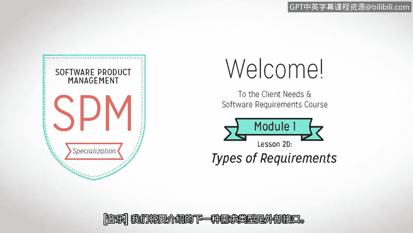
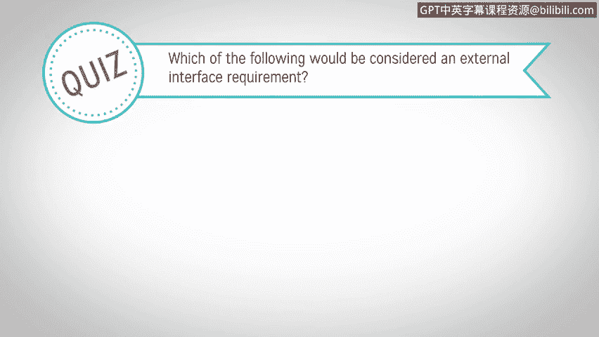

# 软件产品管理：3.1.2d：其他需求类型

在本节中，我们将继续探讨软件需求的其他类型，包括外部接口、物理环境设置和开发约束。这些需求为产品的最终设计和实现提供了重要的上下文信息。

上一节我们介绍了用户需求、功能需求和非功能需求等核心类型。本节中，我们来看看另外三种重要的需求类型，它们有助于更全面地定义产品。

## 🌐 外部接口需求

外部接口需求描述了产品在更大系统中所处的逻辑位置，以及它如何与其他外部实体连接和通信。

其核心思想很简单：你的产品通常属于一个更大的系统。外部接口需求旨在勾勒出产品在该系统中的位置。这里指的不是物理位置，而是产品在逻辑上如何置身于产品外部的其他实体之中。

这些接口还描述了通过何种媒介、协议、格式和兼容性级别来建立这些连接。简单来说，外部接口展示了**产品本身如何与系统中的其他事物相关联**。

假设你有一个软件应用，它向最终用户显示信息并访问远程数据库。该应用位于数据库和最终用户之间，并与两者各有一个外部接口。外部接口指明了应用与数据库交互所需的协议，以及信息应如何呈现给用户。

外部接口通常在数据流图中标识。数据流图将所有产品组件集中展示，并明确标注数据在整个系统中如何与外部实体进行传递。因此，外部接口本质上是对**你的产品在整个系统内其他实体间的逻辑定位的描述**。

请注意，不要将外部接口与产品的物理位置混淆。物理位置实际上是另一种独立的需求类型。

以下哪项可被视为外部接口需求？
*   A. 产品必须能够与客户数据库和广告服务器通信。
*   B. 产品必须能够在电池供电下运行六小时。
*   C. 产品必须能够承受从不少于50米高处跌落造成的冲击。
*   D. 产品必须能承受每天10小时的阳光直射。

答案是 **A**。请记住，外部接口是一种规定**产品如何与系统的其他组件通信或连接**的需求。因此，通过与客户数据库和广告服务器通信，定义了产品的外部接口。

## 🏜️ 物理环境设置需求

物理环境设置需求描述了产品应如何围绕其物理环境进行设计。

这类需求关注产品所处的实际物理条件。例如，如果你要为撒哈拉地区的建筑设备开发一个GPS追踪器，你会希望确保它能承受极端高温、沙尘、噪音和振动。如果你是为南极洲的应用开发该系统，那么你会希望产品能承受极端寒冷。所有这些都是在指定物理环境设置需求时需要考虑的因素。

## ⚙️ 开发约束

开发约束概述了开发团队将使用的实现技术、规范、文档和流程。

假设你已经指定了之前讨论的所有需求，你的开发团队有能力创造出你设计的产品吗？知道这个问题的答案非常重要。

开发约束勾勒出实现技术、惯例、文档以及团队将使用的流程。它们也可能涉及开发团队将支持哪些设备或平台，或者他们在内存、带宽或处理能力的使用上受到何种限制。

通常最好在需求规格说明阶段的后期再指定这些约束，这样产品的愿景就不会被现有技术所限制。技术在进步，产品也应如此。通过最后讨论开发约束，你可以避免过早地使用旧技术和旧能力进行设计的可能性。

## 📝 本节总结

本节课中，我们一起学习了用于表达客户需求的不同需求类型。让我们回顾一下：

首先，我们讨论了可能影响项目的要求类型，即**业务需求**和**业务规则**。

然后，我们探讨了几种核心需求类型，包括**用户需求**、**功能需求**和**非功能需求**。

最后，在本节中，我们介绍了为产品的最终设计和实现提供额外上下文的几种需求，即**外部接口**、**物理环境设置**和**开发约束**。

接下来，我们将讨论如何管理不断变化的需求并控制产品范围。