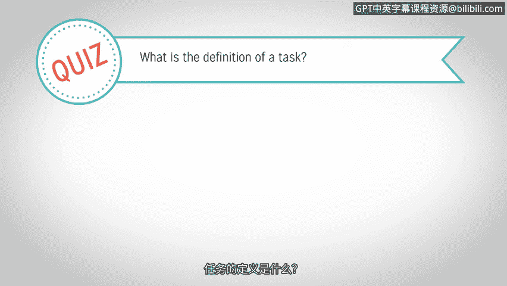
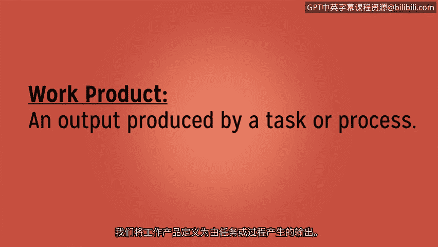
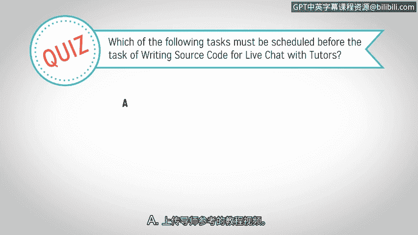

# 003：计划简介

在本节课程中，我们将学习软件项目规划的基础概念。我们将了解如何将项目分解为更小的组成部分，并介绍规划过程中将使用到的核心术语。

## 概述

在本节课中，我们将要学习软件项目规划的策略与技巧。这些技巧与敏捷宣言的原则一致，能使您的项目更好地适应变化。规划软件项目的关键在于将工作负载分解为更小、更易管理的任务。

我们将从理解如何细致地描述和组织任务开始。接着，我们会学习如何分解大型活动。您还将学习如何创建时间和工作量估算，以便准确地安排所需工作。

软件项目有多种规划方式。我们将涵盖发布层面和迭代层面的规划。发布是指将产品交付至可上市的状态。一个发布通常由多个迭代组成。您使用发布计划来整体规划项目，这包括决定哪些需求将在每个迭代中完成。您使用迭代计划来规划特定迭代中要完成的任务。

您将学习发布规划技巧，例如**甘特图**和发布计划。您也将学习迭代规划技巧，例如**PERT图**、**CPM图**和迭代计划。我们将在课程中详细讲解所有这些技巧。

我们还将涵盖风险规划。正如在介绍性课程中提到的，风险规划是软件规划的重要组成部分。软件开发中可能出现许多风险，因此您需要为这些风险做好准备，以避免对创建和支持产品产生负面影响。

## 核心概念回顾与引入

让我们花点时间回顾一下之前课程的内容。在“软件过程与敏捷实践”课程中，我们谈到了“任务”这个术语。任务的定义是什么？

*   A. 一个人承担或扮演的职责。
*   B. 项目中要完成的一个小的、可管理的步骤。
*   C. 软件过程产生的输出。
*   D. 衡量进度的内部检查点。

在“软件过程与敏捷实践”课程中，我们将任务定义为**项目中要完成的一个小的、可管理的步骤**。因此，B是正确答案。答案A定义了角色，答案C定义了工作产品，答案D定义了里程碑。这些都是我们即将更详细讨论的术语。

接下来，我们将从分析上一个测验中出现的术语开始，并引入本课程将使用的一些新术语。

### 任务

**任务**被定义为**项目中要完成的一个小的、可管理的步骤**。任务是项目的核心。项目中发生的所有事情都可以分解为任务。我们将在本模块后面讨论如何将项目分解为任务。在规划中，您将频繁使用任务来为项目创建估算和进度表。

### 角色

我们在“软件过程与敏捷实践”课程中定义了**角色**。角色是**一个人承担或扮演的职责**。角色的例子包括程序员、测试员、设计师、客户和产品经理。角色执行任务，例如，程序员可能承担为某个功能编写源代码的任务。

### 工作产品

**工作产品**在“软件过程与敏捷实践”课程中也有涉及。我们将其定义为**由任务或过程产生的输出**。

任务不仅产生工作产品作为输出，它们也使用工作产品。一个任务产生的输出工作产品，可以作为后续任务的输入工作产品被使用。

让我们看一个例子。假设程序员角色承担了为特定功能编写测试的任务。该任务产生一个工作产品：该功能的测试用例。这些测试用例是执行测试任务的输入工作产品，因为执行测试这个任务要求事先写好测试用例。

### 依赖关系

正如我们在讨论工作产品时看到的，执行测试的任务依赖于编写测试的任务，因为一个任务的输出工作产品是另一个任务的输入。在规划时，您需要牢记这些依赖关系，以便以逻辑顺序安排任务。

## 知识应用

您正在与一个开发团队合作，创建一个允许学生提问作业问题并从在线导师那里获得帮助的网站。学生也会被引导至教程和相关资源链接。您在安排任务时，遇到了“为与导师的在线聊天编写源代码”这个任务。

以下哪个任务必须安排在“为与导师的在线聊天编写源代码”这个任务之前？

*   A. 上传供导师参考的教程视频。
*   B. 为在线聊天功能进行验收测试。
*   C. 设计在线聊天工具。
*   D. 雇佣在线聊天的导师。

上传视频是一个可以在开发后期才实施的任务。雇佣导师取决于在线聊天功能能正常工作，因此不会安排在此任务之前。所以，答案A和D不正确。

答案B很接近，但也不正确。进行验收测试依赖于源代码已被编写完成。为此功能编写源代码的任务必须安排在验收测试之前。

功能需要在程序员开始编程之前进行设计。因此，答案C正确。设计在线聊天的任务必须安排在为在线聊天编写源代码的任务之前。

## 总结

本节课中，我们一起学习了软件敏捷规划的基础。我们明确了**任务**、**角色**、**工作产品**和**依赖关系**这些核心概念的定义。任务是小而可管理的步骤，角色是人员职责，工作产品是任务的输入或输出，而依赖关系则决定了任务执行的逻辑顺序。理解这些概念是进行有效项目规划的第一步。在接下来的章节中，我们将深入探讨如何应用这些概念来分解工作、估算时间和制定计划。