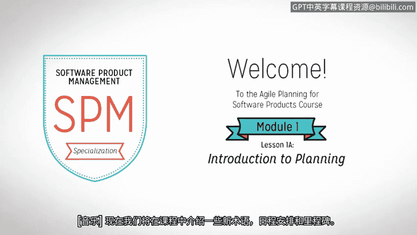
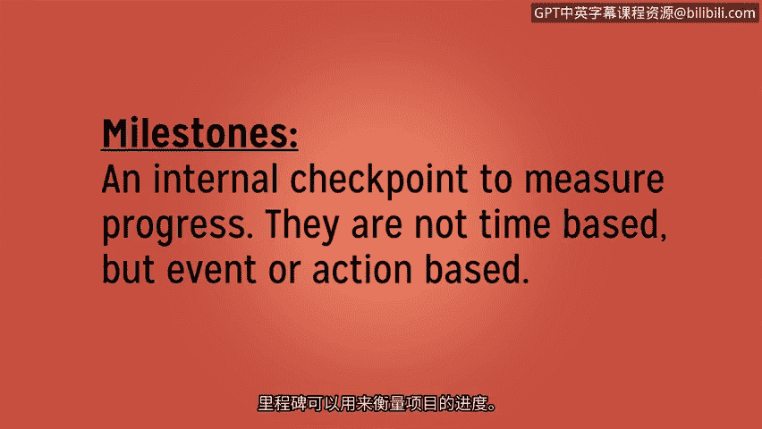
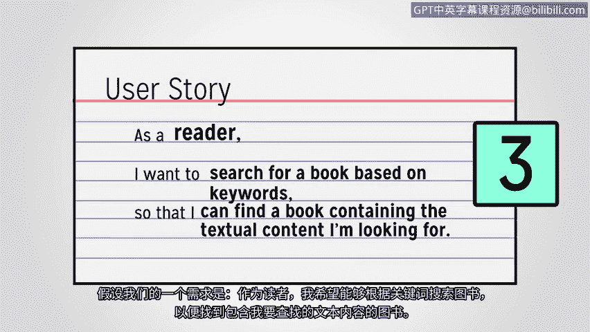
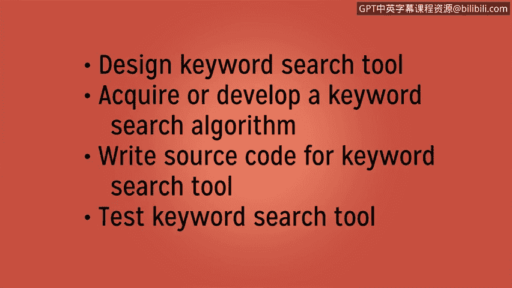

# 004：3_第4.1.1a节 计划简介

在本节课程中，我们将介绍计划中的几个核心概念：**时间表**和**里程碑**。理解这些概念是进行有效项目规划的基础。

## 时间表：任务与时间线的映射

时间表是将任务映射到时间线上的过程。任务是一个项目的基本组成部分。正如之前课程所讨论的，任务之间基于其工作成果存在依赖关系。

识别任务的依赖关系是创建时间表的重要步骤。你需要以这样的方式将任务映射到时间线上：确保作为输入所需的工作成果在其被需要之前已经创建完成。同时，你还需要确保高优先级的需求被优先完成。这意味着你需要规划在每一次迭代中要完成哪些内容。

这听起来可能有些复杂，但本课程将向你展示有效安排这些内容的技术。

## 里程碑：衡量进展的内部检查点

接下来，我们谈谈里程碑。里程碑是用于衡量项目进展的内部检查点。它们不是基于时间的，而是基于事件或行动的。

里程碑可用于衡量项目的进度。然而，它们在**线性流程**和**早期迭代流程**中更为常见。你在关于软件流程和敏捷实践的课程中已经学习过这些流程。

回顾之前课程中对敏捷宣言的探讨，我们了解到在敏捷方法中，通常不设置里程碑。进展是通过可工作的软件来衡量的，而不是通过事件。所有的发布和迭代都是基于时间的，因此它们不符合里程碑的定义。

## 案例分析：识别正确的里程碑

让我们通过一个案例来加深理解。Sierra正在开发一个允许用户监控和追踪月度支出的项目。她和她的开发团队决定基于里程碑来衡量进度。

以下哪项是里程碑的示例？
A. 一个为期两周的冲刺结束。
B. 项目启动一周年纪念日。
C. 产品的截止日期。
D. 需求已编写并评审完成。

**分析**：里程碑不是基于时间的。因此，一个为期两周的冲刺结束不是里程碑，因为它是以两周时间为衡量标准的。同样，一周年纪念日也是基于时间的。所以，选项A和B不正确。

截止日期可能被视为一个里程碑，但它仍然是基于时间的，因此选项C也不正确。如果Sierra想将其表述为里程碑，更好的措辞是“最终产品已交付”。然而，最终产品交付的日期并不总是产品的截止日期。

选项D不是基于时间的，而是基于行动的。当所有需求都已完成编写和评审时，你就知道这个里程碑已经达成。这可以是一个项目的主要里程碑。因此，**选项D是正确答案**。

## 任务：从需求到开发

正如本课前面所说，项目中发生的所有事情都可以分解为任务。它们是规划的一个重要方面，也在之前的课程中扮演了重要角色。

在关于客户需求和软件需求的课程中，你学习了如何创建需求。一旦你创建并确定了软件需求的优先级，就需要将它们分解为需要完成的开发人员任务。

让我们看一个例子。假设我们正在创建一个允许用户浏览电子书（像一个虚拟图书馆）的应用程序。我们的一个需求是：“作为一名读者，我希望能够基于关键词搜索书籍，以便找到包含我所寻找的文本内容的书籍。”

我们有了一个需求，但你的开发团队如何将其转化为产品的一部分呢？以下是从这个需求可能衍生出的一些开发人员任务示例：
*   设计关键词搜索工具。
*   获取或开发关键词搜索算法。
*   编写关键词搜索工具的源代码。
*   测试关键词搜索工具。

开发人员任务可以更具体地涉及技术，而需求则应独立于技术。通过开发人员任务，开发团队正在为问题提出解决方案。这些开发人员任务通常使用**迭代计划**来安排，你将在本课程后续部分学习如何操作。

## 任务在流程与敏捷中的作用

在关于软件流程和敏捷实践的课程中，我们讨论了任务如何构成活动，活动又如何构成阶段。每个阶段都有要完成的特定任务。因此，任务对于创建流程至关重要。

任务在敏捷实践中也扮演着重要角色。敏捷实践提供了组织任务并确保其有效完成的方法。使用迭代计划是Scrum方法论中常见的一种敏捷实践。正如之前提到的，迭代计划是一种安排任务的技术。而看板则是一种通过一系列步骤可视化追踪任务进展的方式。

## 总结与预告

现在，你已经掌握了开始深入学习规划知识的良好基础。在下一课中，你将学习**不确定性空间**以及如何在项目中导航。我们下节课再见。😊